解读 MegaMoE 在 Blackwell 与 Hopper 上的融合算子设计，围绕 TMEM 复用、数据布局、流水线与通信调度，串联具体优化及其依赖的架构知识。

本文基于 2026 年 10 月 16 日 NVIDIA 下午场 S1 讲座整理。

<!-- more -->

# MegaMoE：Blackwell 与 Hopper 的融合算子解读

## 导读：让整层 MoE 跟上 Tensor Core 的速度

矩阵乘法加速之后，MoE 仍可能卡在结果写出、专家之间的通信，或一条迟迟没有发出的就绪通知上。MegaMoE 把 token 分发、两层专家计算和结果回传放进融合流水线；这份讲座关心的是，怎样让它们共享有限的片上资源，同时持续给彼此提供可执行的工作。

文中沿着两条路线展开：Blackwell 利用 TMEM、动态 MMA 形状等架构特性，探索累加器复用和数据重排的新空间；Hopper 更多复用 warp specialization、ping-pong、TMA 多播等成熟设计，通过布局、线程分工和寄存器预算的配合，把它们组织成完整算子。值得观察的是每个选择怎样为下一步创造条件：省下一块缓冲，可能就能加深预取；少占一组线程，可能就能容纳第二份累加结果。

本笔记保留 2026-10-16 讲座的 31 页照片及顺序。正文从可能的瓶颈出发，解释本次 MegaMoE 的具体手段及其打开的优化空间；末尾 **Recap** 集中讲 MoE、CUDA 执行层级、MMA、存储和同步等先验，并由正文按需引用。可以先读下面两部分的简评，选取感兴趣的优化，再回查所需背景。

Blackwell 与 Hopper 分别编号，图片文件及页面锚点沿用原始整理编号。原始文字保留在[未提炼稿](2026-10-16-megamoe-undistill.md)，照片来源与重复页处理见[去重记录](2026-10-16-megamoe-dedup.md)。

## 页面目录

**Blackwell**

- [01 融合之后，瓶颈会转移到哪里](#page-01)
- [02 优化路线：计算、交接与通信一起安排](#page-02)
- [03 256×256 大 tile：让两份累加器复用部分 TMEM](#page-03)
- [04 动态 N 与 swapAB：让 Tensor Core 少算 padding](#page-04)
- [05 借助 TMEM 读写映射，省掉转置的 SMEM 中转](#page-05)
- [06 数据已经写出，为什么还要发布 flag](#page-06)
- [07 批量提交：让多批数据共用一次 MEMBAR](#page-07)
- [08 异步 UREDGR：通知还在推进，生产者继续工作](#page-08)
- [09 Combine 模式一：结果直接写回，但通信占住 epilogue](#page-09)
- [10 Combine 模式二与三：把远程写移交给通信 warps](#page-10)
- [11 FC1 与 FC2 交错：用下一批计算覆盖上一批回传](#page-11)
- [12 自适应 NVLink 流控：少排一点队，给计算取数留空间](#page-12)
- [13 低精度 Combine：直接减少回传字节数](#page-13)

**Hopper**

- [01 整体架构：在一个常驻 Kernel 内推进 MoE](#page-14)
- [02 Warp 分工：把寄存器留给计算，把等待拆给搬运](#page-15)
- [03 swapAB：让少量 Token 落在可缩小的 N 维](#page-16)
- [04 FP8 量化：把分块 Scale 的成本融入主循环](#page-17)
- [05 两个 Warpgroup 合作：把同一任务分成两半](#page-18)
- [06 任务级 Ping-pong：让上一任务的后处理覆盖下一任务的计算](#page-19)
- [07 Cluster 与 TMA 多播：让相邻 CTA 复用同一份输入](#page-20)
- [08 主循环与输出流水线：只等待即将复用的那一份缓冲](#page-21)
- [09 寄存器内融合 Epilogue：让中间结果只在最后写出](#page-22)
- [10 为什么以八个通道交错门控与上投影权重](#page-23)
- [11 只保留一个活跃的分发线程束](#page-24)
- [12 合并生产者线程束组，重新分配寄存器](#page-25)
- [13 第一层结果就绪后立即通知第二层](#page-26)
- [14 用双临时累加器重叠计算与缩放](#page-27)
- [15 扩大调度组，避开尚未就绪的任务](#page-28)
- [16 将第二层输出合并为十六字节写入](#page-29)
- [17 让融合方案与基线具备可比性](#page-30)
- [18 从局部优化到完整算子](#page-31)

**Recap：先验知识**

- [1. MoE 的计算过程与符号](#recap-moe)
- [2. Kernel、CTA、warp 与执行角色](#recap-execution)
- [3. 从 SM80 到 SM100：谁发起 MMA，结果在哪里](#recap-mma)
- [4. 存储层级、TMEM 与分块缩放](#recap-tmem)
- [5. 异步搬运、同步范围与缓冲生命周期](#recap-sync)
- [6. Thread Block Cluster、DSM 与 TMA 多播](#recap-cluster)
- [7. 寄存器预算与 `setmaxnreg`](#recap-registers)
- [8. 写入宽度、sector 与不同层级的流量](#recap-memory)

---

## Blackwell

**简评：微架构细节如何变成编程技巧。** 这一部分更有微架构技巧的看点：TMEM 的容量与读写映射、MMA 描述符中的 N，都成为程序可以利用的设计条件。它们能改变数据的生命周期、计算范围和交换方式，为融合算子提供新的设计空间。

优先推荐三项：

1. **[03 重叠累加器](#page-03)：容量不足时，仍然保留双缓冲的重叠机会。** 先取走地址交集里的旧值，就能让下一次 MMA 插入当前结果的搬出过程。这是理解“容量约束可以通过生命周期安排缓解”的直接例子。
2. **[04 动态 N 与 swapAB](#page-04)：换一个矩阵方向，让 Tensor Core 少算 padding。** 把不规则的 token 维放到可细调的 N 上，直接缩小 MMA 的实际计算范围；它也解释了下一项转置优化为什么有价值。
3. **[05 TMEM 转置](#page-05)：用 TMEM 读写映射完成跨线程的数据重排。** 组合 TMEM 的读写映射与寄存器排列来完成转置，展示了如何把指令布局本身变成数据重排的工具。

这三项分别从容量、计算形状和数据布局切入。后续同步与 NVLink 优化则把视角扩展到整条流水线，讨论计算更快之后，怎样让通知和通信跟上。

<a id="page-01"></a>

### 01 融合之后，瓶颈会转移到哪里


把通信与计算放进同一个 kernel，可以让 token 到达后就开始计算，减少阶段之间的整批等待。但这也把原本分开的资源需求放到了同一个 SM 上：通信要用 SMEM 暂存数据，GEMM 要用 SMEM 缓存 A/B；通信产生的访存请求，也会与计算的取数争用部分硬件资源。因此，这份报告首先提出的假设是：**融合之后，继续只优化 GEMM，未必能让整个 MoE 按相同比例变快。**

图中每一行是融合 kernel 内的一类工作：Dispatch 拉取 token，Computation 发起 FC1/FC2，Epilogue 处理结果，Combine 送回专家输出。这里的 L1/L2 指第一层、第二层矩阵计算；完整流程与角色分工见 [MoE 先验](#recap-moe)和[执行组织](#recap-execution)。

沿着时间线观察，绿色计算块之间出现空隙，下面的 Combine 却可能还在继续。原因之一是结果缓冲有限：旧结果没有被 epilogue 及时取走，后续计算就缺少可复用的累加器空间。通信还可能让输入 TMA 推进变慢，使 Tensor Core 等待下一批数据。

NVFP4 会进一步放大这种失衡。讲座用“FC1/FC2 主循环时间减半”描述低精度计算带来的变化，而当 Combine 仍传 BF16 时，输出字节数没有同步减少。计算越快，留给通信隐藏自身延迟的时间就越短。后续优化因而同时处理三件事：让有效计算更密集、让交接更及时、让通信更平稳。

---

<a id="page-02"></a>

### 02 优化路线：计算、交接与通信一起安排

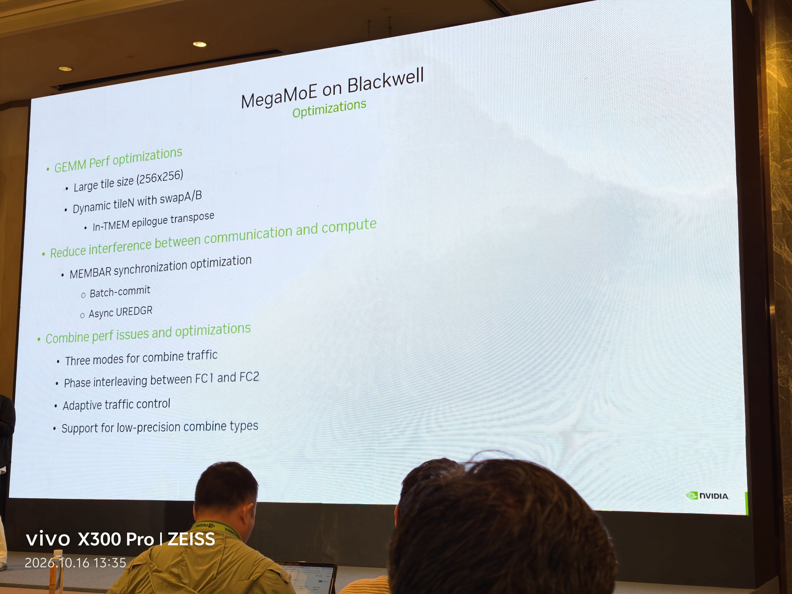

这一页把前页的瓶颈假设展开为几组相互配合的优化。

| 问题 | 本次 MegaMoE 的手段 | 打开的优化空间 |
| --- | --- | --- |
| GEMM 的输入复用不足，或者小 token 数下 padding 太多 | 256×256 tile、重叠累加器、swapAB 与动态 N | 在容量受限时保留大 tile，并减少无效乘加 |
| 计算方向改变后，epilogue 的数据布局不合适 | 利用 TMEM 的不同读写映射完成转置 | 减少转置对 SMEM 容量、带宽和同步的占用 |
| 各阶段频繁发布数据就绪通知 | 批量提交 MEMBAR、异步 UREDGR | 摊薄通知成本，让发布过程与后续工作重叠 |
| 远程写拖慢 epilogue，通信突发干扰取数 | 三种 Combine 执行方式、FC1/FC2 交错、自适应限流 | 调整通信由谁执行、何时发生、以多快的速度注入 |
| 算得快，但回传数据仍然很大 | 低精度 Combine | 直接减少链路需要搬运的字节数 |

这些选择彼此关联。例如，swapAB 解决了小 token 数的计算浪费，却引入输出重排；TMEM 转置降低了这项重排的 SMEM 成本。再如，把 Combine 从 epilogue 中分离能缩短累加器的占用时间，但通信仍与计算共享访存系统，因此还需要控制请求节奏。后文按这些因果关系逐页展开。

---

<a id="page-03"></a>

### 03 256×256 大 tile：让两份累加器复用部分 TMEM

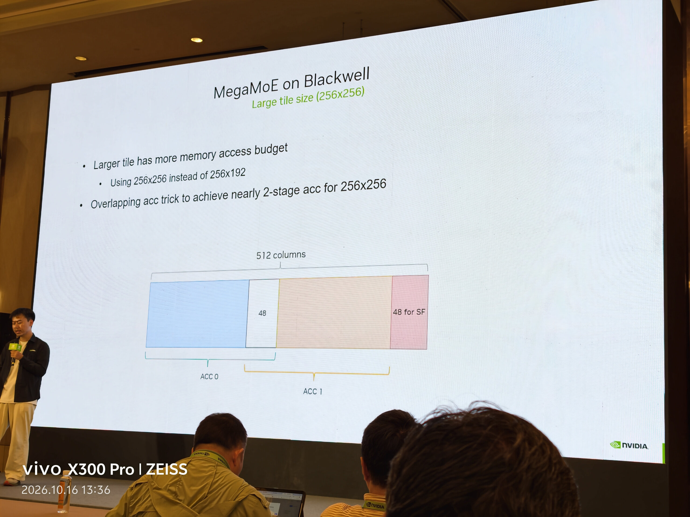

若一次加载的 A 可以参与更多输出列的计算，输入搬运就能被更多乘加摊薄。因此，讲座希望把 256×192 增大为 256×256，同时继续让“当前 tile 的 epilogue”与“下一 tile 的 MMA”并行。困难在于：**大 tile 已经吃掉很多 TMEM，两份完整累加器再加量化 scale，放不下。**

这里采用双 CTA MMA：两个 SM 各自使用自己的 Tensor Core 和 TMEM，分别承载 128×256 的结果，组成逻辑上的 256×256 tile。[MMA 执行模型](#recap-mma)说明了这个拆分。图中的 ACC0/ACC1 则是每个 SM 内交替使用的两份时间缓冲。

按照片给出的 48 列 SF 预算，每个 CTA 的 TMEM 可以这样划分：

| 区域 | 物理 TMEM 列 | 用途 |
| --- | --- | --- |
| ACC0 | `[0,256)` | 当前或下一块的 128×256 FP32 结果 |
| ACC1 | `[208,464)` | 另一块的 128×256 FP32 结果 |
| 两份 ACC 的交集 | `[208,256)` | 48 列物理空间交替复用 |
| SF | `[464,512)` | 分块量化的 scale 输入 |

TMEM 的行列视图以及 SF 为什么也占 TMEM，见 [TMEM 先验](#recap-tmem)。容量关系很直接：两份独立 ACC 需要 `256+256+48=560` 列；让它们共享 48 列后，恰好变成 `256+256−48+48=512` 列。

共享地址之后，关键就变成这些地址什么时候可以改写。假设 tile0 写在 ACC0，tile1 准备写 ACC1。tile1 会覆盖交集，因此 epilogue **先取走 tile0 在交集中的旧值，再允许 tile1 开始 MMA**；tile0 在其他列中的结果可以继续慢慢搬出。发生重叠的行为是：**ACC1 的 MMA 计算，与 ACC0 剩余结果的读出、后处理和写回并行。**

下面用公开 CUTLASS 的双 CTA、FP32 累加、BF16 输出示例解释这次交接。每个 CTA 把结果分成八个 128×32 epilogue 块；48 列交集需要先读两个块，共 64 列。它是与照片相配的教学例子；后页引用的 MegaMoE NVFP4 版本使用 64 列交集与 128×64 epilogue 块。两个配置采用相同的生命周期思路。[CUTLASS 配置与提前释放实现](https://github.com/NVIDIA/cutlass/blob/c213bfdfc1f4ffb156c69d51d07efcf7f367f2fb/examples/python/CuTeDSL/blackwell/dense_blockscaled_gemm_persistent.py#L1314)

以 ACC0 → ACC1 为例，交接过程是：

| 步骤 | 读取的物理列 | 进度与数据位置 |
| --- | --- | --- |
| 1 | `[224,256)` | 读入寄存器，转换后写入输出 SMEM，并提交 TMA store |
| 2 | `[192,224)` | 读入寄存器；与上一步合计覆盖 `[192,256)`，已经包含全部交集 |
| 3 | 等待 TMEM loads 并 handoff | 当前块的旧值已在寄存器；前一块已交给输出流水线。无需等所有 GMEM 写回完成 |
| 4 | `[160,192)` 等剩余六块 | tile1 的 MMA 可以写 ACC1 的 `[208,464)`，同时继续处理 tile0 |

这里用寄存器保护的是当前读出的块。第一块已经交给输出 SMEM，不需要一直把前两个块都留在寄存器中。输出 SMEM 又有自己的复用条件，TMA store 读完对应槽位后才能覆盖；这部分生命周期见[同步与异步完成](#recap-sync)。

以下是两个角色并发执行的教学伪代码。大写操作代表包含必要同步的整体动作，重点是“何时提交下一次 MMA”，而不是具体 API 参数。

```python
# MMA producer：CTA pair 中选出的一个线程发起整次 MMA。
acc_base = [0, 208]

for tile in tile_stream:
    if tile > 0:
        WAIT_HANDOFF_FROM_BOTH_CTAS(tile - 1)

    dst = acc_base[tile % 2]
    for k_index, k_piece in enumerate(K_PIECES(tile)):
        a_desc, b_desc, sfa, sfb = PREPARE_AND_WAIT_OPERANDS(tile, k_piece)
        ASYNC_MMA(dst, a_desc, b_desc, sfa, sfb,
                  enable_input_d=(k_index != 0))
        SCHEDULE_INPUT_RELEASE_AFTER_MMA(k_piece)  # 完成后归还输入 stage

    COMMIT_MMA_COMPLETION(tile)  # 完成时通知 epilogue
```

```python
# Epilogue consumer：各 CTA 的四个 warp 读取自己的 128 行结果。
for tile in tile_stream:
    WAIT_MMA_COMPLETION(tile)
    slot = tile % 2
    order = range(7, -1, -1) if slot == 0 else range(8)

    for ordinal, block in enumerate(order):
        col = acc_base[slot] + 32 * block
        regs = ASYNC_LOAD_TMEM(col, rows=128, cols=32)
        WAIT_TMEM_LOADS()

        if ordinal == 1:
            PUBLISH_HANDOFF(tile)  # 交集旧值已安全取走，允许下一次 MMA

        CONVERT_AND_STORE_TO_PROTECTED_OUTPUT_SMEM(regs)
        SUBMIT_TMA_STORE()         # 输出 SMEM → GMEM
        # 本块寄存器可以复用；继续读取当前 tile 的剩余块。
```

在 CuTe 实现中，这些关键动作分别对应 `acc_pipeline.producer_acquire()`、`cute.gemm()`、`producer_commit()`，以及 consumer 一侧的 `consumer_wait()`、TMEM `cute.copy()`、`fence_view_async_tmem_load()` 和 `consumer_release()`。最后这个 release 才是允许下一次 MMA 复用交集的 handoff。[累加器流水线实现](https://github.com/NVIDIA/cutlass/blob/c213bfdfc1f4ffb156c69d51d07efcf7f367f2fb/python/CuTeDSL/cutlass/pipeline/sm100.py#L570)

ACC1 的交集位于低端，所以消费 tile1 时改为从低列往高列读。tile2 再用 ACC0，则等待 tile1 的 handoff：同一组 epilogue 按顺序处理 tile，走到 tile1 已意味着 tile0 全部处理完；再取走 tile1 的交集，就能安全重用 ACC0。

这项技巧同时保留了大 tile 与近似双缓冲。它只要求较小的寄存器 fragment 暂存当前块，又把下一次 MMA 的开始时刻前移到“交集已读走”，从而给计算与后处理重叠留下更长的窗口。

---

<a id="page-04"></a>

### 04 动态 N 与 swapAB：让 Tensor Core 少算 padding

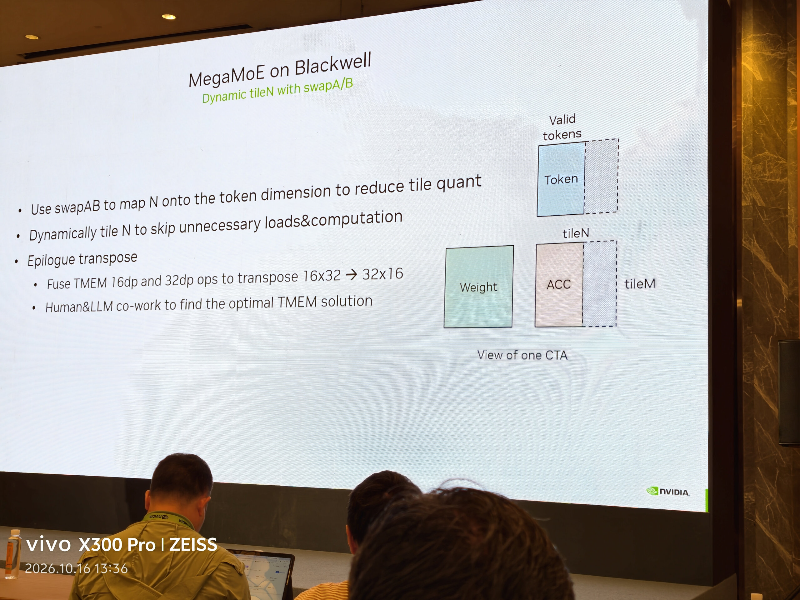

大 tile 有利于复用，但 MoE 中每个专家分到的 token 数不固定。若一个专家只有 20 个 token，却始终按 256 个 token 的 tile 计算，大部分乘加都花在 padding 上。因此，本页的目标是：**保留大 tile 的上限，同时让实际 MMA 范围跟着有效 token 数缩小。**

这要利用 [SM100 MMA 形状](#recap-mma)的一个能力：N 可以通过发起时的指令描述符调整。普通计算 `Y=XW` 把 token 放在 M 维，swapAB 则改为：

$$
Y^{\mathsf T}=W^{\mathsf T}X^{\mathsf T}.
$$

这样，M 对应输出通道，N 对应 token。图中的虚线部分就是尚未填满的 token 列，动态缩小 N 后，可以减少这些列对应的无效乘加。

在所核对的 MegaMoE NVFP4 版本中，静态最大 N 可选 64、128、256；运行时把有效 token 数向上对齐到 16，再写进 MMA 描述符：

```python
N_compute = (valid_tokens + 15) & -16
idesc = static_fields | ((N_compute >> 3) << 17)
```

因此 `Nmax=256` 时，非空 tile 的实际 N 可以取 16、32、48……256。这里改变的是 Tensor Core 实际执行的矩阵范围。[动态 N 实现](https://github.com/NVIDIA/TensorRT-LLM/blob/173e3da05955ff71bceb486df13c1a371f68f08d/tensorrt_llm/_torch/cute_dsl_kernels/mega_moe_nvfp4/dynamic_mainloop.py#L220)

例如 20 个有效 token 对齐到 N=32，原本 236 个 padding token 降为 12 个。双 CTA 的逻辑范围由 256×256 缩成 256×32，各 CTA 对应 128×32。这个版本的 epilogue 仍按每 CTA 128×64 分块组织，因此要分别看两种粒度：**MMA 按 16 调整计算范围，epilogue 按 64 处理结果。** [epilogue 配置](https://github.com/NVIDIA/TensorRT-LLM/blob/173e3da05955ff71bceb486df13c1a371f68f08d/tensorrt_llm/_torch/cute_dsl_kernels/mega_moe_nvfp4/epilogue_refactor.py#L990)

swapAB 于是有了明确的收益来源：把长度不规则的 token 维，放到硬件允许细调的 N 上，减少 padding 对应的矩阵计算，为缩短 MMA 执行时间创造空间。它也带来一个后续问题：结果现在是转置后的方向，epilogue 要把数据重排到激活、量化和输出需要的布局。下一页就是为降低这笔成本而设计的。

---

<a id="page-05"></a>

### 05 借助 TMEM 读写映射，省掉转置的 SMEM 中转

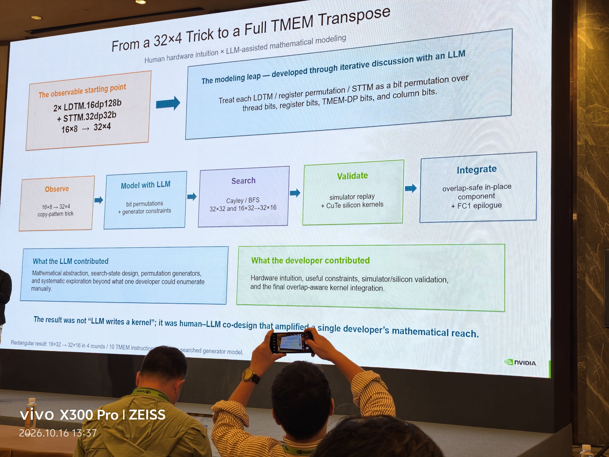

swapAB 省下了无效计算，但如果每次 epilogue 都要先写一遍 SMEM，再换一种布局读回来，转置就会争用输入流水线和通信也需要的容量、带宽。这里提出的思路是：**结果本来就在 TMEM，能否直接利用 TMEM 到寄存器的映射，把跨线程的数据交换完成？**

先看常见基线。线程从 TMEM 取得结果后，按旧布局写入 SMEM，经过同步，再按新布局读回寄存器。SMEM 充当线程之间交换数据的中转站。相比之下，本页使用 TMEM 的不同 load/store 形状，让同一批数值在读出、写回时发生坐标置换；对应的布局概念见 [TMEM 先验](#recap-tmem)。

| 路径 | 转置如何完成 | 需要付出的主要资源 |
| --- | --- | --- |
| SMEM 中转 | TMEM → 寄存器 → SMEM → 同步 → 换布局读回寄存器 | SMEM scratch、SMEM 读写、线程同步 |
| 本页方案 | TMEM → 寄存器重排 → 按另一种 TMEM 映射写回，分轮组合 | TMEM 读写、局部寄存器重排、完成等待 |

标题里的 32×4 是这个探索的起点：它表示 TMEM 中 32 行、4 列的 32-bit 数据，而不是一次完整转置的目标大小。

```text
TMEM 中的 16×8：共 128 个 32-bit 值
    ↓ 两次 LDTM.16dp128b
32 个线程，每线程拿到 4 个值
    ↓ 按 STTM.32dp32b 的线程／寄存器映射写回
TMEM 中的 32×4：仍然是这 128 个值
```

读指令与写指令采用不同的坐标映射，同一批寄存器值写回后就分布到了新的位置。这个小变换本身只是一个构件；把多种读写映射和线程内部的寄存器排列组合起来，才得到 16×32 → 32×16 的完整转置。照片给出的构造是四轮、十条 TMEM 指令。

讲座中人与 LLM 的协作也围绕这个结构展开。开发者先找出有效的小变换，并限定合法指令、寄存器与原地覆盖条件；随后把每次操作抽象成线程编号、寄存器编号、TMEM 行列编号之间的位排列，用搜索寻找能组成目标转置的序列。最后还要重放坐标映射，在实际 CuTe kernel 中验证，再处理原地转置与重叠累加器的生命周期关系。

公开实现把转置拆成可单独推进的 load、寄存器排列和 store 步骤，因此可以与 SwiGLU 等计算交错。融合路径还可以停在最终结果已进入目标寄存器布局的时刻，直接继续激活或量化，省掉原本只为“完成转置接口”而做的最后一次 TMEM 写回。[转置构件](https://github.com/flashinfer-ai/flashinfer/blob/5b0f0ca978ef28d05d71ee78637c3e445f32ddca/flashinfer/moe_ep/kernel_src/sm100/cutedsl_megamoe/src/moe_nvfp4_swapab/epilogue_refactor.py#L767)、[epilogue 集成](https://github.com/flashinfer-ai/flashinfer/blob/5b0f0ca978ef28d05d71ee78637c3e445f32ddca/flashinfer/moe_ep/kernel_src/sm100/cutedsl_megamoe/src/moe_nvfp4_swapab/epilogue_refactor.py#L1591)

这样节省的是转置专用的 SMEM 中转。输入和输出流水线仍可以使用 SMEM，而被腾出的容量则有机会留给更多输入 stage 或通信缓冲。它让上一页的 swapAB 更容易在融合 kernel 中发挥收益。

---

<a id="page-06"></a>

### 06 数据已经写出，为什么还要发布 flag

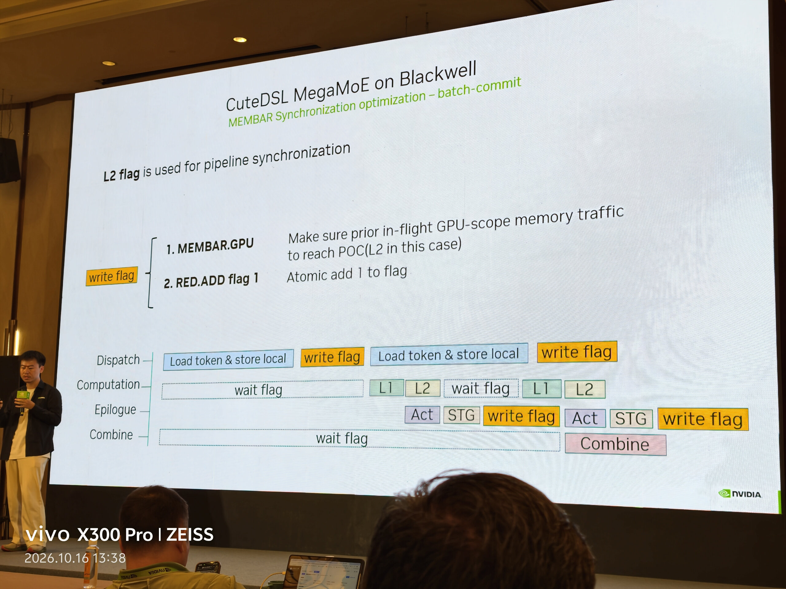

前几页解决单个 tile 内部的计算与后处理，这一页转向阶段之间的交接。假设每批 token 很小，搬运和计算都很快，那么频繁等待“数据已经准备好”的通知，也可能成为流水线中的明显空隙。

本例主要有两条交接链：Dispatch 将 token 写入本地池后，通知 FC1 可以取数；FC2 epilogue 将专家结果写到输出池后，通知 Combine 可以回传。图中的 `write flag` 包含内存顺序与计数器更新两个动作：

```text
生产者：写入数据 → MEMBAR.GPU → REDG：flag += 1
消费者：等待 flag 达到就绪条件 → 按同步协议读取数据
```

这里 STG 是普通全局内存写入，REDG 是不返回旧值的全局原子归约，本例用它把就绪计数加一。MEMBAR.GPU 让发布线程此前的数据访问与后续 flag 更新保持 GPU 范围内所需的顺序。它与消费者的 acquire 等操作共同建立“看到通知后可以使用数据”的关系，详细语义见[同步先验](#recap-sync)。

这也解释了图中的等待为什么值得单独优化。通知之前的数据可能已经在途，但生产者仍需要推进这次有顺序要求的发布；消费者则在 flag 上等待。若每个小块后都重复这一套动作，通知就会反复切开原本可以连续推进的工作。接下来的两页分别摊薄 fence 成本，并使发布过程异步化。

---

<a id="page-07"></a>

### 07 批量提交：让多批数据共用一次 MEMBAR

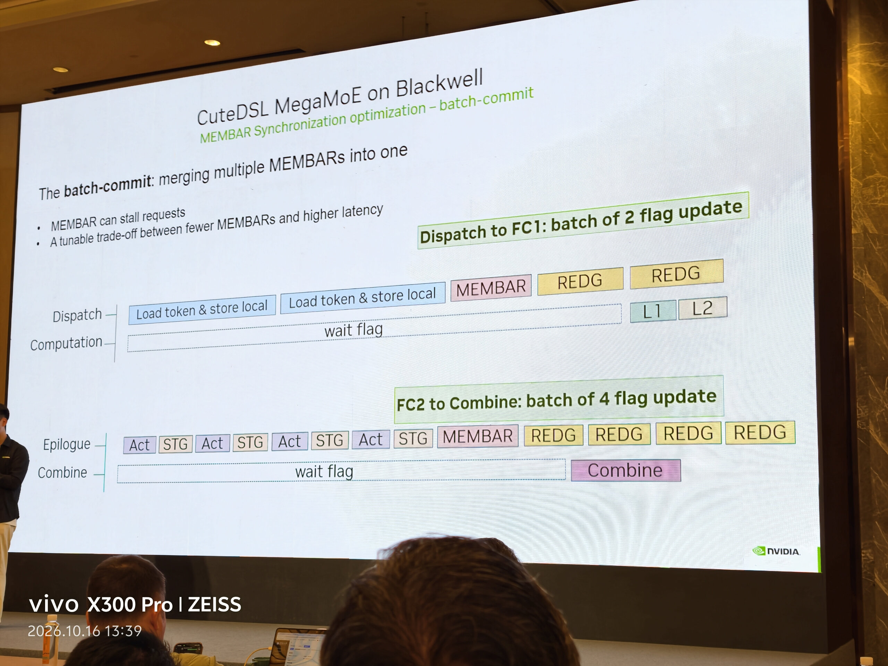

如果下游暂时有工作可做，不必要求每一小批数据都立刻单独通知。那么可以先连续完成几批写入，再用一道 MEMBAR 统一建立顺序，随后发布各自的 flag：

```text
逐批发布：写 A → MEMBAR → flagA++ → 写 B → MEMBAR → flagB++
批量发布：写 A → 写 B → MEMBAR → flagA++ → flagB++
```

合并成立的原因是：A、B 的写入都位于这道 MEMBAR 之前，两个通知都位于它之后，“先数据、后通知”的关系仍然成立。这里要求相关写入属于发布线程的先行操作；若由其他线程写入，就先完成相应的线程间交接。[同步范围与先行关系](#recap-sync)

照片中，Dispatch → FC1 每两次更新组成一批，FC2 → Combine 每四次更新组成一批。**合并的是 MEMBAR；对应的两个或四个 flag 仍分别更新。** 于是生产者可以先让多批写入在途，再一起处理发布，减少反复“写一批、停下来建立顺序”的次数。

批量大小同时决定通知延迟。第一批数据即使早已写好，也要等后续数据凑齐才被下游发现，缓冲占用时间也会延长。因此，这个旋钮适合围绕流水线状态调整：下游已有充足工作时可以摊薄发布成本，启动和收尾时则要及时送出通知。讲座中两条链使用不同批量，正是因为它们的生产速度、消费粒度和可隐藏时间不同。

---

<a id="page-08"></a>

### 08 异步 UREDGR：通知还在推进，生产者继续工作

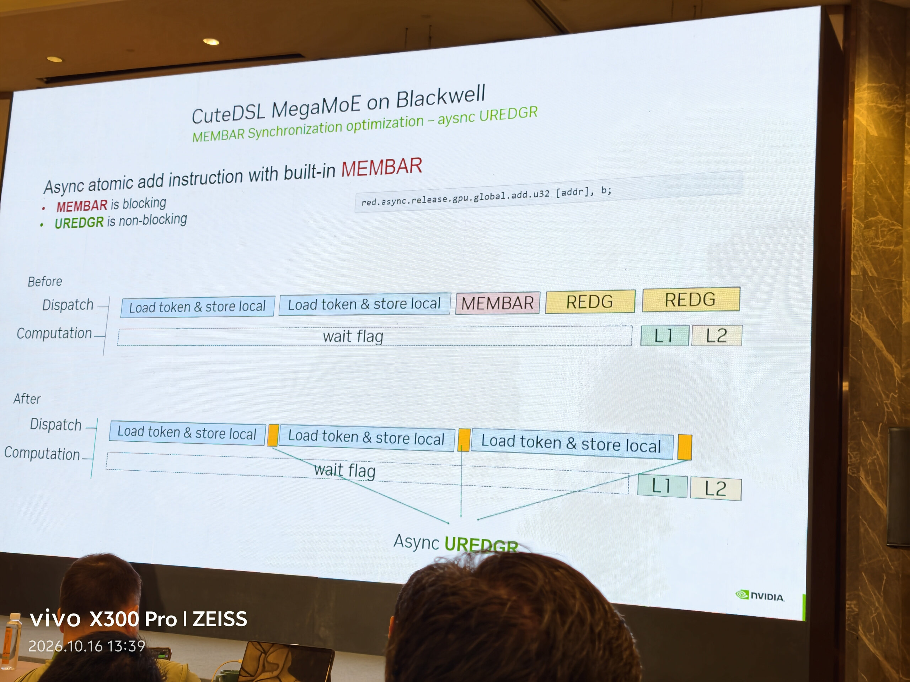

批量提交通过晚一点通知，换取更少的 MEMBAR；另一条优化方向则是让生产者不必在通知完成前停住。本页使用带 release 顺序的异步原子加：

```ptx
red.async.release.gpu.global.add.u32 [flag], 1;
```

讲座把对应机器指令称为 UREDGR。生产者提交后，硬件按 release 所要求的先后关系推进 flag 更新，生产者可以继续处理下一批数据。下游依然等 flag 达到就绪条件后才消费；[release/acquire 的含义](#recap-sync)决定了这项改写能够保留原有的数据依赖。[PTX `red.async` 语义](https://docs.nvidia.com/cuda/parallel-thread-execution/#parallel-synchronization-and-communication-instructions-red-async)

图中黄色块从一段明显的发布阶段，变成嵌在相邻两批搬运之间的小块，表达的是这个异步化机会：

```text
生产者：准备数据0 → 提交异步通知0 → 准备数据1 → 提交异步通知1 → …
硬件：                 按顺序完成发布0          按顺序完成发布1
```

因此，两页优化作用在同一条通知链的不同位置：batch-commit 摊薄 fence 的次数，UREDGR 把发布等待从生产者的关键路径中移出。实际 token 数据仍走原来的 load/store 路径；得到的空间是让“准备下一批数据”与“发布上一批就绪状态”并行。

---

<a id="page-09"></a>

### 09 Combine 模式一：结果直接写回，但通信占住 epilogue

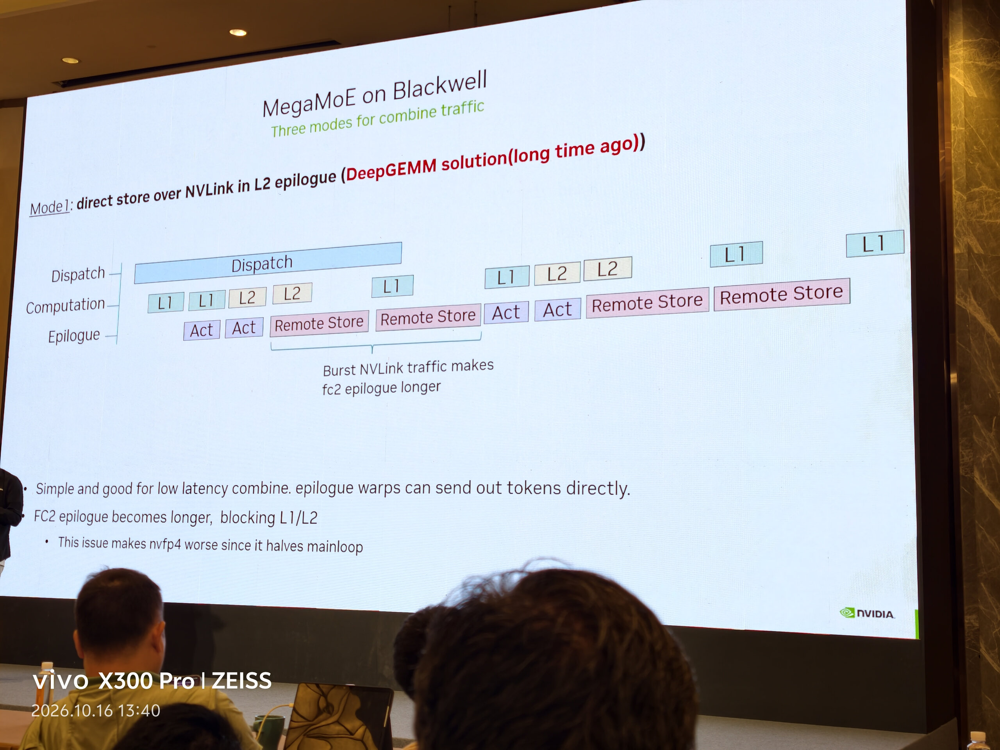

如果追求单个 token 尽快返回，最直接的路径就是让 FC2 的 epilogue 拿到结果后，立刻经 NVLink 写到来源 GPU。少一次本地池中转，也少一个负责取走结果的角色。照片将它作为早期 DeepGEMM 已使用过的方案。

问题出现在多个 FC2 tile 连续完成时：它们的远程写集中发生，NVLink 接收、传输或请求处理变慢，epilogue 就要花更久才能处理完这一批输出。结合[有限缓冲的生命周期](#recap-execution)，影响会沿着下面的链条传播：

```text
连续 FC2 输出形成通信突发
    → epilogue 的远程写推进变慢
    → 旧结果消费、累加器空间释放变慢
    → 后续 MMA 等待可复用的结果缓冲
```

即使采用前面的重叠累加器，也只是提前交还部分空间。Epilogue 仍要顺序处理完整 tile，才能持续为更后面的 tile 腾出空间。因此，图中长长的 Remote Store 最终会在上方 Computation 行制造空隙；NVFP4 缩短主循环后，这个问题更容易显露。

这一模式的优势是路径短、结果可以尽快发出。它适合通信规模较小，或远程写能被其他计算充分隐藏的情形。下一页则从执行角色上拆开 epilogue 与 Combine，为较重的通信留出更独立的推进空间。

---

<a id="page-10"></a>

### 10 Combine 模式二与三：把远程写移交给通信 warps

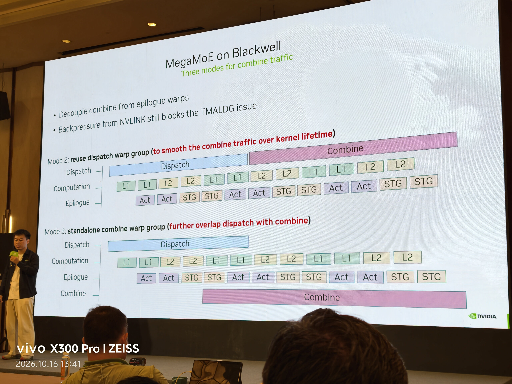

若远程写让 epilogue 占用过久，可以先让 epilogue 写到本地输出池并发布就绪通知，再由通信 warps 负责取走数据：

```text
epilogue：读累加器 → 本地输出池 → 发布就绪
Combine：等待就绪 → 读本地输出池 → NVLink → 来源 GPU
```

这增加了本地缓冲和一次读回，却使 epilogue 有机会更早完成当前结果，继续消费下一块累加器。相比模式一，远程传输的速度不再逐条决定 epilogue 的推进速度。角色之间的交接协议见[执行组织](#recap-execution)与[同步先验](#recap-sync)。

两种实现的区别在于 Combine 由谁承担：

| 模式 | 执行者 | 可以重叠的工作 | 主要资源取舍 |
| --- | --- | --- | --- |
| 模式二 | Dispatch warpgroup 完成自己的拉取工作后，转去 Combine | Combine 与后续 FC1/FC2 计算重叠 | 复用已有 warps，但要等相应 Dispatch 工作结束 |
| 模式三 | 单独的 Combine warpgroup | Combine 可与尚未结束的 Dispatch 及计算同时进行 | 额外占用线程、寄存器及通信缓冲 |

图中的模式二先蓝后粉，表示同一组 warps 的职责转换；模式三把 Combine 单独画成一行，因此最早一批 FC2 输出就绪后，回传可以先行启动。

两种模式都把原本集中在 FC2 epilogue 中的通信拉长到更多计算时段，有机会平滑流量。独立 warps 仍会访问共享的存储和互联资源，图中所提的 NVLink 背压仍可能影响 TMA 取数。这也为后面的自适应限流留下了问题：执行角色拆开之后，还要安排好通信请求的注入强度。

---

<a id="page-11"></a>

### 11 FC1 与 FC2 交错：用下一批计算覆盖上一批回传

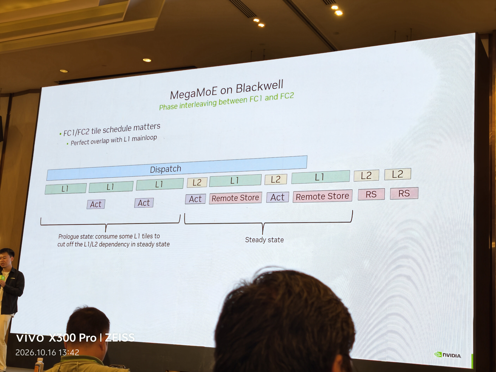

除了改变 Combine 的执行者，还可以改变任务到来的顺序。若连续安排多个 FC2，就会连续产生远程写；如果在相邻 FC2 之间插入可执行的 FC1，较长的 FC1 主循环就能为前一个 FC2 的回传提供隐藏窗口。

难点在于 FC2 必须等相应的 FC1 输出。图中开头先执行若干 FC1 tile，积累一批中间结果，再进入 FC1/FC2 交错的稳态。它把消费者与刚完成的生产者拉开距离，让 FC2 使用此前已经准备好的数据，降低“做完一块 FC1，立刻停下来等它的后处理，再做 FC2”的紧耦合。

```text
预热：FC1(A) → FC1(B) → FC1(C) → …
稳态：FC2(A) → FC1(D) → FC2(B) → FC1(E) → …
                   ↳ 用 FC1(D) 的主循环覆盖 A 的回传
收尾：处理余下 FC2 与回传
```

这里 A、B 等表示满足 FC2 输入就绪条件的任务组；一个任务组可能包含多个 FC1 通道 tile，依赖关系见 [MoE 数据流](#recap-moe)。

这种调度把 FC1 的计算时间作为资源，用来吸收 FC2 epilogue 的通信成本。调度者需要同时考虑输入是否就绪、还剩多少 FC1/FC2、结果缓冲是否可用。图中的“预热—稳态—收尾”也说明，最好的顺序可以随执行阶段变化。它为延长通算重叠窗口提供了机会，而不必增加新的计算工作。

---

<a id="page-12"></a>

### 12 自适应 NVLink 流控：少排一点队，给计算取数留空间

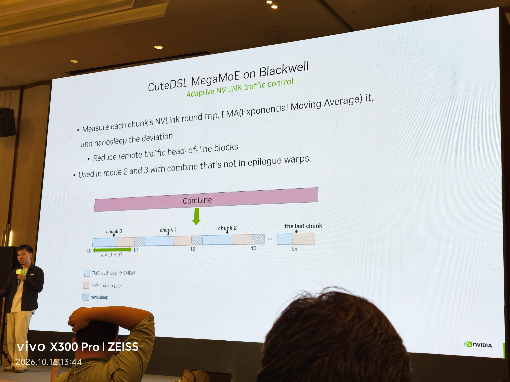

如果 NVLink 已经成为瓶颈，继续快速提交请求为什么未必最好？因为链路带宽饱和后，增加请求往往首先增加在途队列，而通信和计算仍会争用部分请求处理、片上存储与访存资源。**只要其他在途请求还能保持链路忙碌，当前通信 warp 短暂停顿，就可能减少对计算取数的干扰。**

本页用于模式二和三，由执行 Combine 的通信 warps 进行局部调节。每个 chunk 的路径是：

```text
本地输出池 → TMA load → SMEM → bulk store → 对端 GPU
            └──────── 测量这段搬运的完成时间 ────────┘
                                   ↓
                       根据近期耗时决定是否暂停
                                   ↓
                             发送下一个 chunk
```

公开实现用 `clock64` 记录从本地 TMA load 开始，到远程 bulk store 完成等待结束的时间窗口，再更新 EMA。忽略整数舍入和上下限后，可以概括成：

$$
\bar w_t=\tfrac34\bar w_{t-1}+\tfrac14w_t,
\qquad d_t=|w_t-\bar w_t|.
$$

偏差超过阈值时，以它为依据调用 `nanosleep`，然后再处理下一块。测量包含本地读、远程写和相应等待，所以能反映这条通信路径当时的整体推进速度。实现同时处理耗时高于与低于均值的偏差，并给平均值设置范围，在接近任务尾部时减少这种节奏控制。[耗时测量与调用位置](https://github.com/flashinfer-ai/flashinfer/blob/5b0f0ca978ef28d05d71ee78637c3e445f32ddca/flashinfer/moe_ep/kernel_src/sm100/cutedsl_megamoe/src/src/token_comm.py#L1463-L1508)、[EMA 与暂停逻辑](https://github.com/flashinfer-ai/flashinfer/blob/5b0f0ca978ef28d05d71ee78637c3e445f32ddca/flashinfer/moe_ep/kernel_src/sm100/cutedsl_megamoe/src/src/token_comm.py#L1234-L1261)

从微架构角度，可以沿三层理解这项节奏控制，相关存储路径见[访存与共享资源](#recap-memory)：

1. **在途传输需要有限的队列、跟踪项与 credit。** 下游变慢时，这些资源被更久地占住；增加请求会延长排队，背压再逐渐向发起端传播。
2. **通信与计算的独立 warps，仍可能争用请求处理与存储资源。** 普通 SM 访存涉及 MIO/LSU 等派发与执行路径；本例的异步 TMA/bulk 路径也需要 SMEM、本地读取和互联。远程发送、接收端处理与本地读并非完全相同的路径，但其中的竞争足以让计算输入晚到。
3. **取数变慢会进入 GEMM 的关键路径。** 下一份 A/B 尚未装满 SMEM stage，MMA producer 就不能继续提交计算。适当降低通信注入强度，可以给这些本地读请求更多推进机会。

硬件背压发生在请求已经进入系统之后；软件暂停则把一部分等待移到下一批请求发出之前。它打开的空间是：保留足以利用链路的并发量，同时减少过量排队，让 Compute 与 Combine 更平稳地共同推进。暂停过长会让链路缺少工作，因此这里用运行时测得的耗时调节节奏。

DMA／互联硬件对请求的聚合与打包也可能受时序影响，为减少小事务开销留下进一步优化空间；本页的主要解释仍是共享资源与在途请求的管理。其目标是整个 MoE 尽早完成，而不是让每个通信 warp 始终连续发射。

---

<a id="page-13"></a>

### 13 低精度 Combine：直接减少回传字节数


前几页不断调整通信发生的时机和方式。如果最终仍受 NVLink 字节数限制，更直接的机会就是压缩专家输出。FC1/FC2 已经采用低精度计算，Combine 也可以选择较低精度的传输格式，从而缩小计算与通信之间的速度差。

照片列出了三种选项：

| 格式 | 数值数据 | 每块的 scale 信息 | 块大小 | 只计数据与表中 scale 的平均字节数 |
| --- | --- | --- | ---: | ---: |
| BF16 | BF16 | 无 | — | 2 B/元素 |
| `32e4m3xe8m0` | FP8 E4M3 | 1 个 E8M0 scale | 32 | 33/32 ≈ 1.03 B/元素 |
| `16e2m1xbf16` | FP4 E2M1 | 1 个 BF16 amax | 16 | 10/16 = 0.625 B/元素 |

FP8 路径采用 MXFP8 的二次幂 scale。FP4 通信路径则为每 16 个元素保留 BF16 表示的 amax，使缩放参数比 E8M0 更细，缓和 scale 取整带来的精度损失。分块量化的数值含义见 [分块缩放先验](#recap-tmem)。

它还改变了结果合并的位置。照片中的 BF16 路径可以在 kernel 内用原子加直接合并多个专家的贡献；对于这些低精度传输格式，本实现先把每个 top-k 分支送到独立位置，随后启动一个 TopK Reduce kernel，解码并汇总：

```text
MegaMoE：FC2 输出 → 量化 → 回传各 top-k 分支的数据与 scale
                              ↓
TopK Reduce：读取各分支 → 解码 → 累加 → 最终 token 输出
```

因此，它用额外的量化、解码与一次归约 kernel，交换更少的 NVLink 流量。以表中编码计算，FP8 和 FP4 都能显著减少每个元素的传输量；通信越占主导，这笔交换越值得考虑。讲座称部分模型未出现精度回退，也说明格式选择可以根据模型容忍度调整，形成 BF16、FP8、FP4 不同的成本与精度组合。

## Hopper

**简评：看成熟设计怎样互相配合，组成高效算子。** 这一部分更偏工程整合：WGMMA、warp specialization、多级流水和 ping-pong 都是已有设计，价值在于怎样让它们适应 MoE 的不规则任务、量化开销与通信需求。看点集中在具体取舍，以及一次局部调整如何改变后续可用的配置。

优先推荐两条线索：

1. **[12 角色折叠与寄存器重分配](#page-25)：减少一组线程，为计算腾出更多寄存器。** 将搬运、调度填入闲置的 warp 槽位，把预算集中给计算与 epilogue；再接着读 [14 双累加器](#page-27)，看释放出的寄存器怎样用于重叠矩阵计算和缩放。
2. **[10 Gate/up 按 8 交错](#page-23)：从后续操作反推权重布局。** 让 SwiGLU 需要配对的结果自然落进同一线程，消除一次交换。随后可读 [16 十六字节写入](#page-29)，看输出端怎样再次调整数据归属，用少量 shuffle 换取更连续的写出。

主循环和任务级 ping-pong 提供了理解整套实现的背景；上述两条则更适合观察本实现的工程细节。关注的是数据归谁、何时释放、预算如何再利用，以及它们如何共同减少等待。

<a id="page-14"></a>

### 01 整体架构：在一个常驻 Kernel 内推进 MoE

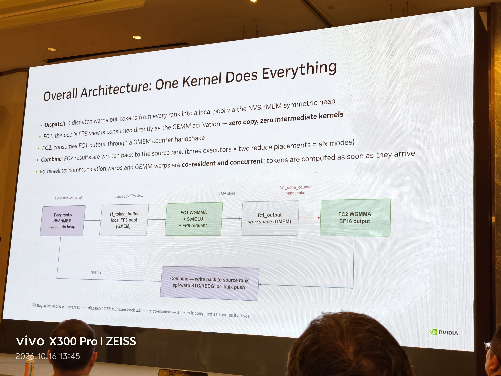

如果 Dispatch、FC1、FC2、Combine 各自等上一整个阶段结束才开始，那么先到达的 token 也必须等待其他 token；每个阶段之间还要交接 kernel、整理输入。MegaMoE 将核心链路放进同一个常驻 kernel，希望把这种整批等待细化为“所需 tile 一旦就绪，就可以继续往下走”。各阶段的含义见[MoE 流程与符号](#recap-moe)。

本实现中，数据实际经过以下位置：

```text
其他 GPU 的 token
    ↓ Dispatch warps 通过 NVSHMEM 拉取
本地 GMEM token pool
    ↓ 直接作为 FP8 激活输入
FC1 WGMMA → SwiGLU → FP8 量化
    ↓ TMA store
本地 GMEM fc1_output
    ↓ fc1_done_counter 通知输入就绪
FC2 WGMMA → BF16 输出
    ↓ Combine
结果送回 token 来源 GPU，并合并专家贡献
```

这里有两个重要的实现选择。第一，本地 token pool 已采用 GEMM 能消费的 FP8 布局，FC1 可以直接从这个缓冲取数，省去一次额外的格式整理或复制。第二，FC1 与 FC2 通过 GMEM workspace 和完成计数器解耦：FC2 等待的是自己需要的输入分块，而不是一次 FC1 kernel 的整体结束。

这也解释了图中的多行时间线：通信、取数、计算和写出是常驻线程的不同职责，可以同时处理不同任务。融合并没有取消中间缓冲和同步，而是让程序能在更细的粒度上安排它们。缓冲可复用时机、数据可见性以及下游的等待条件，成为后续优化的重点。

Combine 又分成“谁把结果送回去”和“在哪里合并 top-k 贡献”两个选择：可以由 epilogue、复用的 dispatch warps 或专门的 token-back warps 执行回传，再搭配不同的归约位置。由此形成讲座中的六种组合，使通信负担可以按工作负载从计算路径上移开。

---

<a id="page-15"></a>

### 02 Warp 分工：把寄存器留给计算，把等待拆给搬运

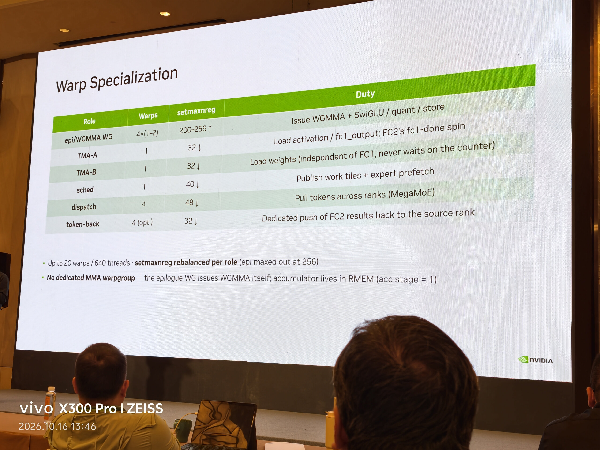

一个线程团队同时负责所有阶段，容易把不相关的等待串在一起：例如 FC2 激活尚未就绪，连本来可以先取的权重也一起停下；搬运线程还可能占用计算线程急需的寄存器。这里通过固定角色分工，把依赖和资源预算分别安排。

下表按幻灯片的常规 A/B 映射列出职责。资源分配的方向是把更多寄存器留给计算与 epilogue，让搬运和调度使用较小预算；具体配额以 warpgroup 为单位组织。

| 角色 | Warp 数 | 寄存器需求 | 本实现中的任务 |
| --- | ---: | ---: | --- |
| 计算与 epilogue WG | 4×(1–2) | 高：累加结果与后处理临时量 | 发起 WGMMA，并在自己的累加结果上执行 SwiGLU、量化和写出 |
| TMA-A | 1 | 低：地址与流水线状态 | 搬运激活；FC2 时等待 `fc1_done`，再读取 `fc1_output` |
| TMA-B | 1 | 低：地址与流水线状态 | 搬运权重，可独立于 FC1 完成计数器继续预取 |
| 调度 | 1 | 较低：任务描述与调度状态 | 发布任务 tile，并预取后续专家相关信息 |
| Dispatch | 4 | 较低：搬运与通信状态 | 从其他 GPU 拉取 token |
| Token-back | 4，可选 | 较低：回传与通信状态 | 专门把 FC2 结果推回来源 GPU |

Hopper 的 WGMMA 结果直接落在参与计算的线程寄存器中。因此，本实现让同一个 warpgroup 接着做 epilogue，避免再把整块结果交给另一组线程。较大的寄存器配额同时服务于累加结果和后处理临时值；搬运与调度角色主要保存地址、描述符和状态，可以让出更多配额。寄存器如何在运行时重新分配，见[寄存器与 `setmaxnreg`](#recap-registers)。

TMA-A 与 TMA-B 分开尤其有价值：FC2 权重与 FC1 输出的就绪时间不同，只让激活搬运者等待计数器，权重侧仍有机会提前填充流水线。调度 warp 也不执行 GEMM，而是提前准备接下来要做的工作，减少计算组在任务切换时的空隙。

这一页给出的是整体角色布局。后面的“单个活跃 Dispatch warp”和“合并生产者 warpgroup”会继续压缩其中的低利用率线程，回收线程槽位、寄存器和 SMEM。

---

<a id="page-16"></a>

### 03 swapAB：让少量 Token 落在可缩小的 N 维


小批量 decode 的问题往往不是缺少矩阵乘法算力，而是一个专家只分到少量 token，原来的计算 tile 却仍然很高。若只有 8 个 token，按 M=64 的 tile 计算，56 行都在处理 padding。要减少这部分工作，首先要让 token 维对应硬件允许细分的方向。

本次 Hopper FP8 路径所用 WGMMA 原子形状为 `m64nNk32`：M 固定为 64，N 有更细的选择。因此，swapAB 将原来的

$$
Y_{T\times C}=X_{T\times K}W_{K\times C}
$$

改写成

$$
Y^T_{C\times T}=W^T_{C\times K}X^T_{K\times T}.
$$

结果相同，但 token 从 M 移到 N；较大的输出通道数则填充 M。本实现选择 M=128 或 256 的通道 tile，token N 可选 8、16、32、64、128。

| 同样计算 8 个 token、128 个输出通道 | 普通布局 | swapAB |
| --- | --- | --- |
| 任务 tile | M64×N128 | M128×N8 |
| Token 所在方向 | M | N |
| Token 方向的有效比例 | 8/64 | 8/8 |

这样打开的空间很直接：把原本用于 padding 的乘加去掉，并沿充足的通道维继续划分任务。这里利用的是 Hopper 可选的 WGMMA 形状；前面 Blackwell 的 dynamic tileN 则进一步在发起 MMA 时修改描述符中的实际 N。两者都需要先把 token 放到 N，但选择计算范围的接口不同，见[MMA 形状与发起方式](#recap-mma)。

交换输入并不需要先执行一次全矩阵转置。实现通过 shape/stride 视图重新解释现有权重和激活，并把 expert 维保留在 TMA 描述符的批次维中，以坐标切换专家。真正需要恢复的输出布局交给 epilogue：FC1 在寄存器写入 SMEM 时使用目标地址映射；FC2 的相应路径直接从寄存器用 STG 写到所需位置。

输入侧少做一次搬运之后，关键便转移到输出侧：SwiGLU 的 gate/up 是否仍落在同一线程、转回目标布局是否需要线程间交换。讲座后面的“8 元素交错布局”正是为这一步配套设计的。

---

<a id="page-17"></a>

### 04 FP8 量化：把分块 Scale 的成本融入主循环

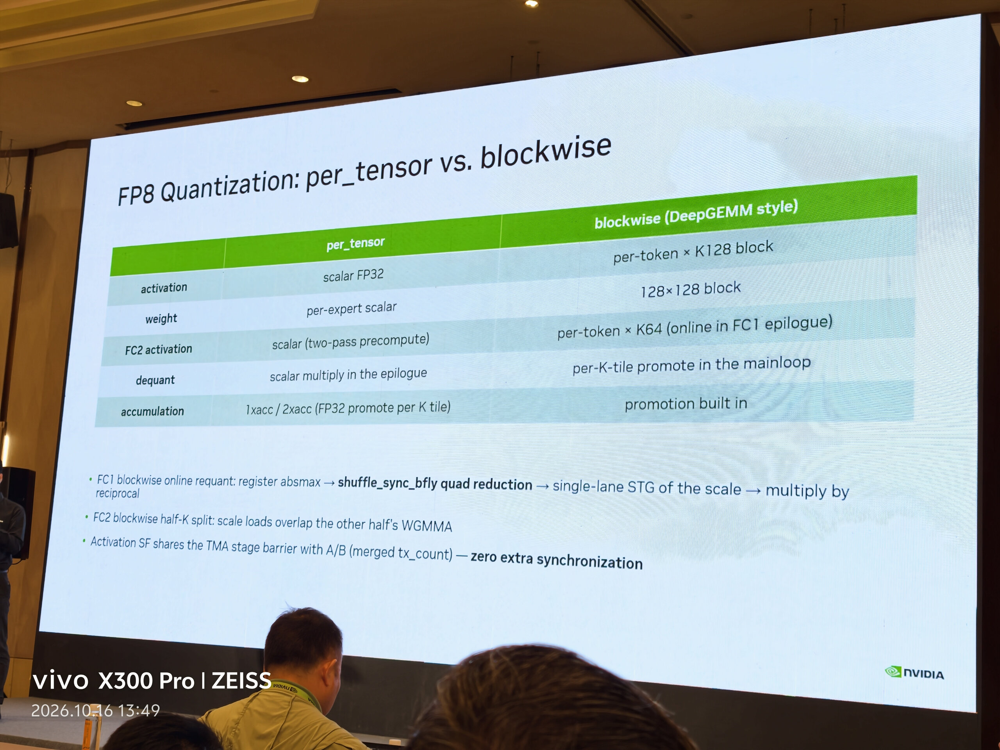

FP8 能降低输入带宽和矩阵计算成本，但 scale 的粒度决定了额外工作出现在哪里。整张量共用 scale 时，反量化可以集中在最终 epilogue；沿 K 使用不同 scale 时，各段乘积必须分别缩放后再累加，缩放就进入 GEMM 主循环。

本实现提供两种路径：

| 数据或处理 | Per-tensor | Blockwise |
| --- | --- | --- |
| FC1 激活 scale | 整体使用标量 | 每 token、每 K128 块一份 |
| 权重 scale | 每专家标量 | 每 128×128 权重块一份 |
| FC2 激活 scale | 通过两遍预处理得到标量 | FC1 epilogue 在线生成，每 token、每 K64 块一份 |
| 反量化位置 | epilogue 统一乘 scale | 主循环中按 K 块缩放部分结果，再加入累计结果 |

沿 K 的分块 scale 为什么不能统一挪到最后，见[TMEM 与分块缩放](#recap-tmem)。本页的优化问题是：既然需要做这些额外工作，能否利用数据已经在寄存器里、下一段 MMA 已经在运行的时机完成它们？

首先，FC1 生成 SwiGLU 结果后，立即计算块内绝对值最大值，得到 scale 并量化成 FC2 所需的 FP8。这样不必先把完整高精度中间结果写出，再启动一个量化 kernel 读回来。常规布局中，每线程先求自己的局部最大值，再在四个 lane 内通过 shuffle 完成归约；scale 由指定 lane 写出，其他线程用其倒数完成量化。

其次，FC2 将一段 K 再拆成两半，让一半的 WGMMA 运行期间穿插另一半所需的 scale 装载与准备。其目的与输入流水线相同：把 Tensor Core 和标量/向量操作安排到相互可重叠的区间。后面的“双累加器”一页会进一步展开这种安排。

最后，激活 scale 的搬运与 A/B 搬运计入同一个 TMA stage 的完成条件。消费者等待一次，就知道这份输入及其 scale 已一同就绪，省去额外一套就绪交接。这里复用的是[异步流水线的完成协议](#recap-sync)，scale 本身的计算和搬运仍属于量化路径的成本。

---

<a id="page-18"></a>

### 05 两个 Warpgroup 合作：把同一任务分成两半

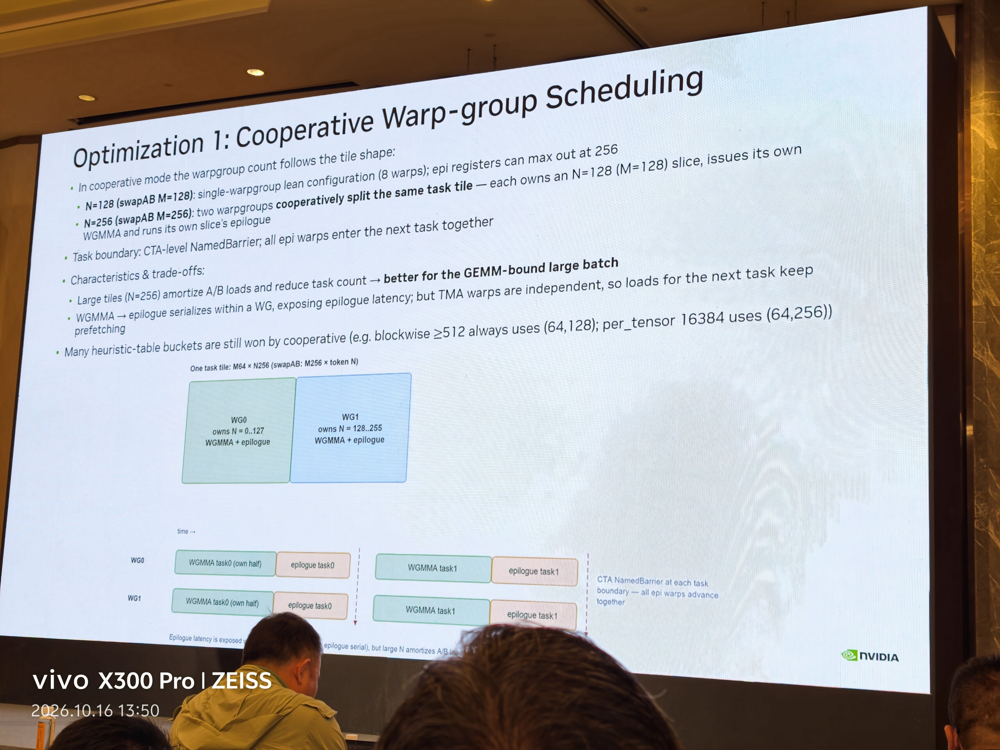

大 tile 可以增加输入复用、减少调度任务数，但结果矩阵也会占用更多寄存器。这里的做法是：任务保持较大，让同一个 CTA 内的两个 warpgroup 分别承担一半结果。

以非 swapAB 的 M64×N256 为例：

```text
同一个 task：64 个 token × 256 个输出通道

WG0：通道 [0,128)   → 自己的 WGMMA → 自己的 epilogue
WG1：通道 [128,256) → 自己的 WGMMA → 自己的 epilogue
                              ↓
                    任务边界 NamedBarrier
                              ↓
                      一起进入下一个 task
```

两个 WG 位于同一个 CTA、同一个 SM，分别持有自己的结果寄存器。它们可以复用已搬入 SMEM 的激活 tile，而不同通道对应各自的权重部分；结果与 epilogue 也随通道一同划分。这样既保留较大任务的输入复用，又把每个 WG 要持有的结果限制在一半。

形状较小时，例如非 swapAB 的 N128，只需要一个 WG；swapAB 把通道放在 M，因此对应的是 M128 用一个 WG、M256 用两个 WG。这里的 128/256 描述任务切分，不改变[WGMMA 原子形状](#recap-mma)。

这一模式的取舍可以从时间线看清：每个 WG 都是先完成本任务的矩阵计算，再处理自己的激活、量化和输出；两个 WG 在任务边界会合。因此它擅长摊薄较大任务的搬运和调度成本，但仍留下了把 epilogue 与下一任务计算交错的空间。独立 TMA warps 可以继续预取，而下一页将进一步调整计算 WG 之间的任务归属。

---

<a id="page-19"></a>

### 06 任务级 Ping-pong：让上一任务的后处理覆盖下一任务的计算

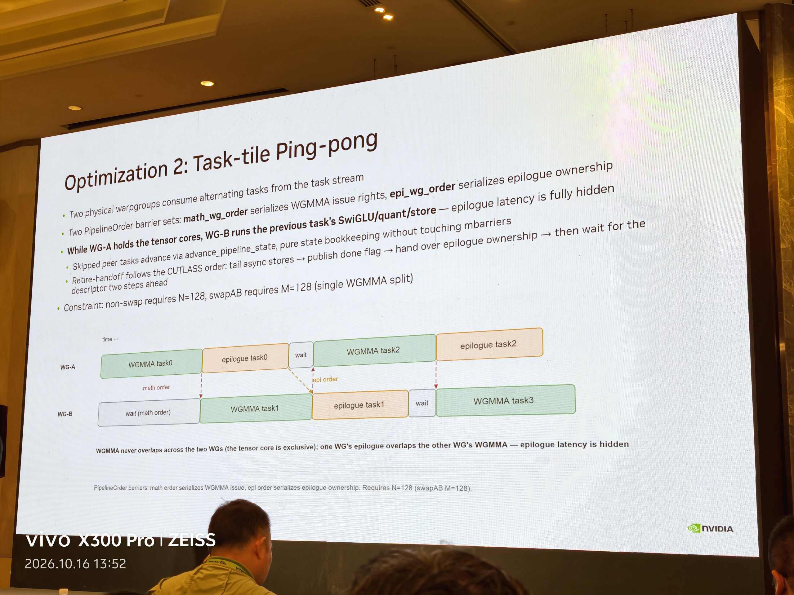

若一个 WG 做完 WGMMA 后，还要花时间处理 SwiGLU、量化和写出，那么 Tensor Core 在这段时间可能缺少后续工作。两个 WG 已经各自拥有寄存器，便可以把任务分给它们交替执行：WG-A 处理 task0、task2，WG-B 处理 task1、task3。

与上一页相比，变化发生在任务所有权上：现在每个 WG 持有一个完整 task，不再各做同一 task 的半边。

| 执行区间 | WG-A | WG-B |
| --- | --- | --- |
| 启动 | WGMMA(task0) | 等待计算轮次 |
| 稳态 1 | epilogue(task0) | WGMMA(task1) |
| 稳态 2 | WGMMA(task2) | epilogue(task1) |
| 稳态 3 | epilogue(task2) | WGMMA(task3) |

这依赖 [Hopper 的结果归属](#recap-mma)：task0 的累加结果留在 WG-A 的线程寄存器中，WG-B 计算 task1 使用另一组线程的寄存器，因此可以在保留旧结果的同时推进新任务。

实现用两套 `PipelineOrder` 分别管理计算轮次与 epilogue 轮次。`math_wg_order` 让两个 WG 按任务顺序交接 WGMMA 阶段；`epi_wg_order` 管理后处理和输出资源的交接。它们允许“一个 WG 的计算”和“另一个 WG 的 epilogue”并行，同时保持各自阶段内部的顺序。

任务结束时，交接动作要放在等待未来任务之前：先完成当前任务所需的输出收尾与通知，交还 epilogue 轮次，再去等自己隔一个任务后的描述符。否则，一个 WG 等待新任务时仍持有旧资源，另一个 WG 就可能无法继续推进。跳过属于对方的任务时，则只推进本地流水线状态，不额外触碰 barrier。

本实现把 ping-pong 用于一个 WG 能独立承担的任务形状：非 swapAB 的 N128，或 swapAB 的 M128。它用两组结果寄存器和额外交接换取计算、后处理的重叠；当 epilogue 的工作能放进对方的 MMA 时间窗，原本暴露在计算之后的尾部就有机会被隐藏。

---

<a id="page-20"></a>

### 07 Cluster 与 TMA 多播：让相邻 CTA 复用同一份输入

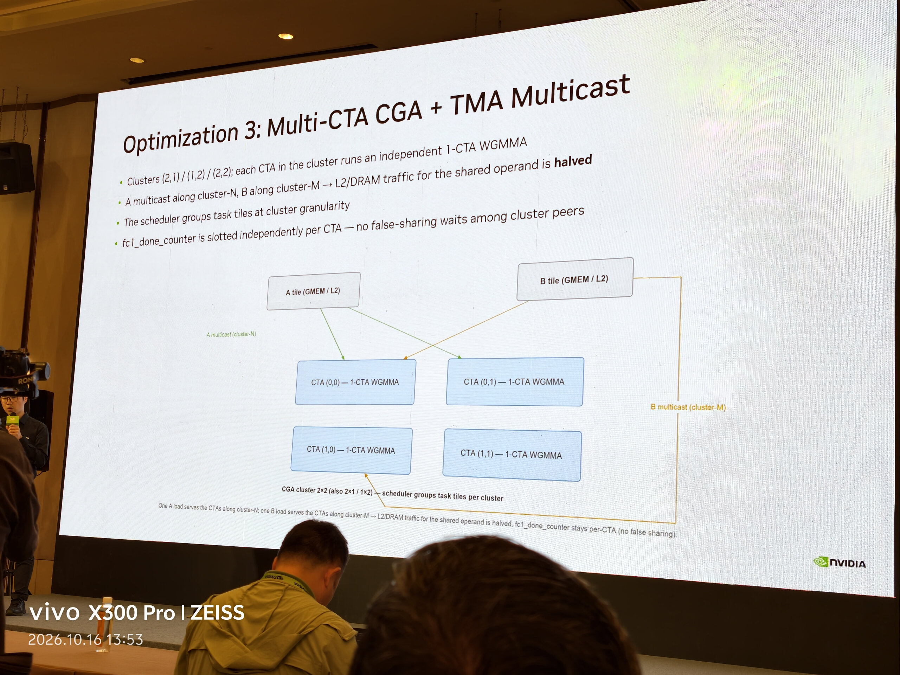

一个 CTA 内已经可以复用输入，但相邻 CTA 仍可能重复加载同一块激活或权重。如果将具有这种复用关系的任务放进一个 cluster，就可以用 TMA multicast 从源端读取一次，再分发给多个 CTA 的 SMEM。[Cluster 的执行与存储特性](#recap-cluster)说明了这种跨 CTA 合作的基础。

本实现采用 `(2,1)`、`(1,2)` 或 `(2,2)` 的 cluster。按输出矩阵的 M 行、N 列排列时，复用关系来自 GEMM 本身：

```text
             N →
         CTA(0,0)  CTA(0,1)   同一行共享 A
 M ↓
         CTA(1,0)  CTA(1,1)   同一行共享 A
            ↑         ↑
         同一列共享 B
```

因为 A 的坐标由 M、K 决定，所以沿 N 相邻的 CTA 可收到同一个 A tile；B 由 K、N 决定，所以沿 M 相邻的 CTA 可收到同一个 B tile。映射到两种实现后：

| 输入布局 | 沿 cluster-N 共享 A | 沿 cluster-M 共享 B |
| --- | --- | --- |
| 普通布局：A=激活、B=权重 | 激活 | 权重 |
| swapAB：A=权重、B=激活 | 权重 | 激活 |

例如两个 CTA 都需要同一份 16 KiB 输入，普通加载需要 L2 向它们分别供数，合计 32 KiB；多播只需源端供数 16 KiB，再分发成两个 SMEM 副本。它不增加 HBM 流量，并减少 L2 到计算端的重复供数，让原本用于重复搬运的带宽可以服务其他输入。

每个 CTA 仍独立运行自己的 WGMMA、保存自己的结果；这里合作的是输入搬运。调度器按 cluster 安排具有复用关系的 tile，同时保留每个 CTA 对应的 `fc1_done_counter` 槽位，使它可以依据自身输入的完成条件推进。这样，输入共享不会把所有后续任务强行绑成一个共同完成的单元。

---

<a id="page-21"></a>

### 08 主循环与输出流水线：只等待即将复用的那一份缓冲


如果每次搬入、计算、写出之后都把异步操作全部等完，独立硬件也只能串行工作。这一页的思路是把缓冲分成多个 stage：当前 stage 被消费时，下一份数据继续准备；只有即将覆盖某个 stage 时，才等待它原来的使用者退出。

输入侧在稳态保留一组未完成的 WGMMA。示意过程如下，`group` 是提交后的异步计算组：

```text
输入 stage0 就绪 → 发起并提交 WGMMA group0
输入 stage1 就绪 → 发起并提交 WGMMA group1
等待到最多剩 1 个未完成 group
    → group0 已完成，释放 stage0 给 TMA 填入后续输入
    → group1 继续计算
再发起 group2，按相同方式回收 stage1
```

关键是把 `consumer_release` 放到旧输入不再被 WGMMA 使用之后，同时让较新的 WGMMA 保持在途。TMA 生产者还会提前尝试获取下一 stage；已经空闲时可直接推进，尚未空闲才进入等待路径。A/B stage 数则根据 tile 大小和可用 SMEM 预算配置，使较小 tile 有机会拥有更深的预取队列。[异步完成与缓冲生命周期](#recap-sync)给出了这类交接的通用规则。

输出侧采用两个 4 KiB SMEM stage。线程先把寄存器结果写入一个 stage（R2S），再提交 TMA store，将它从 SMEM 写到 GMEM（S2G）；与此同时，下一个输出分块可以写入另一个 stage：

| 分块 | 寄存器 → SMEM | 可并行推进的工作 |
| --- | --- | --- |
| subtile0 | 写 stage0，提交 TMA store0 | 准备 subtile1 |
| subtile1 | 写 stage1，提交 TMA store1 | TMA 继续读取 stage0 |
| subtile2 | 确认 stage0 的旧数据已被 TMA 读走，再覆盖 stage0 | store1 继续推进 |
| subtile3 | 同样复用 stage1 | store2 继续推进 |

因此，回收源 SMEM 只需要确认 TMA 已读完这份源数据；需要向 FC2 或 Combine 发布结果时，再完成对应的目标可见性与通知协议。把这两个完成点分开，才能保留输出传输和下一块 R2S 的重叠窗口。

本实现还让 FC1 与 FC2 复用同一份 WG 私有输出环：FC1 的 64×64 FP8 和 FC2 的 64×32 BF16 都恰好是 4 KiB。阶段切换后可以更换数据解释，而不必同时保留两套输出缓冲。省下的 SMEM 又能用于输入预取或通信，从而把缓冲容量与延迟隐藏一起考虑。

关键代码可对照 [WGMMA 主循环](https://github.com/flashinfer-ai/flashinfer/blob/5b0f0ca978ef28d05d71ee78637c3e445f32ddca/flashinfer/moe_ep/kernel_src/sm90/pull_style_cutedsl_megakernel/src/moe_hopper_fp8/kernel_fp8_glu_fc12.py#L1014)与[双 stage 输出路径](https://github.com/flashinfer-ai/flashinfer/blob/5b0f0ca978ef28d05d71ee78637c3e445f32ddca/flashinfer/moe_ep/kernel_src/sm90/pull_style_cutedsl_megakernel/src/moe_hopper_fp8/epilogue_fp8.py#L1314)。

---

<a id="page-22"></a>

### 09 寄存器内融合 Epilogue：让中间结果只在最后写出

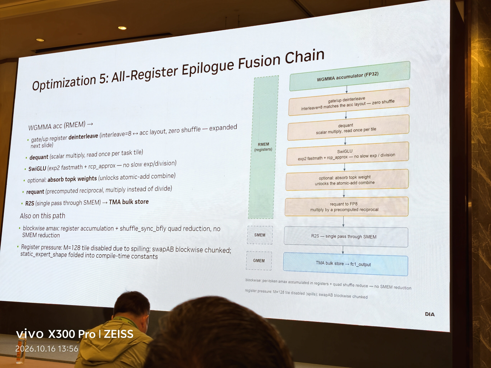

FC1 之后还要反量化、组合 gate/up、计算 SwiGLU，再量化成 FC2 输入。若每一步都写出中间张量，数据会反复经过存储系统；即便融合到一个 kernel，额外的 SMEM 中转和同步也会消耗资源。Hopper 的累加结果已经在寄存器中，因此这条路径尽量就地把它变成最终需要写出的 FP8。

以常规 per-tensor FC1 为例，整条处理链是：

```text
线程寄存器中的 FP32 累加结果
    → 取得本线程配对的 gate / up
    → 乘输入与权重的反量化 scale
    → SwiGLU
    → 可选：乘路由权重
    → 乘量化 scale 的倒数，转换成 FP8
    → 一次 R2S，写入输出 SMEM
    → TMA store，写入 fc1_output
```

首先，权重预先采用 8 元素的 gate/up 交错布局，让需要配对的两路结果落到同一线程。Epilogue 通过寄存器索引即可找到对应值，省去一次线程间重排；下一页会结合 WGMMA fragment 说明这个“8”的来源。

其次，SwiGLU 把现有的 gate、up 寄存器直接串起来：

$$
h=u\cdot\operatorname{SiLU}(g)
  =u\cdot g\cdot\frac{1}{1+e^{-g}}.
$$

实现采用 `exp2` 与近似倒数，并把量化中的除法改为乘预先准备的倒数。这样，结果生成后可直接进入 FP8 转换，减少独立的中间存储和通用数学运算。若该模式把路由权重提前吸收到 FC2 输入，在本例的线性 FC2 上利用 `p(hW₂)=(ph)W₂`，最终 Combine 就能直接累加各专家已经加权的贡献。

Blockwise 路径还要在线求块内 `amax`。常规布局把每线程局部归约与四 lane 的 shuffle 归约接起来，再量化并写出；swapAB 的分块实现则按其归约范围安排额外协作。这里的“全寄存器”描述主要数值处理链：最终通过 SMEM 组织 TMA 输出，并不妨碍前面的中间结果一直留在寄存器中。

这种融合的资源约束也很明确：累加结果、gate/up、激活临时值与量化暂存的生命周期不能无限延长。实现因此会避开造成 spill 的较大 tile，并将 swapAB 的 blockwise epilogue 分块处理，消费一批结果后复用其寄存器空间。[寄存器容量与生命周期](#recap-registers)解释了为什么“少一次存储”和“同时保留更少的值”需要一起设计。

对应实现见 [FC1 寄存器处理链](https://github.com/flashinfer-ai/flashinfer/blob/5b0f0ca978ef28d05d71ee78637c3e445f32ddca/flashinfer/moe_ep/kernel_src/sm90/pull_style_cutedsl_megakernel/src/moe_hopper_fp8/epilogue_fp8.py#L1015)与[激活函数实现](https://github.com/flashinfer-ai/flashinfer/blob/5b0f0ca978ef28d05d71ee78637c3e445f32ddca/flashinfer/moe_ep/kernel_src/sm90/pull_style_cutedsl_megakernel/src/moe_hopper_fp8/epilogue_fp8_common.py#L92)。

---

<a id="page-23"></a>

### 10 为什么以八个通道交错门控与上投影权重

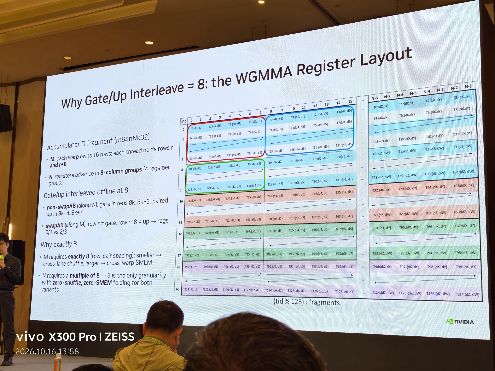

SwiGLU 要把同一个通道的 gate 和 up 相乘。如果这两个值落在不同线程中，epilogue 就需要先交换数据。这里的优化机会是：**预先调整权重的通道顺序，让 WGMMA 自然把配对结果写进同一个线程的寄存器。** 结果 fragment 的归属由指令规定，见[矩阵指令与结果存储](#recap-mma)。

图中 `m64nNk32` 的布局可以只看线程 T0：

| 寄存器 | 结果坐标 `(行, 列)` |
| --- | --- |
| `d0, d1` | `(0,0), (0,1)` |
| `d2, d3` | `(8,0), (8,1)` |
| `d4, d5` | `(0,8), (0,9)` |
| `d6, d7` | `(8,8), (8,9)` |

同一线程同时持有相隔 8 行的结果；沿列方向，每跨过一组 8 列，又得到四个寄存器值。于是把权重对应的输出通道预排成：

```text
gate[0:8]，up[0:8]，gate[8:16]，up[8:16]，……
```

- **普通布局沿 N 交错**：每线程的 `d0…d3` 是 gate，`d4…d7` 是对应的 up，后续各组重复这个关系。
- **swapAB 沿 M 交错**：行 `r` 是 gate，行 `r+8` 是配对 up；同线程的 `d0/d1` 与 `d2/d3` 直接配对。

对本页布局，M 方向的同线程行间距恰好是 8，N 方向也以 8 列为基本分组，因此粒度 8 能同时服务两个变体。Epilogue 只需索引自己的寄存器，就能接上激活与量化，省去这一步的跨线程 shuffle 或 SMEM 交换。一次权重预排，让每次执行都受益。

---

<a id="page-24"></a>

### 11 只保留一个活跃的分发线程束

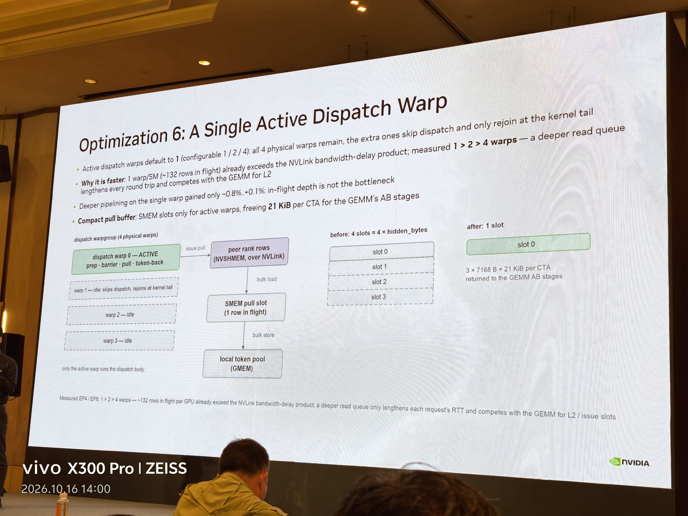

通信需要足够的在途请求来覆盖延迟；链路已经忙碌时，继续增加请求则可能主要增加排队，并争用计算需要的访存资源。因而这里先尝试**减少每个 CTA 的活跃 Dispatch warp**，把通信并发维持在够用的水平。[访存层级与共享资源](#recap-memory)解释了这种取舍。

演讲报告，在其 EP4/EP8 配置下，每个 SM 一个活跃 warp，整张 GPU 已有约 132 行 token 在途；一个活跃 warp 的表现优于两个和四个，继续加深单 warp 流水也只有约 −0.8% 到 +0.1% 的变化。这个结果支持了本页的选择：让一个 warp 持续完成“远端 token → SMEM 中转槽 → 本地 token pool”，把其余通信并发预算让给计算。

缓冲也随活跃角色缩减。图中每行占 7168B，四个 pull slot 改成一个，释放：

$$
3\times7168\ \mathrm{B}=21\ \mathrm{KiB/CTA}.
$$

这些 SMEM 可以用于更多 A/B 输入 stage，帮助 TMA 提前准备后续计算的数据。这一步仍保留四个物理 warp，只让其中一个运行 Dispatch；空出的三个角色槽为下一页的合并创造了条件。

---

<a id="page-25"></a>

### 12 合并生产者线程束组，重新分配寄存器

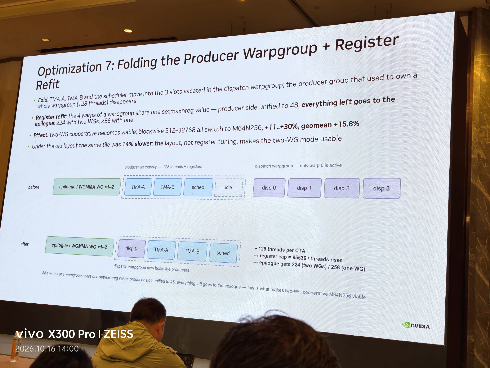

上一页留下三个空闲的 Dispatch warp；另一边，TMA-A、TMA-B 和调度器又独占一个 producer warpgroup。**把三个生产者角色放进已有空位，就能减少 CTA 的线程数，把寄存器预算集中给保存累加结果的计算线程。** 分角色预算的背景见[寄存器与生命周期](#recap-registers)。

以图中的两个 WGMMA/epilogue warpgroup、无独立 Combine warpgroup 为例：

| 布局 | 计算与 epilogue | 生产者 | Dispatch | CTA 线程数 |
| --- | --- | --- | --- | ---: |
| 合并前 | 8 个 warp | TMA-A、TMA-B、调度、空闲，共 4 个 warp | 1 个活跃、3 个空闲，共 4 个 warp | 512 |
| 合并后 | 8 个 warp | 与 Dispatch 共用 `[Dispatch, TMA-A, TMA-B, 调度]` 四个角色槽 | 同左 | 384 |

这是重新安排 kernel 的线程角色与 launch 大小。合并后 producer warpgroup 的四个 warp 统一使用每线程 48 个寄存器，再为两个计算 warpgroup 分配每线程 224 个。公开实现的预算计算如下，其中 `floor8` 表示向下对齐到 8：[角色布局与预算代码](https://github.com/flashinfer-ai/flashinfer/blob/5b0f0ca978ef28d05d71ee78637c3e445f32ddca/flashinfer/moe_ep/kernel_src/sm90/pull_style_cutedsl_megakernel/src/moe_hopper_fp8/kernel_fp8_glu_fc12.py#L669-L816)

```text
入口预算       = floor8(65536 / 384) = 168 个寄存器/线程
可分配池       = 168 × 384 = 64512
生产者预算     = 48 × 128  = 6144
计算线程候选值 = (64512 − 6144) / 256 = 228
计算线程配额   = floor8(228) = 224
```

更多寄存器让较大的 accumulator tile 和 epilogue 临时值更容易同时驻留，打开了双 WG 合作处理 M64N256 的空间。演讲报告，在其 blockwise、512–32768 token 桶中，这套布局使该配置获得约 11%–30% 的提升，几何平均为 15.8%；同一大 tile 在旧布局下反而慢约 14%。这里的关键是先改变资源分配，再重新选择值得采用的 tile。

---

<a id="page-26"></a>

### 13 第一层结果就绪后立即通知第二层

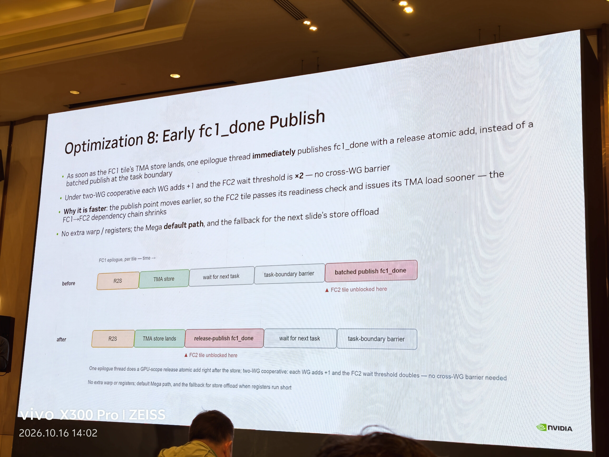

FC1 输出已经可以交给下游时，FC2 仍可能看不到就绪通知：原来的发布点排在“领取下一任务、任务边界同步、凑批”之后。把通知提前，可以直接缩短这条依赖链。

```text
原来：写出 FC1 → 等下一任务 → 任务边界同步 → 批量发布 fc1_done
现在：写出 FC1 → 满足输出就绪协议 → 发布 fc1_done → 等下一任务 → 边界同步
```

发布由每个负责输出的 WG 中一个线程执行 GPU-scope release atomic add；FC2 按[匹配的 acquire 协议](#recap-sync)观察计数器，再读取中间结果。**提前的是通知位置，数据就绪仍是发布的前提。**

`fc1_done` 汇总同一专家、同一 token block 的所有 FC1 通道 tile。一次 `+1` 表示一个生产者完成了自己的贡献，FC2 要等总数达到阈值才能开工。在两个 WG 合作一个 task tile 的配置中，原来等双方汇合后发布一次，现在各 WG 完成自己的半块就各 `+1`，等待阈值也相应乘 2。这样就绪通知不再被跨 WG 的汇合拖后。[早发布与等待阈值](https://github.com/flashinfer-ai/flashinfer/blob/5b0f0ca978ef28d05d71ee78637c3e445f32ddca/flashinfer/moe_ep/kernel_src/sm90/pull_style_cutedsl_megakernel/src/moe_hopper_fp8/kernel_fp8_glu_fc12.py#L2785-L2816)

细化发布会增加这一路径的 atomic 次数，并减少集中发布的机会；它换来的是下游更早取得可执行工作。这里优化的目标是 FC1→FC2 的关键路径：当等待通知已经阻碍流水线，及时交接就值得优先于攒批。

---

<a id="page-27"></a>

### 14 用双临时累加器重叠计算与缩放


Blockwise FC2 的一个 K tile 包含两组 activation scale，因此要把两半的部分和分别缩放，再合入长期 FP32 累加器。若共用一份临时结果寄存器，就只能执行“算第一半 → 等完成 → 缩放累加 → 算第二半”。中间的普通 FP32 运算会留下 Tensor Core 可利用的空隙。

增加第二份临时 fragment 后，两半可以连续发射。利用 [WGMMA 的异步完成协议](#recap-mma)，先等第一半完成，就能在第二半仍计算时处理第一半：

```text
发射 WGMMA(K 前半) → partial0；commit
发射 WGMMA(K 后半) → partial1；commit
读取第一组 scale
wait_group(1)           # 最后一组仍可在途，partial0 已可读
total += scale0 × partial0
读取第二组 scale
wait_group(0)           # partial1 已可读
释放本轮 A/B 输入 stage
total += scale1 × partial1
```

这里同时存活的是一份长期 `total` 与两份短期 `partial`。每份 partial 只需保留到对应的缩放累加结束；A/B 的 SMEM stage 则要等两半 WGMMA 都用完后才能释放。这正是[按生命周期安排存储](#recap-registers)的应用：用有限的额外寄存器，换取 Tensor Core 与向量处理的重叠。

本页把这条路径限制在较小的累加 fragment（每线程不超过 64 个寄存器值），并要求独立小 CTA 或折叠后至少 224 个 epilogue 寄存器的预算。预算不足时继续复用同一份 partial，保留串行路径。上一页回收的资源，在这里转化为新的流水空间。[双累加器实现](https://github.com/flashinfer-ai/flashinfer/blob/5b0f0ca978ef28d05d71ee78637c3e445f32ddca/flashinfer/moe_ep/kernel_src/sm90/pull_style_cutedsl_megakernel/src/moe_hopper_fp8/kernel_fp8_glu_fc12.py#L1307-L1443)

---

<a id="page-28"></a>

### 15 扩大调度组，避开尚未就绪的任务

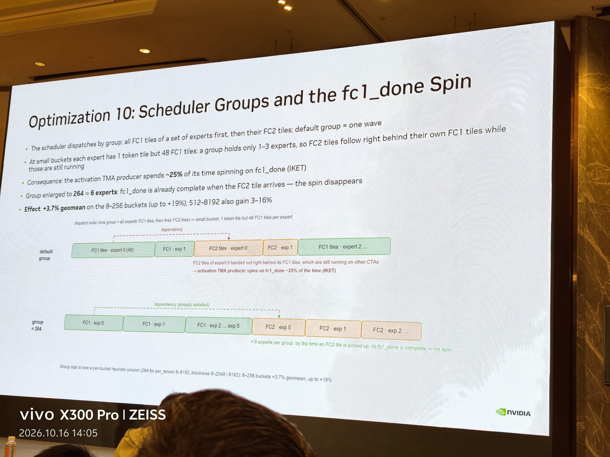

及时通知解决了“结果已好、通知还没发”的等待。另一种等待发生得更早：**调度器把 FC2 任务交给 CTA 时，它依赖的 FC1 任务还在其他 CTA 上执行。** 此时 activation TMA producer 只能轮询 `fc1_done`。

本例按专家组安排工作：先派发组内专家的全部 FC1 tiles，再派发它们的 FC2 tiles。小 token 桶中，一个专家虽然只有一个 token tile，仍有 48 个 FC1 通道 tiles；默认约一波工作的组只容纳 1–3 个专家，FC2 容易紧跟尚未完成的 FC1 被领走。演讲中的 IKET 时间分解显示，这种情况下 activation TMA producer 约 25% 的时间花在等待计数器上。

扩大组，把更多独立专家的 FC1 放进两段依赖之间：

```text
小组：FC1 专家0 → FC1 专家1 → FC2 专家0（可能等待）→ ……
大组：FC1 专家0 → FC1 专家1 → …… → FC1 专家5 → FC2 专家0 → ……
```

后续专家的 FC1 填充了先前专家尚未完成的时间，使 CTA 领取 FC2 时更容易直接开始取数。这改变了任务交错顺序，不增加模型计算量。

演讲给出的选择是 `group_hint=264`，对应约六个专家；在报告的小 token 桶中消除了这段 spin，8–256 桶的几何平均提升为 3.7%，最高约 19%，512–8192 桶也报告了 3%–16% 的收益。最终把组大小纳入按 token 桶选择的配置：有足够独立任务时，用它们填充依赖间隔，而不让生产者过早停在未就绪任务上。

---

<a id="page-29"></a>

### 16 将第二层输出合并为十六字节写入

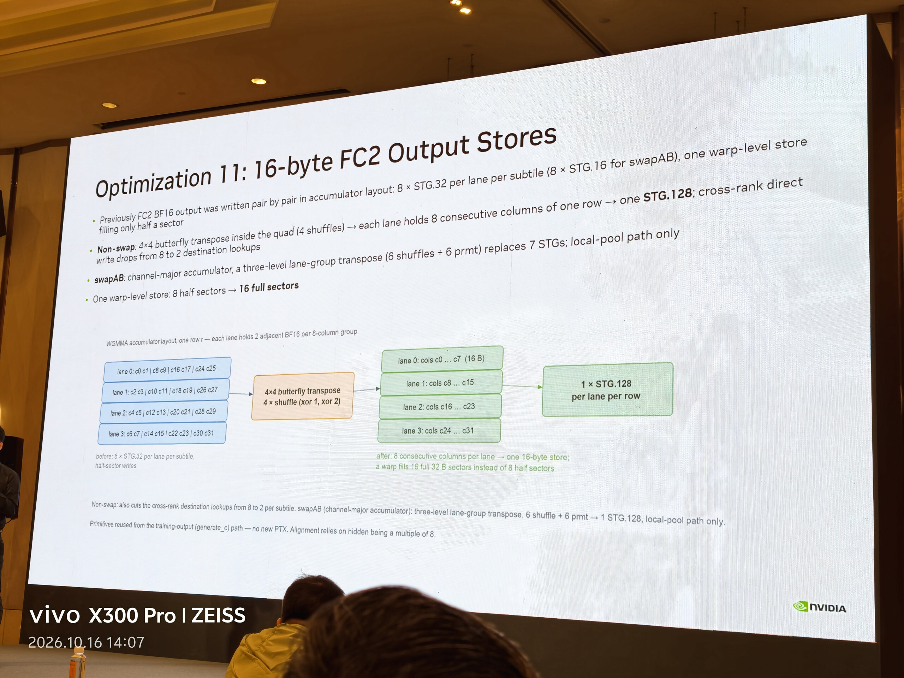

WGMMA 的结果布局适合计算，却不一定适合连续写出。直接按 accumulator 中的 BF16 对逐次写回，会产生许多窄 store，还要反复计算目标地址。这里把问题转成：**先在寄存器间交换结果，让每个线程持有足够长的连续片段，再一次写出。**

普通布局中，四个相邻 lane 对同一行的结果分布如下：

| lane | 交换前持有的列 | 交换后持有的列 |
| --- | --- | --- |
| 0 | `0,1 / 8,9 / 16,17 / 24,25` | `0…7` |
| 1 | `2,3 / 10,11 / 18,19 / 26,27` | `8…15` |
| 2 | `4,5 / 12,13 / 20,21 / 28,29` | `16…23` |
| 3 | `6,7 / 14,15 / 22,23 / 30,31` | `24…31` |

每对 BF16 打包成一个 32-bit word，四个 lane 的四份 word 就构成一个 4×4 小矩阵。两级 butterfly、共四条 shuffle 完成这次转置后，每个 lane 拿到同一行连续八个 BF16，即 16B，可以执行一次 `STG.128`。

每个线程在本例 subtile 中负责两行，因此完整对比是：

| 每线程、每 subtile | 原来 | 重排后 |
| --- | --- | --- |
| 输出量 | 16 个 BF16，共 32B | 相同 |
| store 指令 | 8 次 `STG.32` | 2 次 `STG.128`，每行一次 |
| 直接远程写的目标地址解析 | 8 次 | 2 次，按行解析 |

`STG.128` 的 128 是 bit，即每线程 16B。按[sector 与合并访存](#recap-memory)的口径，对满 warp、对齐的这一输出布局，原来一条窄写使用 8 个半满的 32B sector，新的一条宽写填满 16 个 sector。写完同样的 1024B，原来是 `8×8=64` 次 sector 访问，新方案为 `2×16=32` 次；连续值由更少的指令和访问请求送出。[重排与宽写实现](https://github.com/flashinfer-ai/flashinfer/blob/5b0f0ca978ef28d05d71ee78637c3e445f32ddca/flashinfer/moe_ep/kernel_src/sm90/pull_style_cutedsl_megakernel/src/moe_hopper_fp8/epilogue_fp8.py#L1193-L1225)

swapAB 的 local-pool 路径也采用相同思路：三层 lane-group 重排，用六条 shuffle 和六条 `prmt` 整理八个 BF16，把八次 `STG.16` 合为一次 `STG.128`。两条路径都把一部分线程间重排工作换成更少的写指令、地址计算和碎片化访问，让 epilogue 更快交出结果。

---

<a id="page-30"></a>

### 17 让融合方案与基线具备可比性

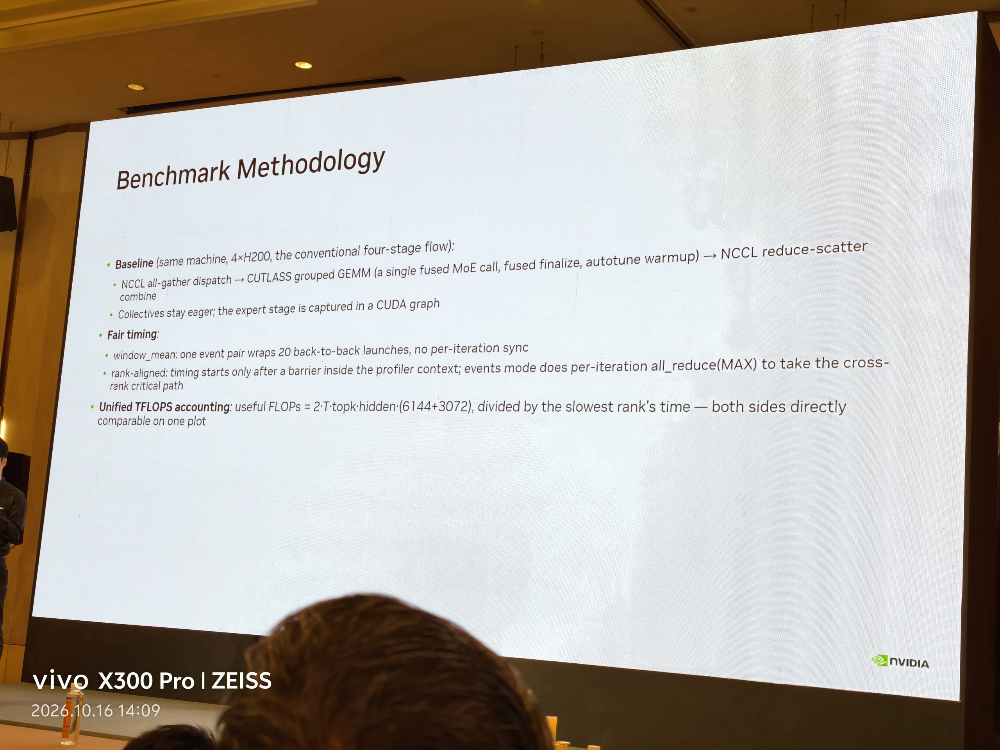

融合同时改变通信、计算和启动方式，比较必须覆盖同样的工作。演讲在同一台 **4×H200** 机器上，以分阶段方案作为基线：

```text
NCCL all-gather Dispatch
→ CUTLASS grouped GEMM 专家阶段（融合 MoE 调用与 finalize，完成 autotune 预热）
→ NCCL reduce-scatter Combine
```

基线的专家阶段使用 CUDA Graph，collective 通信保持 eager。这个边界决定了报告比较的是哪些软件路径，也保留了常规方案对专家计算启动开销的优化。

计时设计解决两个可比性问题：连续执行用 `window_mean`，一对 event 包住连续 20 次运行，中途不逐次同步；多 rank 在计时前对齐，逐次 `events` 模式通过 `all_reduce(MAX)` 取最慢 rank 的时间。前者减少测量插入的空隙，后者计入整个分布式步骤真正要等待的那一条路径。

两边还统一按有效工作量计算吞吐。该模型的 FC1 gate/up 合并宽度为 6144，激活后的中间宽度为 3072，因此采用：

$$
F_{\mathrm{useful}}=2T\cdot\mathrm{topk}\cdot H\cdot(6144+3072),
\qquad
\mathrm{TFLOPS}=\frac{F_{\mathrm{useful}}}{t_{\mathrm{slowest}}\times10^{12}}.
$$

其中两边使用一致的 token 数 $T$、路由数 top-k 和 hidden 维度 $H$。把通信和等待纳入时间、把 padding 排除在有效 FLOPs 之外，能让缩减无效计算和改善整层流水都体现在同一口径中。

---

<a id="page-31"></a>

### 18 从局部优化到完整算子

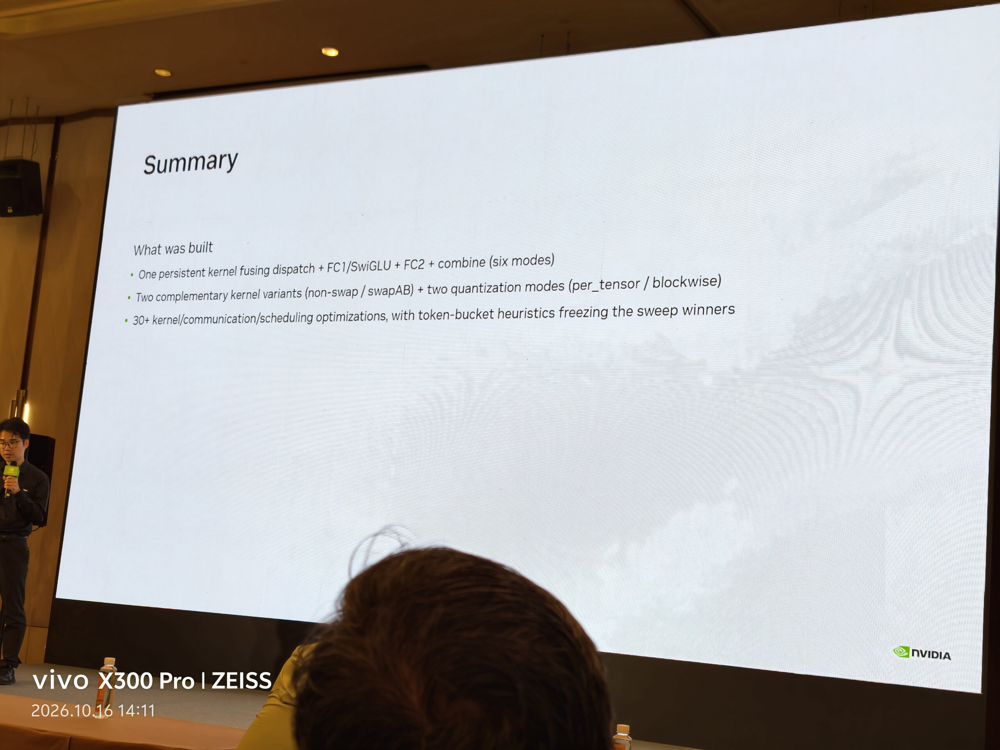

这些优化互相创造条件：合适的寄存器布局让融合 epilogue 更便宜；精简通信角色释放 SMEM 和寄存器；新的预算容纳更大的 tile 或更多临时结果；更早的通知和更合适的任务顺序，再把这些局部能力连成持续推进的流水线。

最终形成的是一组互补配置：persistent kernel 融合 Dispatch、FC1/SwiGLU、FC2 与 Combine，普通布局和 swapAB 服务不同的 token 规模，per-tensor 与 blockwise 量化保留各自的数据流。演讲总结了六种 Combine 模式、三十余项计算/通信/调度优化，并按 token 桶固化配置选择。

这也解释了为什么大 tile、更多流水 stage、更多通信 warp 都需要放回整层资源预算中考虑。把数据布局、存储生命周期和任务依赖一起安排，才能让 Tensor Core、向量处理与通信各自获得持续可做的工作。

---

## Recap：阅读这份讲座所需的先验

正文讨论 MegaMoE 怎样使用硬件；这里集中解释它所依赖的计算模型、存储和同步规则。

<a id="recap-moe"></a>

### 1. MoE 的计算过程与符号

MoE（Mixture of Experts）为每个 token 选择少量专家。Router 给出 top-k 个专家及其路由权重；专家可以分布在不同 GPU 上。一次前向计算可以按以下逻辑阶段理解：

```text
输入 token → Router / top-k → Dispatch → FC1 → Act → FC2 → Combine → 输出
```

| 阶段 / 符号 | 含义 |
| --- | --- |
| Dispatch | 按路由结果整理、分发 token，使专家所在 GPU 得到输入 |
| FC1 / L1 | 专家的第一段矩阵计算；SwiGLU 专家包含 gate、up 两路投影 |
| Act | 激活处理；这里主要指 SwiGLU |
| FC2 / L2 | 将激活后的中间结果投影回输出通道 |
| Combine | 将专家结果送回 token 来源，并按路由权重合并专家贡献 |
| rank / EP | rank 表示通信参与者；这里通常对应一张 GPU。EP 表示专家并行 |
| token bucket | 为选择实现配置而划分的 token 数量区间 |

对于输入 $X$，忽略偏置时，一个 SwiGLU 专家的计算是：

$$
G=XW_{\mathrm{gate}},\qquad U=XW_{\mathrm{up}},\qquad
H=\operatorname{SiLU}(G)\odot U,\qquad Y=HW_{\mathrm{down}}.
$$

FC1 可以把 gate/up 权重拼在一起计算，再从输出中取出两路。Epilogue 指 GEMM 主循环之后的处理，例如激活、缩放、量化和写出；FC1、FC2 都可以有各自的 epilogue。

GEMM 通常记为 $C_{M\times N}=A_{M\times K}B_{K\times N}$：M、N 是输出的两个维度，K 是归约维度。普通专家 GEMM 的 M 对应 token、N 对应输出通道；把运算改写为 $C^T=B^TA^T$ 后，两者在指令中的位置交换。Tile 是对这些维度的分块，task tile 则是调度器分发的一份工作。

讲座时间线中的 **L1/L2 是 FC1/FC2 的简写**；“L2 flag”“L2 traffic”中的 L2 指缓存。

<a id="recap-execution"></a>

### 2. Kernel、CTA、warp 与执行角色

| 层级 / 资源 | 如何理解 |
| --- | --- |
| Kernel / grid | 一次 GPU 程序启动所产生的一组线程块 |
| CTA / thread block | 一个线程块；其线程在同一个 SM 上执行，并共享该 CTA 的 SMEM |
| Warp | 32 个线程组成的执行组 |
| Warpgroup / WG | 这里指同一 CTA 中连续的四个 warp，共 128 个线程；Hopper WGMMA 以它为协作单位 |
| SM | 包含线程调度、寄存器、SMEM、Tensor Core 等资源的硬件单元 |
| Cluster / CGA | 多个 CTA 的协同执行层级，详见后面的 cluster 小节 |

SM 会从已驻留且可以执行的 warps 中选择下一条指令。这使一个 warp 等待访存时，其他 warp 仍有机会推进。能够驻留多少 CTA/warp，同时受线程数、寄存器和 SMEM 等资源约束。[CUDA 执行模型](https://docs.nvidia.com/cuda/cuda-programming-guide/01-introduction/programming-model.html)

**Warp specialization** 是程序给不同 warps 安排不同职责，例如搬数据、发起矩阵计算、后处理、调度任务。这些角色仍然使用同一 SM 的资源，因此划分角色后还要安排缓冲和交接。

**Persistent kernel** 让驻留 CTA 在一次启动中反复领取任务，而不是完成一个 task tile 就退出。软件 scheduler warp 负责发什么任务；硬件 warp scheduler 负责哪个就绪 warp 现在执行。两者处于不同层次。

MoE 的逻辑阶段不固定对应几个 kernel。可以把 Dispatch、FC1+Act、FC2、Combine 分成多个 kernel，也可以将它们融合。若跨 stream 传递工作，通常先把结果放入全局内存缓冲，再通过 event 建立依赖；在资源允许、缓冲独立时，旧任务的 epilogue 和新任务的 computation 可以并行。融合到一个 kernel 后，交接更多地通过内部 pipeline、barrier 和 flag 完成。

无论采用哪种形式，流水线都需要回答两个问题：**消费者什么时候可以读取；生产者什么时候可以覆盖。** 多级缓冲给两者留下时间差，计算与搬运的重叠由此展开。

<a id="recap-mma"></a>

### 3. 从 SM80 到 SM100：谁发起 MMA，结果在哪里

MMA 是矩阵乘加，基本语义为 $D\leftarrow AB+D$。一个完整 GEMM 沿 K 分成多段，连续发出 MMA，再由 epilogue 处理结果。WGMMA 是 Warpgroup Matrix Multiply-Accumulate 的缩写。

| 环节 | SM80：`mma.sync` | Hopper SM90：`wgmma.mma_async` | Blackwell SM100：`tcgen05.mma` |
| --- | --- | --- | --- |
| 发起粒度 | 一个 warp 的 32 个线程共同执行 | 一个 warpgroup 的 128 个线程共同执行 | 一个线程提交；双 CTA 模式由 pair 中一个线程提交 |
| A/B 输入 | 按 fragment 布局分布在线程寄存器中 | A 可在寄存器或 SMEM，B 在 SMEM | A 可在 SMEM 或 TMEM，B 在 SMEM |
| 累加结果 | 线程寄存器 | 线程寄存器 | TMEM |
| 计算与线程执行 | 同步指令 | 异步，使用 commit/wait 管理完成 | 异步，使用完成通知与 barrier 交接 |
| 后处理怎样取得结果 | 使用结果寄存器 | 等待对应 WGMMA 完成后使用结果寄存器 | 等待 MMA 完成，再用 `tcgen05.ld` 读入寄存器 |

表中的位置与形状取决于具体数据类型和指令形式。Fragment 指逻辑矩阵分布到各线程寄存器中的片段，其映射由指令规定。

例如 SM80 的 `mma.sync.aligned.m16n8k16.row.col.f32.f16.f16.f32` 由一个 warp 合作完成 16×8 输出：每线程保存八个 FP16 的 A 值、四个 FP16 的 B 值，以及四个 FP32 累加值。Hopper 将协作单位扩大到 warpgroup，输入可直接引用 SMEM，结果仍由线程寄存器承载。它的典型执行顺序是：

```text
准备 SMEM 输入与所需的 fence
    → warpgroup 执行 wgmma.mma_async
    → wgmma.commit_group 将已发起操作组成待完成组
    → 推进其他独立工作
    → wgmma.wait_group 等待相关组完成
    → 使用累加寄存器做 epilogue
```

`wait_group 1` 允许最新的一组继续在途；不同组写入独立累加片段时，可以先消费较早组的结果。`wait_group 0` 则等待此前已提交的组全部完成。程序利用这种区别，让一批矩阵计算与另一批结果的处理交错。[SM80 fragment](https://docs.nvidia.com/cuda/archive/12.9.0/parallel-thread-execution/index.html#warp-level-matrix-fragment-mma-16816-float)、[Hopper WGMMA](https://docs.nvidia.com/cuda/parallel-thread-execution/#asynchronous-warpgroup-level-matrix-instructions)

SM100 的发起线程主要提供“输入在哪里、做哪种矩阵运算、结果写到哪里”。以 A/B 位于 SMEM 的分块量化路径为例：

```text
A_desc / B_desc     A/B 在 SMEM 中的位置和布局
D_tmem              TMEM 累加器地址
SFA_tmem / SFB_tmem  A/B 的分块 scale 地址
idesc               矩阵形状、格式等指令配置
enable_input_d      是否累加已有 D
```

输入数值由 Tensor Core 按描述符访问，发起线程无需先把整块 A/B 装进自己的寄存器。首个 K 分片可初始化 D，后续分片继续累加。

**Tensor Core 属于 SM。** SM100 的双 CTA MMA 使用两个 SM 各自的资源协作完成一个逻辑 tile。例如 256×256 输出沿 M 分成两份，每个 CTA 对应 128×256 的 TMEM 结果。256×256 描述指令覆盖的逻辑结果范围；内部如何分拍执行，由硬件流水线实现。[Blackwell 的 MMA 与双 CTA 模式](https://docs.nvidia.com/cutlass/latest/media/docs/cpp/blackwell_functionality.html)

#### 计算 tile 与 epilogue tile

MMA 形状决定这次矩阵指令计算多少行、多少列；epilogue tile 决定线程每次搬出和处理多少结果。前者受指令支持的形状约束，后者还受寄存器容量、输出布局和搬运粒度影响。可以用多次较小的 epilogue 操作消费一次较大的 MMA 结果。

在支持相应形状的 SM100 路径上，N 由指令描述符指定，程序能在允许的离散值中选择；SM90 WGMMA 的形状则体现在所选指令形式中。它们都给 tile 选择留下空间，但程序组织方式不同。正文分别说明两份 MegaMoE 怎样利用这一能力。

<a id="recap-tmem"></a>

### 4. 存储层级、TMEM 与分块缩放

| 名称 | 保存什么、由谁使用 |
| --- | --- |
| 线程寄存器 / RMEM | 每个线程的操作数、地址和临时结果；物理上来自 SM 的寄存器文件 |
| SMEM | CTA 使用的软件管理片上存储，常作输入流水线和输出中转缓冲 |
| TMEM | SM100 面向 Tensor Core 的专用片上存储，可承载累加器、部分输入与 block scale |
| L2 | GPU 范围共享的缓存，服务来自多个 SM 及其他访问路径的请求 |
| GMEM | 全局内存地址空间；数据可由缓存服务，显存通常由 HBM 提供 |

SM100 的 TMEM 为每 SM 256 KiB，按 128 行×512 列组织，每格 32 bit。它与 SMEM、线程寄存器分别占用不同的资源预算。TMEM 的地址、读写形状以及“哪个线程取得哪些值”有专门的指令规则，程序通过这些规则组织数据。[TMEM 的组织与访问](https://docs.nvidia.com/cuda/parallel-thread-execution/#tensor-memory)

在典型 SM100 分块量化 GEMM 中，数据流可以分成三条：

```text
A/B：   GMEM → TMA → SMEM → Tensor Core
Scale： GMEM → SMEM → tcgen05.cp → TMEM → Tensor Core
结果：  Tensor Core → TMEM → tcgen05.ld → 线程寄存器 → epilogue
```

Hopper（SM90）没有 TMEM，WGMMA 结果直接留在线程寄存器。Blackwell 将累加器移到 TMEM，给矩阵计算与线程后处理之间增加了可独立安排的存储和交接阶段。

**为什么 scale 也要占 TMEM？** 对分块量化的输入，沿 K 维分组后，一个输出元素的计算为：

$$
D_{ij}=\sum_g s^A_{i,g}s^B_{g,j}
\left(\sum_{k\in g}q^A_{i,k}q^B_{k,j}\right).
$$

不同 K 块可以有不同的缩放因子。SM100 的 block-scaled MMA 在乘加过程中消费这些 scale，其指令接口要求从 TMEM 提供 SFA/SFB；因此 scale 与累加器共享 TMEM 容量预算。Per-tensor 让整张张量共用 scale，blockwise 为更小的块分别设置 scale，用更多缩放参数适应局部数值范围。[分块缩放语义](https://docs.nvidia.com/cuda/parallel-thread-execution/#tcgen05-block-scaling)

<a id="recap-sync"></a>

### 5. 异步搬运、同步范围与缓冲生命周期

TMA（Tensor Memory Accelerator）按张量描述符搬运数据，减少线程逐元素计算地址和执行 load/store 的工作。本讲座涉及的 TMA load 是 **GMEM → SMEM**，TMA store 是 **SMEM → GMEM**；TMEM 的访问由另一组 `tcgen05` 指令完成。

理解异步流水线时，需要分清三种完成事件：

| 完成事件 | 接下来允许做什么 |
| --- | --- |
| 输入搬运完成，或 MMA 完成 | 相应消费者可以使用新输入或计算结果 |
| 异步操作已经读完源缓冲 | 生产者可以按协议复用该源缓冲 |
| 输出写入满足消费者的可见性要求 | 可以发布就绪通知，让下游读取目标数据 |

例如 TMA store 的 `.read` 等待用于确认相关源读取完成，使 SMEM 可以被再次填充；向另一个消费者宣布全局输出就绪，还要满足对应的目标完成和内存顺序要求。这样可以把“释放本地缓冲”与“交付远端数据”安排在各自合适的时刻。[TMA store 与完成等待](https://docs.nvidia.com/cuda/parallel-thread-execution/#data-movement-and-conversion-instructions-cp-async-bulk-wait-group)

| 指令 / 机制 | 作用 |
| --- | --- |
| STG | 将寄存器中的数据写入全局内存 |
| REDG | 全局内存原子归约，例如计数器加一，不返回更新前的值 |
| MEMBAR / fence | 建立所覆盖访问之间的内存顺序 |
| release / acquire | 生产者发布之前的写入，与消费者观察通知后的读取建立配对顺序 |
| barrier / mbarrier | 协调参与者或异步操作的完成，管理流水线阶段 |

一种常见的生产者—消费者交接是：

```text
生产者：写数据 → 建立发布顺序 → 更新 ready flag
消费者：按 acquire 协议等 flag → 读取数据
```

Flag 是全局内存中的计数器，不需要一个互斥锁来保护每次消费。原子更新保证计数正确；发布协议保证“看见就绪”与“看见数据”相匹配。

同步作用域规定这套顺序覆盖哪些参与者：

| 作用域 | 覆盖范围 |
| --- | --- |
| CTA | 一个线程块 |
| Cluster | 同一 cluster 内的 CTA |
| GPU | 当前 GPU 上的线程 |
| System | 系统范围内符合相应访问条件的参与者，包括跨设备通信所需的范围 |

`MEMBAR.GPU` 约束发布线程的相关访问，以及通过同步与其建立先行关系的操作；它并不要求整张 GPU 的线程一起到达。跨 GPU 交接则需要覆盖通信参与者的作用域和对应协议。[PTX 内存模型与作用域](https://docs.nvidia.com/cuda/parallel-thread-execution/#memory-consistency-model)

<a id="recap-cluster"></a>

### 6. Thread Block Cluster、DSM 与 TMA 多播

Thread Block Cluster 是 Hopper 引入的协同执行层级，也称 CGA（Cooperative Group Array）。它将多个 CTA 组成一组，并保证在同一 GPC 内协同调度。GPC 包含多个 SM；每个 CTA 仍在一个 SM 上执行，保留自己的寄存器和 SMEM。[CUDA cluster 编程模型](https://docs.nvidia.com/cuda/cuda-programming-guide/01-introduction/programming-model.html#thread-block-clusters)

Cluster 提供三类常用能力：

| 能力 | 用途 |
| --- | --- |
| Cluster 同步 | 协调多个 CTA 的执行进度和数据生命周期 |
| DSM：Distributed Shared Memory | 通过片上网络访问同一 cluster 内其他 CTA 的 SMEM，支持读、写和原子操作 |
| TMA multicast | 将同一份全局输入分发到多个 CTA 各自的 SMEM，供它们分别计算 |

DSM 的物理存储仍属于各 CTA；远程访问结束前，提供存储的 CTA 和缓冲必须保持有效。TMA 多播则给接收方各放一份副本，适合多个计算 tile 复用同一输入。

两个 SM 都需要同一份 16 KiB 输入时，可以把源端供数理解为：

```text
普通加载：
HBM → L2 ┬─16 KiB→ SM_A 的 SMEM
         └─16 KiB→ SM_B 的 SMEM
         L2 合计供数：32 KiB

TMA multicast：
HBM → L2 ─16 KiB→ 多播分发 ┬─16 KiB→ SM_A 的 SMEM
                          └─16 KiB→ SM_B 的 SMEM
         L2 源端供数：16 KiB
```

这减少了 L2 源端重复供数，同时不增加 HBM traffic。对于 $C=AB$，沿输出 N 排列的多个 CTA 复用 A，沿 M 排列的多个 CTA 复用 B；具体哪一个是权重，取决于是否采用 swapAB。

CUDA 可移植的 cluster 大小上限为 8 个 CTA，H100 还可显式启用最多 16 个 CTA 的非可移植配置。更大的 cluster 增加数据复用机会，也提高协同驻留的资源要求。[Hopper 调优指南](https://docs.nvidia.com/cuda/hopper-tuning-guide/index.html#thread-block-clusters)

<a id="recap-registers"></a>

### 7. 寄存器预算与 `setmaxnreg`

角色表中的“每线程 32、48、224 个寄存器”指 **32-bit 通用寄存器的额度**。地址、标量参数、矩阵累加值和后处理临时量都可能占用它们。Hopper 把 WGMMA 累加结果放在这里，所以计算角色通常比搬运和调度角色需要更多寄存器。

编译器决定变量怎样映射到寄存器，并生成相应代码；`setmaxnreg` 则允许程序在运行时调整角色所持有的寄存器额度：

```text
setmaxnreg.dec：释放一部分额度，归还 CTA 的寄存器池
setmaxnreg.inc：从该池取得更多额度；资源未到位时可能等待
```

指令中的目标数是编译时确定的立即数，取值为 24 到 256、按 8 对齐；额度变化发生在执行到指令时。同一 warpgroup 的 warps 必须共同执行一致的设置。这样可以在 CTA 的总预算内，让轻量角色少占寄存器，把空间留给计算和 epilogue。[`setmaxnreg` 指令](https://docs.nvidia.com/cuda/parallel-thread-execution/#miscellaneous-instructions-setmaxnreg)

增加额度后，算法才有空间保留更多累加片段或并行中间结果；编译器仍需要生成利用这些空间的代码。若活跃值过多而溢出到 local memory，额外访存会抵消寄存器内处理的好处。因此，寄存器数、tile 大小、流水线深度和角色数量需要一起安排。

<a id="recap-memory"></a>

### 8. 写入宽度、sector 与不同层级的流量

GPU 将一个 warp 中同一条访存指令的地址合并为若干内存事务。对本讲座涉及的现代架构，global-memory 合并访存以 32B sector 为基本分析单位。每线程的访问宽度、有效 lane 数、地址排列和对齐共同决定需要多少个 sector。[CUDA 合并访存](https://docs.nvidia.com/cuda/cuda-c-best-practices-guide/index.html#coalesced-access-to-global-memory)

对于 32 个有效线程、连续且对齐的地址：

| 每线程访问宽度 | 一条 warp 指令的有效数据 | 理想 sector 数 |
| --- | ---: | ---: |
| 4B | 128B | 4 |
| 8B | 256B | 8 |
| 16B | 512B | 16 |

`STG.128` 中的 128 表示每线程 128 bit，即 16B，可以装八个 BF16。比较宽写入与窄写入时，应比较完成相同输出所需的指令数和累计 sector 数。更宽的单条指令自然可能涉及更多 sector。[NCU 对 requests 与 sectors 的定义](https://docs.nvidia.com/nsight-compute/ProfilingGuide/index.html#memory-tables)

Warp 地址合并、缓存侧请求处理、DMA/NVLink 的传输打包属于不同层级。互联硬件也可能进一步合成满足条件的事务；32B sector 本身并不等于 NVLink 包长。分析通信时，应分别看源端取数、互联传输和目标端写入，这些阶段可能与本地计算共享部分资源。

同样，算术强度也需要指定流量层级：

$$
AI_{\mathrm{HBM}}=\frac{\mathrm{FLOPs}}{\mathrm{HBM\ bytes}},\qquad
AI_{\mathrm{L2}}=\frac{\mathrm{FLOPs}}{\mathrm{L2\ bytes}}.
$$

多播和缓存复用可以减少某一级的重复供数，即使另一级流量变化不大，仍然为更高效的计算供给创造空间。
