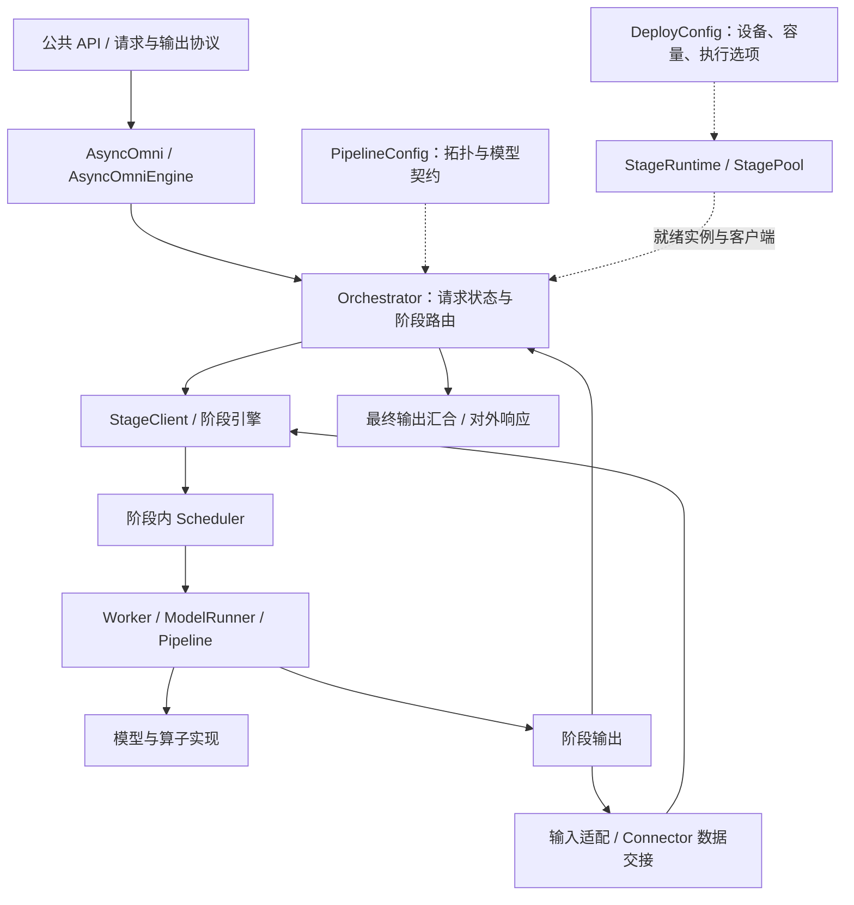
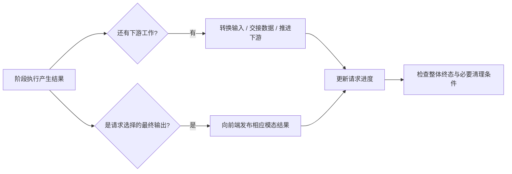

# vLLM-Omni 架构概览：从执行阶段到请求生命周期

**面向读者：** 已理解 SGLang/vLLM 的请求调度、KV cache、Worker 与 ModelRunner，希望进一步阅读和修改 vLLM-Omni 的开发者。本组教程的目标是：给定一个需求或异常，能够定位相关实现、解释改动会影响的约束，并设计最小验证。

**核心结论：** vLLM-Omni 将异构模型执行组织为阶段流水线。理解它，需要分别找到五种职责的负责人：**定义拓扑、推进请求、执行阶段内工作、交接数据、结束并回收状态**。阶段内仍然需要熟悉的模型执行能力；阶段之间则增加了输入就绪、结果路由和生命周期协调。[1][arch] [2][config]
## 1．先确定系统要协调什么

一次模型调用的最终产物可能是文本、语音、图像、视频或动作。生成这些结果的计算并不一定采用相同的推进方式：语言阶段逐 token 生成，codec 解码阶段将一段码转换成波形，diffusion pipeline 则围绕 latent 重复去噪。这些计算还可能依赖上一阶段输出的 hidden states、embedding、codec 或其他条件信息。[1][arch] [2][config]

因此，“支持某种模态”至少包含两个问题。第一个是模型如何计算这种模态；第二个是服务系统如何让相关计算及时获得输入、占用合适的资源，并将结果正确交给下一阶段或客户端。vLLM-Omni 的架构阅读重点是第二个问题与模型执行之间的接口。

以 Qwen3-Omni 为例，流水线定义了 Thinker、Talker 和 Code2Wav 三个执行阶段。Thinker 既产生最终文本，也为 Talker 提供条件；Talker 产生音频 codec；Code2Wav 将 codec 转为波形。文本和音频分别有自己的最终输出阶段，所以收到文本结束事件后，还需要判断音频阶段是否完成。[3][pipeline]

这提供了一个可检验的认识：**如果修改只在当前模型的 `forward()` 内看起来正确，还不足以证明它符合整条请求的输入、输出和结束契约。** 后文将沿真实接口说明这些契约如何被维护。

## 2．职责地图：先找到问题属于哪条边

下面按职责组织系统。图中的方框是阅读边界，实线表示主要推进关系，虚线表示部署与实例管理。



同一条阶段边可以同时需要控制信息和数据传输。编排器需要知道该请求应到哪里、是否结束；下游执行端需要收到真正的输入数据。传输方式决定数据怎样到达，输入契约决定到达什么程度才可执行。不能仅凭一条箭头推断所有 Tensor 都经过编排器复制。[4][orchestration] [5][connector]

| 职责    | 输入与输出                          | 首先查什么                                                    |
| ----- | ------------------------------ | -------------------------------------------------------- |
| 公共接入  | API 请求 → 内部输入；模型结果 → HTTP/流式输出 | 参数如何解释、请求哪些输出模态、错误与终态如何呈现                                |
| 模型拓扑  | 模型配置 → 有向阶段依赖与输出声明             | `PipelineConfig`、`StagePipelineConfig`、模型的 `pipeline.py` |
| 请求编排  | 新请求、阶段输出、取消事件 → 下游提交与最终输出      | `Orchestrator` 的请求状态、输入处理函数和完成条件                         |
| 实例管理  | 部署配置 → 可用阶段实例与客户端              | `StageRuntime`、`StagePool`、启动、亲和与退出                      |
| 阶段执行  | 本阶段可执行工作 → token、Tensor 或生成结果  | stage 的 scheduler、worker、runner/pipeline                 |
| 跨阶段交接 | 上游 payload → 下游可消费输入           | 输入适配、connector、异步队列和资源回收                                 |

这张表不要求读者记住全部类名。它用于提出下一步问题：例如“音频阶段没有执行”，应先判断没有被提交、正在等数据，还是已经执行但输出未被路由。三种情况对应不同负责人，也需要不同证据。

## 3．拓扑、部署和请求参数各决定什么

**模型拓扑描述合法的计算关系，部署配置描述如何承载它，请求参数描述这一次需要什么。** 三者最后共同形成执行配置，但不具有相同的修改自由度。[2][config]

`StagePipelineConfig` 是模型侧的冻结定义，包含 `execution_type`、`input_sources`、`final_output`、输入转换函数以及模型声明的能力。`DeployConfig` 则配置设备放置、实例与容量、connector、runner 等部署选项。合并过程不仅填默认值，还解析执行模式、选择适配函数并进行能力检查。因此，某个字段能出现在 YAML 中，不意味着任意取值组合都能被模型消费。

| 层面 | 代表性问题 | Qwen3-Omni 主例 |
| --- | --- | --- |
| 模型拓扑 | 后续阶段消费哪个上游？什么阶段可以产出最终结果？ | Thinker → Talker → Code2Wav；Thinker 输出文本、Code2Wav 输出音频 |
| 部署 | stage 放在哪里？使用哪种交接与执行方式？ | GPU0 承载 Thinker；GPU1 承载 Talker 和 Code2Wav；共享内存交接 |
| 本次请求 | 输入是什么？需要哪些公开输出？ | 文本提问，`modalities: ["text", "audio"]` |

实际默认部署还给不同 stage 设置独立容量与采样参数，并打开内部 `async_chunk`。这些是本例的确定配置，不能转写为所有模型的默认行为。[3][pipeline] [6][deploy]

本组教程会反复区分两个标识：**逻辑 stage ID** 用于表达流水线中的位置，**replica 身份** 用于定位实际承载请求的实例。阶段有多个实例时，更新、取消与清理必须能够找到正确实例；它们不能只凭“这是 stage 1”就完成定位。实例选择与生命周期在 [Runtime](vllm-omni-runtime.md) 展开。[7][stage-runtime]

## 4．三种执行类型：对接已有知识的位置

当前源码的 `StageExecutionType` 明确区分 `LLM_AR`、`LLM_GENERATION` 和 `DIFFUSION`。这些名称描述框架中的执行契约，而不是仅凭模型输出的模态分类。[2][config]

| 类型 | 本层需要解释的推进方式 | 本组中的入口 |
| --- | --- | --- |
| `LLM_AR` | 由 token 进度和 KV 状态驱动，Omni 为输入等待、多模态中间状态与输出增加适配 | Qwen3-Omni Thinker、Talker |
| `LLM_GENERATION` | 使用 generation scheduler/runner 承接生成任务，模型一次调用可以输出媒体 Tensor | Qwen3-Omni Code2Wav |
| `DIFFUSION` | 由 diffusion runtime 管理请求或逐步去噪，pipeline 持有具体生成算法 | Qwen-Image 文生图 |

Code2Wav 不逐 token 生成文本，但这不足以将它归为 diffusion。它在当前模型拓扑中的声明是 `LLM_GENERATION`。反过来，diffusion pipeline 内部可能同时包含文本编码、去噪和解码；这些模型内阶段是否对应独立 runtime stage，要查该模型具体拓扑。[2][config] [3][pipeline]

对已有 vLLM 背景的读者，最有用的迁移方式是保持阶段内与阶段间两种视角。阶段内继续追踪 batch、位置、KV、模型输入与执行输出；阶段间增加请求身份、输入完整性、数据到达与终态汇合。熟悉其中一层不能代替另一层的验证。

## 5．三个关系图不要混用

### 5.1 模型组件与执行阶段

模型结构告诉我们什么计算依赖什么计算；stage 定义还要指定调度和数据交接边界。一个 stage 可以包含多个模型内部组件，某个模型也可能提供多种流水线配置。阅读时，先找到选中的 `PipelineConfig`，再讨论该请求的真实 stage 数量。[2][config]

### 5.2 执行阶段与设备

主例的部署关系如下。它足以说明两个 stage 可以共享一个 GPU；同时，这个放置关系不代表它们共享 scheduler、KV 或请求状态。[6][deploy]

```text
逻辑流水线        stage 0              stage 1              stage 2
                  Thinker   ────────> Talker   ──────────> Code2Wav
执行类型          LLM_AR               LLM_AR               LLM_GENERATION
公开最终输出      text                                      audio
设备放置          GPU 0                └──────── GPU 1 ────────────┘
```

跨 stage 的放置与一个 stage 内的 TP/EP 等并行方式也属于不同维度。修改 `devices`、副本数或阶段内并行配置时，需要分别检查实例建立、请求亲和、模型执行和传输能力。本文不会由“模型支持 TP”推导任意混合部署均有效。

### 5.3 计算完成与请求完成

“某一轮 forward 返回”“某个 chunk 完成”“某个 stage 结束”“所有请求输出都结束”描述不同范围。正常结束、失败和取消还可能走不同的传播路径。全局请求状态需要将这些事件解释为正确的下一步行动；资源释放则要满足消费者已经不再使用资源的条件。[4][orchestration] [5][connector]



这是理解完成条件的职责图，不是源代码中一段原样控制流。具体事件和字段在 Runtime 的 Level 3–5 核对；共享内存为何不能在发送结束时立即释放，在 Connectors 的取消案例中核对。

## 6．阅读顺序与能力检查

| 文章                                                  | 读完应能解决的问题                                  | Level 4–5 的主要依据                             |
| --------------------------------------------------- | ------------------------------------------ | ------------------------------------------- |
| [Runtime：请求编排与生命周期](vllm-omni-runtime.md)           | 请求在哪一阶段、等什么、何时终止？修改终态如何影响前端？               | #7006：合成 abort 的最终阶段路由                      |
| [阶段内调度与执行](vllm-omni-stage-execution.md)            | Omni 怎样扩展已有 scheduler/runner？执行结果怎样归属当前请求？ | #8184：阶段级 runner 与多模态输出契约                   |
| [Connectors：交接与回收](vllm-omni-connectors.md)         | 数据何时完整、谁负责送达、取消后怎样安全释放？                    | #7544：混合 chunk/full-output；#8082：SHM 回收竞态   |
| [Diffusion Runtime](vllm-omni-diffusion-runtime.md) | step 如何成为调度单位？合批怎样隔离请求？是否真的更快？             | #5810：MiniMax-H3 continuous batching 的机制和边界 |
| [源码与证据索引](references.md)                            | 上述结论来自哪个版本，怎样继续查证？                         | 固定源码、历史 PR、测试和证据范围                          |

可以用以下任务检验架构理解，而不靠背诵类名：

1. 若 Thinker 已返回文本而客户端仍未结束，先列出仍可能未完成的职责，再选择日志或源码入口。
2. 若增加一个必须接收完整 waveform 的 stage，指出需要核对的拓扑、交接、输出累计和完成条件。
3. 若相同模型在并发提高后延迟恶化，区分阶段排队、数据交接、GPU 执行和结果汇合，提出能够区分它们的测量。

这些题目前还不需要给出全部修复代码。它们用于确定下一章要寻找的状态和约束；完整推演将在对应专题出现。

## 参考与范围边界

本教程覆盖普通 turn 请求的核心执行与跨阶段协作，并给 diffusion 独立路径。双工会话、全部硬件后端、每一种并行策略和具体 kernel 算法不在这里逐一展开；遇到这些分支，应沿相同接口检查其额外契约。某个 PR 的能力声明和实验结果仅适用于其写明的模型、配置与版本。

当前仓库部分设计文档仍标记 `draft`，也包含在研重构。下列文档用于定位职责，具体已实现行为以固定源码、选中配置和测试为准。

[arch]: https://github.com/vllm-project/vllm-omni/blob/5ca23106fd6a0f500deea818bc2b7089306a210f/docs/design/architecture_overview.md
[config]: https://github.com/vllm-project/vllm-omni/blob/5ca23106fd6a0f500deea818bc2b7089306a210f/vllm_omni/config/stage_config.py
[pipeline]: https://github.com/vllm-project/vllm-omni/blob/5ca23106fd6a0f500deea818bc2b7089306a210f/vllm_omni/model_executor/models/qwen3_omni/pipeline.py
[orchestration]: https://github.com/vllm-project/vllm-omni/blob/5ca23106fd6a0f500deea818bc2b7089306a210f/vllm_omni/engine/orchestrator.py
[connector]: https://github.com/vllm-project/vllm-omni/blob/5ca23106fd6a0f500deea818bc2b7089306a210f/vllm_omni/distributed/omni_connectors/transfer_adapter/chunk_transfer_adapter.py
[deploy]: https://github.com/vllm-project/vllm-omni/blob/5ca23106fd6a0f500deea818bc2b7089306a210f/vllm_omni/deploy/qwen3_omni_moe.yaml
[stage-runtime]: https://github.com/vllm-project/vllm-omni/blob/5ca23106fd6a0f500deea818bc2b7089306a210f/vllm_omni/engine/stage_runtime.py
[request-example]: https://github.com/vllm-project/vllm-omni/blob/5ca23106fd6a0f500deea818bc2b7089306a210f/examples/online_serving/qwen3_omni/run_curl_multimodal_generation.sh
