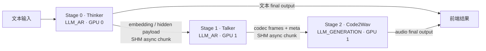
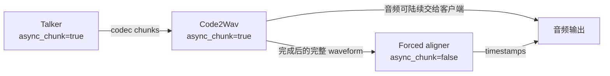

从一个 Talker codec chunk 追踪到 Code2Wav，说明阶段之间传什么、何时能消费，以及取消后谁负责收回共享内存。

<!-- more -->

# vLLM-Omni Connector：阶段契约、分块传输与资源生命周期

**面向读者：** 已熟悉 SGLang、vLLM 与 CUDA，想进一步定位 vLLM-Omni 跨阶段代码、推理修改影响并设计验证的读者。本文关注阶段边上的数据协议；请求生命周期见[运行时篇](vllm-omni-runtime.md)，模型执行见[阶段执行篇](vllm-omni-stage-execution.md)。

**核心结论：** Connector 把一份 payload 从生产者交给消费者，但可消费条件和资源回收条件由更高层的阶段契约决定。读懂一次传输，要同时追踪“谁产生什么”“哪次请求的第几块”“何时变为可运行”“谁还能访问这份数据”。内部按块执行、模型一次解码的分块以及客户端流式响应是不同层面的选择；并不存在让所有 stage 都流式化的通用目标。

**范围与版本：** 当前实现固定于公开提交 `5ca23106fd6a0f500deea818bc2b7089306a210f`，核对日期为 2026-10-05。主例使用 Qwen3-Omni 的 turn 模式、默认 `model_runner: v1` 及随仓库提供的 SHM 部署：Thinker、Talker、Code2Wav 三个 stage。本文追踪 scheduler 持有 chunk adapter 的 V1 路径；原生 MRv2 数据通道使用另一套就绪通知与 coordinator，不能直接套用相同对象关系。历史案例分别固定于 PR #7544 最终 head `216ba3636648dca9b61fb69a5cba9ede50c88c05`、PR #8082 最终 head `546e4e4f27aec4b66d9c083cf6b76059475b8242`。本文读取了源码、实际补丁、测试和审查记录，没有在本文环境启动模型、执行 GPU 测试或复测 PR 作者的结果；文中的时间线和帧计数是源码推演。[1]、[2]、[21]、[29]、[42]、[46]

**阅读路径：** L1 区分职责 → L2 建立对象和所有权 → L3 跟踪真实 chunk → L4 分析混合阶段契约 → L5 推演取消竞态与验证。

## 引入｜为什么“把 tensor 发过去”还不够？

设想 Talker 已经生成四帧 codec，Code2Wav 却仍停在等待队列。原因可能是 codec 尚未达到发送阈值，也可能是 receiver 使用了错误的 request ID，还可能是接收成功后没有发布 ready 状态。这三种情况都表现为“没有音频”，但分别属于模型适配、传输寻址和调度衔接。

再设想客户端断开后，调度器已经删除请求，SHM 段仍继续增加。删除请求对象只改变调度器的视图；后台 sender 可能正处在 `put()` 中，稍后仍会创建共享内存。如果把取消理解成同步地删除所有对象，就会错过真正需要建立的执行顺序。

五层学习的终点是一条能够复查的解释链：

| 层次 | 要能回答的问题 |
|---|---|
| L1 职责与概念 | 谁决定阶段连接，谁组装 payload，谁搬运字节？ |
| L2 对象与所有权 | 队列、身份、计数器、SHM 分别活多久，由谁回收？ |
| L3 动态数据流 | 一个 codec frame 如何进入 chunk，又如何成为 Code2Wav 输入？ |
| L4 执行机制 | 为什么流式上游可以接需要完整 waveform 的下游？ |
| L5 正确性与性能 | 取消和 ID 复用如何破坏时序，怎样稳定地测出来？ |

这些问题也适用于其他 pipeline，但本文的具体 key 格式、字段布局、阈值和清理实现只对所引用路径成立。

## Level 1｜职责边界：一条边包含三种工作

**本层结论：路由决定交给哪个 stage，适配决定下一阶段应当看到什么，传输决定这份数据怎样跨过进程边界。**三者相互配合，却不能用一个“通信层”概念替代。

### 1.1 路由、适配与传输分别知道什么？

Pipeline topology 描述 stage 的输入来源、执行类型与最终输出类型。主例中，stage 0 是 `LLM_AR` Thinker，stage 1 是 `LLM_AR` Talker，stage 2 是 `LLM_GENERATION` Code2Wav。Thinker 的 text 和 Code2Wav 的 audio 都是 final output；Talker 只提供中间结果。这里的 Code2Wav 属于 LLM generation 执行路径，不能因为它生成音频就归入 diffusion runtime。[1]

Orchestrator 管理请求应推进到哪里，以及一个 stage 输出应交给前端还是继续转发。配置解析再根据该阶段的 async 模式，选择相应的输入处理函数和下一阶段 payload 处理函数。例如 Talker 的 `talker2code2wav_async_chunk` 知道如何积累 codec frame；SHM connector 并不知道“25 帧”是什么意思。[3]、[4]

| 责任 | 主例中的对象或代码 | 需要维护的约束 |
|---|---|---|
| 阶段路由 | PipelineConfig、Orchestrator | 请求目标、前驱关系、最终输出是否齐全 |
| 模型适配 | `talker2code2wav_async_chunk` | codec 布局、有效帧、上下文和结束语义 |
| 异步传输编排 | `OmniChunkTransferAdapter` | 排队、chunk 编号、ready 发布、取消与复用 |
| 字节传输 | `SharedMemoryConnector` | key 对应的 bytes、锁、消费与 unlink |
| 客户端输出 | OpenAI serving 层 | 音频编码、响应协议、每段样本是否重复 |

表中的边界有利于定位修改。调整 chunk 帧数首先触及模型适配与 Code2Wav 的窗口；更换 SHM 后端首先触及可见性和生命周期。两种修改都可能影响端到端延迟，却不是在同一层修改“通信性能”。[4]、[5]、[6]

### 1.2 完整交接与内部 chunk 的区别在哪里？

完整交接要求上游先产出满足下游条件的一份完整结果，再提交或唤醒下游。内部 async chunk 允许上游还在生成时，就把可消费的部分送到已注册的下游请求中。在当前 orchestrator 中，是否提前提交下游由 `stage_receives_chunks` 决定；不接收 chunk 的阶段通过结束后的转发路径取得真实输入。[3]、[7]、[37]

“完整”是相对于下一阶段的输入契约而言。一个完整的 Talker 输出可以是一整段 codec；对 forced aligner 来说，需要的则是完整 waveform 与文本。完整交接仍然可以通过 connector 搬运大 payload，也可以在消费者内部再次分块计算，所以它不是“完全没有 chunk”的同义词。

`async_chunk` 描述阶段间增量交接；`async_scheduling` 是阶段内 scheduler 的同步／异步调度配置，实际作用取决于执行类型。当前解析器用它选择 AR 的同步或异步 scheduler，`LLM_GENERATION` 则固定选择 `OmniGenerationScheduler`。因此主例 Code2Wav 的 `async_chunk: true` 与 `async_scheduling: false` 并不矛盾，后者也不是 CUDA 异步执行开关。[2]、[45]

### 1.3 三种容易混淆的“流式”

| 机制 | 分块边界由谁决定 | 消费者 |
|---|---|---|
| 阶段间 codec chunk | Talker 的 stage-input processor | Code2Wav 请求 |
| Code2Wav 内部分块解码 | Code2Wav 解码实现 | 同一模型内部计算 |
| HTTP / WebSocket 流式响应 | serving 层与协议 | 外部客户端 |

当前 `generate_audio()` 在 `async_chunk=True` 时调用 `chunked_decode_streaming()`；关闭它后仍会调用 `chunked_decode(chunk_size=300, left_context_size=25)`。后一种内部计算分块用于控制解码工作集，不意味着上游边仍逐块输送。[8]

仓库的 curl 主例也提供了一个直接反例：请求正文未设置 `stream: true`，部署却启用了内部 async chunk。因此服务器可以在内部重叠 Thinker、Talker 和 Code2Wav，最后向客户端返回普通完整响应。外部不流式，并不证明 stage 之间在串行等待整段结果。[2]、[9]

### 1.4 主例的物理部署与逻辑路径



这张图只描绘本例：Thinker 放在 GPU 0，Talker 与 Code2Wav 放在 GPU 1。后两者同处一个 GPU，并不意味着共享 Python 对象，也不意味着 codec 自动走 GPU peer copy。该 SHM 实现先序列化对象，其 tensor 编码会 `detach().cpu()`，再写入 POSIX 共享内存；选择 SHM 是进程间传输选择。[2]、[5]、[10]

**本层自检：** 能否说明“内部流式但 HTTP 非流式”“同 GPU 但仍需 SHM”“生成音频但不是 diffusion”各自由哪条代码事实支持？

## Level 2｜对象、状态与资源：同一个 request 有几种身份？

**本层结论：身份决定状态归属，所有权决定清理权限，执行顺序决定清理何时安全。**只看一份 payload 的内容，无法判断晚到的数据还能不能提交。

### 2.1 Connector 对象与 transfer adapter 的边界

`OmniConnectorBase.put(from_stage, to_stage, put_key, data)` 返回成功状态、序列化大小及可选传输 metadata。`get()` 返回对象和字节数，或表示当前未获得数据的 `None`。同一个接口可以由不同传输后端实现；接口本身并未承诺 tensor 零拷贝或全局请求完成。[6]

`OmniChunkTransferAdapter` 在 connector 之上持有请求级状态。构造时创建 sender/receiver 状态锁、注册表及 connector，然后启动基类的后台收发线程。`load_async()` 把接收注册放入待轮询队列，`save_async()` 把待处理输出和请求快照放入待发送队列；它们的名字并不意味着调用时已经完成传输。[11]、[12]

```text
阶段调度器
  │ save_async(output, request)          │ load_async(request)
  ▼                                      ▼
_pending_save_reqs                   _pending_load_reqs
  │ save thread                          │ recv thread
  ▼                                      ▼
模型 processor → connector.put       connector.get → 校验注册身份
  │                                      │
SHM bytes + lock                      写入请求输入 + ready 标记
                                         │
                                         ▼
                                    阶段调度器继续执行
```

待发送队列里存的是工作项，SHM 中存的是经过适配与序列化的数据。待接收队列里存的是 `_LoadEntry` 注册对象，不是所有 chunk 的副本。这种区别解释了为什么“队列已经清空”既不等于“下游已经计算”，也不等于“SHM 已被消费”。[11]、[12]

### 2.2 request ID、external ID 与 chunk ID

在发送侧，`put_req_chunk` 按 `external_req_id` 记录下一个发送序号。在接收侧，`get_req_chunk` 按当前阶段的内部 `request_id` 记录期望序号。`request_ids_mapping` 连接这两种命名空间；发送失败则按 scheduler 使用的内部 ID 报告。[11]、[13]

主例 Talker 向 Code2Wav 发送第 k 块时，实际 key 为：

```text
external_req_id = R
source stage_id = 1
chunk_id = k
put_key = R_1_k

Code2Wav stage_id = 2
target_stage_id = 2 - 1 = 1
get_key = R_1_k
```

这里最后的整数是传输序号，不是 codec token ID，也不是 HTTP 响应段编号。key 中间保存源 stage，接收方按 `stage_id - 1` 构造相同名字；这是本文走读的相邻 stage adapter 路径，不能推广为任意 DAG 的寻址规则。[13]、[14]

`_SenderGeneration` 进一步区分同一 external ID 的不同发送生命周期。它是 adapter 本地的身份 token，保存 `in_flight`、`cancelled`、`terminal_pending`、`num_puts` 和 `terminal_sent` 等状态。它没有被附加到上述 SHM key；旧 generation 与新 generation 的隔离依赖身份检查和队列顺序，L5 会推演这一点。[15]、[38]

### 2.3 Payload metadata 与传输 metadata 是两套信息

主例 payload 使用 `OmniPayloadStruct`，其中的 `codes.audio` 保存 codec，`meta.left_context_size` 保存上下文帧数。`meta.finished` 说明流的终止语义，`meta.is_segment_finished` 则用于可恢复分段边界。这些字段属于模型与运行时共同遵守的消费协议。[16]、[13]

Connector 的返回值 `metadata={"shm": {"name": ..., "size": ...}, "size": ...}` 则描述字节在哪里以及有多大。SHM 可通过这个 handle 读取，也可直接按 key 查找；在本文 chunk 接收路径里，接收方能够由 request 和 chunk 序号重新构造 key。不能把 `left_context_size` 放进传输 handle 后就期待模型自动看见它。[5]、[14]

还有一处容易漏掉的边界：发送侧 processor 构造的是 struct，通用 msgpack 解码后接收侧得到的是 dict。所以发送代码访问 `payload_data.meta.finished`，接收代码访问 `payload_data["meta"]["finished"]`。扩展 schema 时必须检查两端，而不能只给 dataclass/struct 加一个字段。[13]、[16]

### 2.4 SHM 的正常所有权转移

写入侧在锁文件的排他锁保护下创建并填充 SHM，然后关闭自己的 handle。读入侧尝试取得锁，复制出 bytes，关闭并 unlink SHM，最后反序列化。`close()` 只关闭本进程句柄，`unlink()` 才移除命名对象；这是不同资源动作。[5]、[17]

| 资源 | 创建与持有 | 正常释放条件 |
|---|---|---|
| SHM 段 | sender 按精确 chunk key 创建 | receiver 读取 bytes 后 unlink |
| 锁文件 | sender 写入前创建 | receiver 消费后删除 |
| sender `_pending_keys` | sender 本地记录已写 key | 本地消费或发现远端已 unlink 后移除 |
| 接收注册 `_LoadEntry` | receiver adapter 注册 | 当前 chunk 提交成功或请求清理 |
| 请求缓存与计数器 | adapter 按各自身份维护 | 对应 generation / 请求退役 |

receiver 在另一进程消费时，不能直接修改 sender 的 Python `_pending_keys`。因此“/dev/shm 中对象已经没了”和“sender 还记着这个 key”可以同时成立。当前 connector 用有界轮转扫描发现这些已消费项；这是一种 bookkeeping 回收，并不重新消费 payload。[5]、[18]

如果反序列化失败，bytes 已经读走且 SHM 已被 unlink，锁文件也应该删除。当前代码用 `consumed` 判断资源是否消耗，而不是用“对象是否反序列化成功”判断；这正是 #8082 修复的一部分。[5]、[29]

### 2.5 Ready、上游结束与本阶段结束不能合并

接收一块数据成功后，adapter 设置 ready，使 scheduler 有机会执行当前 chunk。收到 `meta.finished` 时，再把请求记入 `upstream_exhausted_requests`。但“上游再也不发数据”仍不等于“本阶段对已有输入的计算已经结束”。[14]

同理，sender 正常发送 terminal payload 后，可以释放自己的请求缓存，却不能立即 unlink 下游尚未读到的 terminal。取消则走另一条资源路径：没有消费者会负责消费的 chunk 必须由发送方回收。这两条路径共享清理入口，但清理条件不同；把它们统一成“请求结束就删全部 SHM”会引入新的挂起。[15]、[19]

**本层自检：** 若 `R_1_3` 仍存在，应先问它是否未消费、sender 是否仍在写、terminal 是否仍被下游需要，而不是只检查 orchestrator 是否还有 R。

## Level 3｜真实数据流：从四帧 codec 到一段音频

**本层结论：一个 chunk 不是被动切片，它包含模型挑选的有效新帧、重复上下文和运行时结束语义。**下面沿固定源码追踪一个实际请求形态，数值只用于手算，不伪造运行日志。

### 3.1 从仓库提供的请求开始

仓库脚本 `run_curl_multimodal_generation.sh` 支持 `text` 输入和单独的输出 modalities 参数。选择 `text '["text","audio"]'`，正文会包含 Qwen3-Omni 模型名、system/user messages 及三个 stage 的 sampling params。用户文本是要求模型用 15 个词解释可扩展音频生成架构；请求发向 `/v1/chat/completions`。[9]

```bash
bash examples/online_serving/qwen3_omni/run_curl_multimodal_generation.sh \
  text '["text","audio"]'
```

这是仓库相对目录下的调用示意；服务需要事先按对应模型与部署配置启动。脚本只把响应中的 text 打印出来，注释明确没有打印大段音频内容。因此不能由脚本终端只显示文本，判断 audio stage 没有执行。[9]

这个请求会需要 Thinker 的文本 final output 和 Code2Wav 的音频 final output。在 async chunk 路径中，orchestrator 预先提交接收 chunk 的下游请求，以 placeholder prompt 建立可管理的请求对象。这些零 token placeholder 是执行协调用的占位，并不是应该直接拿去合成的真实 codec。[1]、[7]

### 3.2 Thinker 先把 Talker 的条件准备出来

Thinker→Talker 的第一块不仅是一个文本 token。`thinker2talker_async_chunk` 从捕获的 hidden layers 中取得 embedding 与被接受的 hidden state，构造 `embed.prefill`、`hidden_states.output`、`ids.all`、`ids.prompt`，并携带 TTS BOS/EOS/PAD embedding 等条件。如果首块还只有原 prompt，没有满足 Talker 输入要求的首个生成位置，它会缓存并暂缓交接；后续 decode 块主要携带 `embed.decode`。[20]

这一边解释了为什么 Talker 的输入不是“把 Thinker 最后打印出的字符串再 tokenize”。它消费的是模型约定的条件表示，而文本 final output 仍可独立交给用户。本节不重述 Talker 投影与 MTP 的计算细节，相关执行边界见[阶段执行篇](vllm-omni-stage-execution.md)。

### 3.3 Talker 输出中的 codec 从哪里来？

在 `qwen3_omni.py` 的 Talker 输出包装分支，代码从各请求的 `model_intermediate_buffer` 中取 `codes.audio`，合并后放入 `OmniOutput.multimodal_outputs`。普通路径是一行 codec frame 携带多个 codebook 的离散索引。MRv2 eager 路径还会明确提供 `meta.codec_frame_valid`；processor 必须遵守对应的有效性约定。[8]

AR scheduler 获得本次 `inter_stage_output` 后调用 `chunk_transfer_adapter.save_async()`。后台 save thread 才执行 `talker2code2wav_async_chunk`；所以“模型 step 完成”“排入发送队列”“实际 put 一块”是三个事件。某个 step 可以只积累一帧，尚不产生任何 connector put。[13]、[30]

### 3.4 四帧怎样成为第零块？

固定部署给出：

```yaml
initial_codec_chunk_frames: 4
codec_chunk_frames: 25
codec_left_context_frames: 25
```

processor 先读取 `codes.audio`。有显式 `codec_frame_valid` 时，以对应帧的有效性为准；普通路径跳过全零 prefill 占位，并排除第一 codebook 等于 stop token 的 post-EOS 帧。有效帧被追加到 `code_prompt_token_ids[external_req_id]`。[2]、[4]

假设请求 R 的普通路径连续得到四个有效帧，每帧 shape 为 `[1,Q]`，Q 是模型 codebook 数。前三次调用只积累，第四次满足首块阈值。processor 将四帧拼成 `[4,Q]`，转置成 `[Q,4]`，再 flatten 成长度 `4Q` 的一维 tensor。[4]

```text
模型输出（token-major）       传输排列（codebook-major）
frame 0: [c00,c01,...]        [c00,c10,c20,c30,
frame 1: [c10,c11,...]         c01,c11,c21,c31,
frame 2: [c20,c21,...]         ...]
frame 3: [c30,c31,...]
```

这个转置不能省略。接收侧随后按 `[Q,T]` reshape；若发送端直接 flatten `[T,Q]`，tensor 长度仍合法，语义却已错位。这类错误通常不会以 transport exception 形式暴露，而会进入音频质量问题。[4]、[8]

首块的主要内容是 `codes.audio=flattened_codes`、`meta.left_context_size=0`、`meta.finished=False`。`meta.first_audio` 来自模型上游标记并受 `chunk_id==0` 限定；它不是所有首块必然为 True 的通用字段。adapter 还会补齐 scheduler 视角的 finished 和 segment-finished 标记。[4]、[13]

### 3.5 后续 25 帧为什么要带旧数据？

沿默认无 ramp 路径，发送顺序可手算为：

| chunk | 有效新帧 | 带入的左上下文 | 传输帧数 | 累计新帧 |
|---:|---:|---:|---:|---:|
| 0 | 4 | 0 | 4 | 4 |
| 1 | 25 | 4 | 29 | 29 |
| 2 | 25 | 25 | 50 | 54 |
| 3 | 25 | 25 | 50 | 79 |

第二块只能重发已有的四帧；从后面的稳态块起，最多重发 25 帧。这不是网络层重复投递，而是 Code2Wav 解码窗口需要的重叠上下文。当前源码另支持显式配置 chunk ramp，但本例 YAML 未启用，不能把它描述成所有请求自动使用的动态策略。[2]、[4]

若请求结束时只多出 r 个有效帧，processor 会 flush 尾部。若恰好在边界结束且没有新有效帧，processor 可以返回 `None`；adapter 仍会构造没有 codec 的结束 payload。因此“没有新音频数据”不能成为丢弃 terminal 的理由，否则下游只看到暂时无数据，无法知道已经结束。[4]、[13]

### 3.6 从发送队列到共享内存

对第一块，sender 使用 `R_1_0` 调用 `put(from_stage="1", to_stage="2", ...)`。processor 此时已决定布局与 meta；connector 只负责序列化并写入 bytes。写入受对应锁文件保护，成功后返回 size/handle，并记录 sender 的 `_pending_keys`。[5]、[13]

当前源码还包含 SHM arrival wakeup：put 向目标 stage 的 receiver FIFO 发出提示。提示本身不携带模型 payload，也不能替代读取 key 的正确性检查；FIFO 不可用时实现仍保留轮询回退。这一机制已经存在于固定源码，但不属于后面分析的 #8082 补丁。[5]

接收 adapter 的 `_poll_single_request()` 取出 Code2Wav 的 `_LoadEntry`。在锁内确认它仍是有效注册后，取得 external ID 与期望 chunk 号，再在锁外执行 `connector.get()`。读取返回后重新检查注册对象身份，只有当前注册才能提交数据。[14]

### 3.7 收到 codec 后，怎样真正成为模型输入？

在 generation 分支，接收 adapter 取 `payload_data["codes"]["audio"]`。本例是一维 tensor，于是转成 token ID 列表并赋给 `request.prompt_token_ids`。其余 meta 合入 `request.additional_information`，其中 `finished` 被用于控制上游耗尽状态，而不是当作普通模型 metadata 继续累加。然后重置该 chunk 的计算计数，将内部请求 ID 加入 `_finished_load_reqs`。[14]

Code2Wav 的 `schedule()` 先经 `_process_pending_omni_inputs()` 调用 adapter 的 `process_pending_chunks()`：已在 `WAITING_FOR_CHUNK` 且出现在 `_finished_load_reqs` 的请求恢复为 `WAITING`／`RUNNING`，转入 `requests_with_ready_chunks`；尚无输入者暂时移出本轮候选队列。scheduler 随后选择工作，输出后处理清掉已选中请求的 ready 标记；`restore_queues()` 再把暂时停放且仍存活的请求放回，留待下一轮检查。恢复队列不等于给未到输入的请求授予 ready。[43]、[44]

这也是模型输入布局必须追到消费者的原因：此处一维 audio codec 走 prompt IDs，不是永远作为 `codes.audio` tensor 挂在 sidecar。如果某模型改用二维 codec tensor，接收代码另有保留 tensor 与占位 prompt 的分支；不能只凭相同字段名认定数据路径相同。[14]

Code2Wav forward 根据 `num_quantizers` 和各请求的 `seq_token_counts`，把 token IDs 恢复为 `[batch,Q,T]`。它从 `runtime_additional_information` 取出各请求的 `meta.left_context_size`，再调用流式解码。waveform 返回时与 sample rate 包装成输出，继续沿 generation runtime 和 orchestrator 回到前端。[8]

### 3.8 重叠窗口怎样避免重复播放？

当前 `chunked_decode_streaming()` 解码包含左上下文的窗口，再裁剪有效输出。下面 `window_frames` 是本次 decode 分组的输入窗口宽度；`request_frames` 是当前请求由 `seq_token_counts / num_quantizers` 得到的实际帧数，包含左上下文、不含该请求为合批补齐的帧，不能替换成“有效新帧数”。结合解码器右侧暂留的 tail，计算：[31]

```text
tail  = max(0, window_frames * total_upsample - decoded_samples)
start = max(0, left_context_frames * total_upsample - tail)
end   = max(0, request_frames * total_upsample - tail)
emit  = decoded_waveform[start:end]
```

这个 tail 修正用前一块重新解码的上下文补上边界，不能粗暴简化成“固定丢掉左边 25 帧对应的所有 samples”。传输上重发 codec 与客户端重复播放 waveform 是两回事：前者提供模型上下文，后者必须由正确裁剪避免。[31]

**本层自检：** 给定累计 29 帧，应能指出 `R_1_1` 的帧数、layout、left context，以及接收后哪些字段进入 prompt、哪些字段进入 runtime metadata。

## Level 4｜PR #7544：一条 pipeline 为什么允许混合交接契约？

**本层结论：让对齐器等待完整 waveform，是保留其正确输入语义；上游 Talker→Code2Wav 仍可继续按块运行。**这个案例换用 Qwen3-TTS，不是给前面的 Qwen3-Omni 主例悄悄增加第四个 stage。

### 4.1 原始故障不是“音频传得慢”

PR #7544 于 2026-09-16 合并，修复 Qwen3-TTS 开启 async chunk 并注入 forced aligner 时，`word_timestamps=true` 请求可能挂起的问题。原有 aligner 继承 pipeline-wide async 标志，被 orchestrator 提前提交成 placeholder。scheduler 因而把它当成 chunk consumer，等待一条本来就不存在的输入流。[21]

实际 `code2wav2aligner` 的契约是：只处理 `src.finished` 的输出，抽取完整 waveform 与 sample rate，结合原文本构造 aligner 的文本 prompt 和 multimodal audio。它还记录真实音频时长用于后续时间戳处理。因此，让它等待 connector chunk 与它的 processor 完全不匹配；多等一会或调大 timeout 都不会补出这条输入。[22]



### 4.2 修复把模式解析统一到阶段层

最终补丁引入 `StageDeployConfig.async_chunk: bool | None`。`False` 明确退出全局 async chunk；`None` 继承，`True` 也不能突破全局关闭。核心解析相当于 `pipeline_async and stage_async is not False`。[23]

| pipeline async | stage async | 解析结果 |
|---|---|---|
| False | None / False / True | False |
| True | None / True | True |
| True | False | False |

同一个 `resolve_stage_async_chunk` 同时用于结构化配置、legacy engine args 以及 processor 选择。这一点比单独增加布尔字段更重要：否则 scheduler 可能认为自己收 chunk，实际 processor 却按完整输入组织。当前固定源码在相同语义外还增加了 bool 类型校验；那是当前状态，不应回填成 #7544 最初补丁内容。[3]、[23]

注入 forced aligner 时，部署显式设置 `async_chunk=False`，同时维持 pooling stage 所需的非 async scheduling。共享判断 `stage_receives_chunks` 增加对解析后 async 标志的检查。这样 prewarm 会跳过 aligner，Code2Wav finished 后由正常转发调用 `code2wav2aligner`。[7]、[22]、[24]、[39]

### 4.3 为什么不能任意关闭某一端？

补丁也引入 `validate_stage_async_chunk_edges`。对于声明了 async producer processor 的边，producer 和 consumer 的解析模式必须一致；否则启动时直接报错。Talker→Code2Wav 属于这种边，只关闭其中一端会破坏协议。[23]

Code2Wav→aligner 的情况不同：Code2Wav 没有声明用于下一阶段的 async chunk producer，该边本来就是完整 waveform 交接。validator 因而不要求它与 aligner 同模式。“混合模式合法”不是允许在任意边上随意组合 True/False，而是让每条边有明确、可验证的输入契约。[21]、[23]

另一处修复是全局运行时判断。引入 stage opt-out 后，不能再从 stage 0 的值推断整条 pipeline 是否包含 async chunk。最终代码采用 `any(resolved_stage.async_chunk)`；例如 `[False,True,True]` 仍要启用下游 chunk 相关编排。[25]

### 4.4 人工审查继续发现：不挂起仍可能算错

第一次人工 review 在 `701706f6` 请求修改。审查认可阶段 opt-out 的主要路径，但指出两个问题：stage 0 会错误关闭下游 chunking，以及流式时间戳请求只把最后一个 DELTA 音频块交给 aligner。后者已经不再挂起，却会在错误时间范围上生成时间戳。[26]

这揭示另一个边界：内部 stage 输入契约与向调用者输出的累计策略相互影响。如果 output processor 每次以 `DELTA` 排空早先音频，terminal 输出只有尾块；“terminal 已到”不保证“terminal 携带完整音频”。修复必须保留上游历史音频，而不只是延迟 aligner 调用。[26]、[27]

最终补丁对需要时间戳的流式请求 clone sampling params，再设为 `RequestOutputKind.CUMULATIVE`。clone 避免把这个请求的特殊需求写入共享默认参数。普通无时间戳流式请求仍使用原先的 DELTA 语义。[27]

### 4.5 内部累计，客户端只发送新尾部

假设 Code2Wav 依次产生 800、1200、400 个新 samples。内部累计输出应是 800、2000、2400 samples；最终 aligner 收到全部 2400。但若 serving 层把每个累计 tensor 原样发出去，客户端将收到 800+2000+2400=5200 samples，出现重复播放。[28]

最终修复用 `emitted_samples` 记录已发长度：对累计 tensor 先取 `audio[..., emitted_samples:]`，更新计数，再进行 resampling 等输出处理。若这次输出长度未增长，则跳过空尾部。list 模式已有按 `prev_count` 选新 chunk 的逻辑，两种表示都需保持“每个样本只发一次”。[27]

这里不要混淆 L3 的左上下文裁剪。Code2Wav 裁剪消除模型窗口的重叠；serving 层裁剪消除累计输出的重复前缀。一个处理 codec 解码上下文，一个处理 API 输出策略；缺少任意一层都可能让用户听到重复内容。

### 4.6 测试怎样钉住这个契约？

`test_cumulative_audio_terminal_output_supplies_full_aligner_waveform` 用三段常数音频明确区分 800、1200、400 个样本。它先确认未 finished 的输出不生成 aligner 输入，再确认最终波形长度为 2400，三段值及边界正确，24 kHz 下总时长为 100 ms。这比只断言“有时间戳”更能排除“只对最后一块对齐”的错误。[28]

配置测试覆盖 pipeline/stage 模式组合、legacy/structured 一致性和非法边。orchestrator 测试确认 aligner 不被预提交，只在音频完成后进入，而且请求要等音频和 timestamps 两个 final output 都完成才 cleanup。serving 测试检查累计音频只发送一次，WebSocket E2E 检查最终词时间戳覆盖整段语音。[21]、[28]、[40]、[41]

最终人工 review 在 `216ba363` 转为 APPROVED。作者在后续评论报告 1,145 个 CPU 测试通过、3 个完整模型 GPU 测试通过；审查者明确注明自己的判断来自静态阅读，没有执行 PR 代码。这些是历史记录，既不是本文运行结果，也不能直接证明所有模型、设备或响应协议都兼容。[26]

当前固定源码还收紧了 API 边界：HTTP `/v1/audio/speech` 的 streaming 加 word timestamps 会返回错误并指向 WebSocket `/v1/audio/speech/stream`。因此读这段历史时，应把内部累计修复与当前允许的外部接口分别核对，不能从 PR 讨论推断当前任意流式 endpoint 都支持时间戳。[32]

**本层自检：** 如果新增一个句末评分器，能否分别说明其输入何时完整、是否接收 chunk、上游应保留什么历史，以及请求最终完成要等哪些输出？

## Level 5｜PR #8082：取消不是一次同步删除

**本层结论：取消正确性必须同时覆盖后台写入、旧任务提交、ID 复用和未消费资源。**修复的关键是建立先后关系，并用可控制的交错测试证明这些关系。

### 5.1 先界定 PR 实际修了什么

PR #8082 于 2026-09-24 合并，最终 head 为 `546e4e4f`。补丁处理的是已有 abort fence 之后仍留下的 SHM、锁文件和 producer bookkeeping，以及 receiver 取消 tombstone 的累积。它没有从零引入所有 generation/fence 机制，也没有宣称解决同一 issue 中的任意内存泄漏。[29]

在此前路径中，即使取消已阻止新 chunk 入队，仍可能存在已经开始但尚未返回的 `put()`。删除 adapter 字典不能撤销这次写入。若清理先 unlink，旧 `put()` 后创建 SHM，就得到请求消失后才出现的孤儿段。

### 5.2 一次取消与 external ID 复用的时序

设旧请求内部 ID 为 `old`，external ID 为 R，正在发送 `R_1_0`。后续新请求内部 ID 为 `new`，也想使用 R。以下顺序由历史补丁以及当前 sender 实现共同约束：[15]、[19]、[33]

| 时刻 | save thread | scheduler / 新请求 | 需要保证的条件 |
|---|---|---|---|
| t0 | 旧 generation 开始 put | — | key 属于旧 token |
| t1 | put 尚未返回 | abort old | 只标记 cancelled，不等待 I/O |
| t2 | 仍在 put | 尝试复用 R | 旧 token 仍 draining 时拒绝混入 |
| t3 | put 返回，进入 finally | — | 登记旧 generation 应清理的精确范围 |
| t4 | 执行 cleanup 工作项 | 新 generation 可排入其后 | 先清旧 key，再写新 key |
| t5 | 写入新 `R_1_0` | — | 旧清理不能追上并删除它 |

这里的“拒绝混入”不是静默接纳并延迟新请求。当前 `save_async` 发现同 ID token 仍 cancelled，会记录 send failure；安全复用应发生在旧 generation 已退役之后。测试证明的队列顺序与服务层是否允许用户主动复用 ID，是两个层面的问题。[12]、[15]

为何仅靠 generation identity 还不够？它能阻止晚到 put 的完成回调修改新请求状态，却不能自动删除已经创建的命名 SHM。反过来，仅靠 unlink 也不够，因为新 generation 可能重用同一个 key。需要同时保存“这是哪个 token 的完成”和“清理必须在什么队列位置发生”。[15]、[33]

### 5.3 精确 key 范围怎样记录？

补丁增加 `num_puts`，在调用 connector 之前记录当前可能创建的 key 上界。即便 connector 在创建段之后抛异常，或取消在 put 返回之前获胜，这个在途 key 也被纳入清理范围。若只在成功返回后才计数，恰好会漏掉最需要清理的失败交错。[13]、[33]

取消的 generation 退役时，adapter 将下面的任务追加到原 save queue：

```text
cleanup_shm = (external_id + "_" + source_stage, num_puts)

save thread:
    for chunk_id in range(num_puts):
        connector.cleanup(prefix + "_" + str(chunk_id))
```

这不是另启一个清理线程，也不是让 scheduler 扫描 /dev/shm。同一 save thread 保证旧 put 已结束，cleanup 与后续 put 又按同一队列排序。短锁只保护 token 与队列状态，耗时的 connector I/O 不在 scheduler 持有的锁内执行。[19]、[33]

### 5.4 为什么不用 request ID 前缀删除？

若 R 为 `task`，另一个合法 external ID 可以是 `task_1_2`。简单的 `startswith("task_")` 会把后者的 chunk 误判成前者资源。
#8082 将 SHM `cleanup()` 改成精确 key 删除，adapter 负责枚举自己确实可能创建的 key。[29]、[34]

这体现的是所有权分工：connector 只认识被要求删除的 key，adapter 才知道一个 generation 对应哪些 chunk。测试专门写入相似 ID 的 sibling key，取消一个请求后仍读取 sibling。只验证“被取消的 key 不存在”，而不验证“相似请求仍存在”，无法发现过度清理。[34]、[35]

### 5.5 正常 terminal 为什么要保留？

成功发出的 terminal 是下游知道输入已结束的必要证据。补丁新增 `terminal_sent`，只有 `success and is_finished` 才置 True；这种情况下 adapter 清理自己的状态，但不排入取消用的 SHM 删除。若 terminal put 失败，即使 backend 实际曾创建过段，也不能假定消费者会完成正常接收，仍要回收。[13]、[33]

terminal 尚在队列里时，`terminal_pending` fence 还要保住这次发送。`cleanup_sender` 记录 deferred cleanup，而最终任务在成功、返回失败或抛异常的所有出口释放 fence。这是此前已有机制与本次资源回收共同工作的地方，不能把“cancelled”简单解释成所有待发项无条件丢弃。[15]、[19]

当前固定源码比 #8082 多了一条最终兜底：当 orchestrator 确认各阶段都不再需要请求时，`release_shm_resources` 可回收 producer 成功发送但 consumer 提前停止后未读的段。它通过 `cleanup_prefix` 只匹配已跟踪 key 且剩余后缀为整数 chunk ID 的项。这与取消时枚举 generation 精确范围是不同入口，不能把当前所有成功结束回收行为归给 #8082。[18]、[19]、[36]

### 5.6 Receiver 为什么用注册对象身份？

旧 receiver work 也可能晚到。`_LoadEntry` 被放入队列后，请求可能取消、清理，甚至同一个内部 request ID 又被注册。如果只检查 ID 是否存在，旧 get 的返回可能写进新请求的 prompt 和 ready 状态。[14]

当前接收逻辑在 get 前后都检查：

```python
registered_load_entries.get(req_id) is entry
```

cleanup 删除注册；重注册产生新 entry，旧对象自然失去提交资格。request-ID mapping 的发布也挪入同一受保护路径，避免一个旧队列项在 cleanup 后重新创建映射。由此不需要永久积累“曾取消过哪些 ID”的 tombstone 集合。[14]、[33]

注意 get 仍在状态锁外执行。取消可以迅速返回，晚到数据即使被 connector 读走，也不会重新恢复已经删除的模型输入。这是接收提交屏障；它保证状态不复活，不代表能够撤销所有底层 I/O。

### 5.7 Producer 的 bookkeeping 为什么还要轮转回收？

另一个进程消费 SHM 后，producer 的 `_pending_keys` 仍可能包含旧 key。补丁将它组织为 `OrderedDict`，每次 `reap_consumed()` 最多检查 64 项。还存在的段放回尾部，已不存在的段不再保留；save loop 即使没有新发送，也会调用回收。[18]、[34]

只总是检查前 64 项会饿死尾部：若队头都是未消费段，后面已经消费的 key 永远到不了扫描窗口。轮转让每一项最终被看见，同时限制单次扫描成本。但“每轮最多 64”不等于“整个 pending 集合最多 64”；若下游持续跟不上，真实未消费的数据仍会积累，需要另外分析 admission 与背压。[18]

### 5.8 用 Event 固定竞态，而不是碰运气

`test_shm_abort_reclaims_inflight_put_without_blocking` 包装真实 connector.put。sender 先设置 `put_started`，再等待 `release_put`；测试线程等到 put 确实进入后才触发 abort。随后断言 sender 仍活着，证明 abort 没有等 connector I/O；释放 put 后排空清理任务，确认 SHM、pending keys 和 sender 状态都被收回。[35]

这种测试控制的是发生关系：`put started < abort returned < put released < cleanup completed`。若仅 sleep 一段时间再 abort，机器负载改变就可能让取消发生在 put 之前，测试虽然通过，却没有覆盖目标竞态。

同一补丁的其他回归分别约束：

| 用例 | 排除的错误 |
|---|---|
| 取消后同 external ID 复用 | 旧 cleanup 删除新 generation 的 chunk |
| 相似 request IDs | 前缀匹配误删其他请求 |
| terminal 成功与失败 | 正常结束过早删除；失败后遗留 |
| stale receiver entry | cleanup 后恢复映射或输入状态 |
| 多次 receiver cleanup | tombstone 随已完成请求数永久增长 |
| idle save loop | 最后一批消费后 producer 记录永不回收 |
| 未读 key 在前、已读 key 在后 | 有界扫描始终困在队头 |
| deserialize 抛错 | SHM 已消费但锁文件仍遗留 |

这些用例各自对应一个不变量；它们的价值不来自测试数量，而是能否区分修复前后的具体坏序列。[34]、[35]

### 5.9 从修复推导性能与验证边界

对稳态新帧数 C、左上下文 L，codec 传输与解码窗口通常约为 C+L 帧。本例 C=25、L=25，稳态处理窗口相对新增帧约有 2 倍帧数；这是窗口长度比，不是实测端到端耗时比。首块 4 帧降低等待形成首块的门槛，但增加小消息、序列化、唤醒及较小解码批次的占比，最终收益必须结合实际关键路径测量。[2]、[4]、[31]

本例 Talker 和 Code2Wav 共用 GPU 1，时间重叠也可能引入算力和显存带宽竞争。SHM 的 CPU 序列化、复制与轮询同样可能成为瓶颈。所以调小 chunk 时，应同时观测首音频时间、后续块间隔、尾延迟、队列长度与已分配未消费资源，而不能只看单次 put 时间。[2]、[5]、[10]

#8082 作者报告：相关 connector suite 为 424 passed、3 skipped；跨进程 5,000 次传输含 4,285 次正常消费和 715 次未读取消，最后 pending keys、请求拥有的 SHM 与锁文件均为零。
模型验证包含 14 个完成响应、12 个首块后断连，以及取消后的正常请求和健康检查。PR 描述标注的验证提交为 `4843c857`，最终 head 另有后续提交。这些记录支持特定传输与取消回归得到修复，不证明多日 RSS 无增长，更不覆盖作者明确排除的 torch stable-ABI 字符串泄漏。[29]

若要为自己的改动建立证据，应先复现上述确定性交错，再运行实际完成/断连请求，最后按问题目标设计长时间负载。“单元测试通过”“真实模型响应成功”“长期资源趋势稳定”回答不同的问题，不能互相替代。

**本层自检：** 能否画出一个旧 put、新 generation、cleanup 三者交错，指出哪一个身份检查和哪一个队列顺序共同阻止误删？

## 结尾｜把一条边作为可验证的协议阅读

接手新的跨阶段改动时，先沿同一条请求链找出 producer、processor、adapter、connector 与 consumer。记录 payload 的 shape/layout、标识符、结束字段和资源释放点，再提出修改。如果不能解释“接收成功后谁让 scheduler 继续”，或“取消返回后谁还可能写 SHM”，说明执行链还没有闭合。

可用以下问题检查自己的分析：

1. 下游需要一块、累计前缀还是完整最终输入？相关配置能否提前拒绝不匹配？
2. 同样大小的 tensor 是否仍有相同布局和语义？结束标记能否没有数据？
3. 内部 ID、external ID、chunk 序号与 generation 是否各有明确作用？
4. 正常完成、取消、发送失败和消费者提前停止，分别由谁释放资源？
5. 验证是否稳定覆盖指定交错，而不是仅证明一次请求恰好成功？

更完整的系统地图见[架构篇](vllm-omni-arch.md)；调度器怎样等待、恢复和完成请求见[运行时篇](vllm-omni-runtime.md)。Code2Wav 的具体执行路径见[阶段执行篇](vllm-omni-stage-execution.md)，独立 diffusion 路径见[Diffusion Runtime 篇](vllm-omni-diffusion-runtime.md)。全部版本与来源集中在[参考资料](references.md)。

## 引用与源码定位

以下当前源码链接均固定于 `5ca23106fd6a0f500deea818bc2b7089306a210f`；标记为历史的条目使用对应 PR 最终 head。行号用于直接定位本节讨论的函数或测试，不表示只阅读了该处片段。

[1]: https://github.com/vllm-project/vllm-omni/blob/5ca23106fd6a0f500deea818bc2b7089306a210f/vllm_omni/model_executor/models/qwen3_omni/pipeline.py#L22-L84 "Qwen3-Omni 三阶段 topology"
[2]: https://github.com/vllm-project/vllm-omni/blob/5ca23106fd6a0f500deea818bc2b7089306a210f/vllm_omni/deploy/qwen3_omni_moe.yaml#L15-L81 "Qwen3-Omni SHM、chunk 与设备配置"
[3]: https://github.com/vllm-project/vllm-omni/blob/5ca23106fd6a0f500deea818bc2b7089306a210f/vllm_omni/config/stage_config.py#L1014-L1033 "当前 async 模式解析与 processor 选择"
[4]: https://github.com/vllm-project/vllm-omni/blob/5ca23106fd6a0f500deea818bc2b7089306a210f/vllm_omni/model_executor/stage_input_processors/qwen3_omni.py#L708-L840 "Talker codec chunk 适配"
[5]: https://github.com/vllm-project/vllm-omni/blob/5ca23106fd6a0f500deea818bc2b7089306a210f/vllm_omni/distributed/omni_connectors/connectors/shm_connector.py#L34-L308 "SHM 实现、wakeup 与 put/get"
[6]: https://github.com/vllm-project/vllm-omni/blob/5ca23106fd6a0f500deea818bc2b7089306a210f/vllm_omni/distributed/omni_connectors/connectors/base.py#L13-L121 "Connector 接口与序列化入口"
[7]: https://github.com/vllm-project/vllm-omni/blob/5ca23106fd6a0f500deea818bc2b7089306a210f/vllm_omni/engine/orchestrator.py#L2639-L2801 "按 consumer 契约预提交 downstream"
[8]: https://github.com/vllm-project/vllm-omni/blob/5ca23106fd6a0f500deea818bc2b7089306a210f/vllm_omni/model_executor/models/qwen3_omni/qwen3_omni.py#L604-L875 "Code2Wav 输入恢复、Talker 输出包装与音频生成"
[9]: https://github.com/vllm-project/vllm-omni/blob/5ca23106fd6a0f500deea818bc2b7089306a210f/examples/online_serving/qwen3_omni/run_curl_multimodal_generation.sh#L60-L172 "真实请求构造与 curl 示例"
[10]: https://github.com/vllm-project/vllm-omni/blob/5ca23106fd6a0f500deea818bc2b7089306a210f/vllm_omni/distributed/omni_connectors/utils/serialization.py#L87-L101 "Tensor 的 CPU 字节编码"
[11]: https://github.com/vllm-project/vllm-omni/blob/5ca23106fd6a0f500deea818bc2b7089306a210f/vllm_omni/distributed/omni_connectors/transfer_adapter/base.py#L20-L142 "后台 recv/save 队列与循环"
[12]: https://github.com/vllm-project/vllm-omni/blob/5ca23106fd6a0f500deea818bc2b7089306a210f/vllm_omni/distributed/omni_connectors/transfer_adapter/chunk_transfer_adapter.py#L319-L496 "load_async 与 save_async"
[13]: https://github.com/vllm-project/vllm-omni/blob/5ca23106fd6a0f500deea818bc2b7089306a210f/vllm_omni/distributed/omni_connectors/transfer_adapter/chunk_transfer_adapter.py#L771-L916 "适配、terminal、put 与计数提交"
[14]: https://github.com/vllm-project/vllm-omni/blob/5ca23106fd6a0f500deea818bc2b7089306a210f/vllm_omni/distributed/omni_connectors/transfer_adapter/chunk_transfer_adapter.py#L498-L684 "receiver identity 与 generation 输入更新"
[15]: https://github.com/vllm-project/vllm-omni/blob/5ca23106fd6a0f500deea818bc2b7089306a210f/vllm_omni/distributed/omni_connectors/transfer_adapter/chunk_transfer_adapter.py#L688-L769 "sender generation 与 terminal fence"
[16]: https://github.com/vllm-project/vllm-omni/blob/5ca23106fd6a0f500deea818bc2b7089306a210f/vllm_omni/data_entry_keys.py#L181-L264 "CodesStruct、MetaStruct、OmniPayloadStruct"
[17]: https://github.com/vllm-project/vllm-omni/blob/5ca23106fd6a0f500deea818bc2b7089306a210f/vllm_omni/entrypoints/stage_utils.py#L193-L237 "SHM write/read 的 close 与 unlink"
[18]: https://github.com/vllm-project/vllm-omni/blob/5ca23106fd6a0f500deea818bc2b7089306a210f/vllm_omni/distributed/omni_connectors/connectors/shm_connector.py#L310-L362 "精确清理、最终释放与有界轮转"
[19]: https://github.com/vllm-project/vllm-omni/blob/5ca23106fd6a0f500deea818bc2b7089306a210f/vllm_omni/distributed/omni_connectors/transfer_adapter/chunk_transfer_adapter.py#L932-L1087 "adapter 的 receiver/sender cleanup 与最终 SHM release"
[20]: https://github.com/vllm-project/vllm-omni/blob/5ca23106fd6a0f500deea818bc2b7089306a210f/vllm_omni/model_executor/stage_input_processors/qwen3_omni.py#L428-L542 "Thinker→Talker 首块与 decode 条件"
[21]: https://github.com/vllm-project/vllm-omni/pull/7544 "历史 PR #7544：故障、patch、测试与合并记录"
[22]: https://github.com/vllm-project/vllm-omni/blob/5ca23106fd6a0f500deea818bc2b7089306a210f/vllm_omni/model_executor/stage_input_processors/forced_aligner.py#L125-L173 "code2wav2aligner 完整 waveform 契约"
[23]: https://github.com/vllm-project/vllm-omni/blob/216ba3636648dca9b61fb69a5cba9ede50c88c05/vllm_omni/config/stage_config.py#L896-L929 "历史 #7544：统一解析与 edge validation"
[24]: https://github.com/vllm-project/vllm-omni/blob/5ca23106fd6a0f500deea818bc2b7089306a210f/vllm_omni/distributed/omni_connectors/utils/config.py#L21-L47 "stage_receives_chunks 与 connector role"
[25]: https://github.com/vllm-project/vllm-omni/blob/5ca23106fd6a0f500deea818bc2b7089306a210f/vllm_omni/engine/omni_engine_base.py#L277-L284 "pipeline async 使用 any(stage)"
[26]: https://github.com/vllm-project/vllm-omni/pull/7544#pullrequestreview-5228856207 "最终人工批准与前轮发现说明"
[27]: https://github.com/vllm-project/vllm-omni/blob/216ba3636648dca9b61fb69a5cba9ede50c88c05/vllm_omni/entrypoints/openai/serving_speech.py#L1440-L1984 "历史 #7544：CUMULATIVE 与新样本尾部"
[28]: https://github.com/vllm-project/vllm-omni/blob/5ca23106fd6a0f500deea818bc2b7089306a210f/tests/engine/test_output_processor.py#L907-L925 "800+1200+400 samples 的完整累计测试"
[29]: https://github.com/vllm-project/vllm-omni/pull/8082 "历史 PR #8082：资源泄漏范围与作者验证记录"
[30]: https://github.com/vllm-project/vllm-omni/blob/5ca23106fd6a0f500deea818bc2b7089306a210f/vllm_omni/core/sched/omni_ar_scheduler.py#L818-L834 "AR scheduler 将 inter-stage output 交给 adapter"
[31]: https://github.com/vllm-project/vllm-omni/blob/5ca23106fd6a0f500deea818bc2b7089306a210f/vllm_omni/model_executor/models/qwen3_omni/qwen3_omni_code2wav.py#L447-L508 "Code2Wav 流式窗口与 tail 裁剪"
[32]: https://github.com/vllm-project/vllm-omni/blob/5ca23106fd6a0f500deea818bc2b7089306a210f/vllm_omni/entrypoints/openai/serving_speech.py#L2608-L2618 "当前 streaming timestamps 接口边界"
[33]: https://github.com/vllm-project/vllm-omni/blob/546e4e4f27aec4b66d9c083cf6b76059475b8242/vllm_omni/distributed/omni_connectors/transfer_adapter/chunk_transfer_adapter.py#L677-L1038 "历史 #8082：精确 key、generation、cleanup 队列"
[34]: https://github.com/vllm-project/vllm-omni/blob/546e4e4f27aec4b66d9c083cf6b76059475b8242/tests/distributed/omni_connectors/test_shm_connector.py#L238-L295 "历史 #8082：相似 ID、轮转和坏 payload 测试"
[35]: https://github.com/vllm-project/vllm-omni/blob/546e4e4f27aec4b66d9c083cf6b76059475b8242/tests/distributed/omni_connectors/test_chunk_transfer_adapter.py#L30-L150 "历史 #8082：Event 竞态、ID 复用、terminal 与 idle 测试"
[36]: https://github.com/vllm-project/vllm-omni/blob/5ca23106fd6a0f500deea818bc2b7089306a210f/vllm_omni/engine/orchestrator.py#L1627-L1688 "当前 orchestrator 请求最终清理"

[37]: https://github.com/vllm-project/vllm-omni/blob/5ca23106fd6a0f500deea818bc2b7089306a210f/vllm_omni/engine/orchestrator.py#L1840-L1980 "当前输出路由、完整交接和最终完成"
[38]: https://github.com/vllm-project/vllm-omni/blob/5ca23106fd6a0f500deea818bc2b7089306a210f/vllm_omni/distributed/omni_connectors/transfer_adapter/chunk_transfer_adapter.py#L34-L78 "SenderGeneration 与 LoadEntry 身份对象"
[39]: https://github.com/vllm-project/vllm-omni/blob/5ca23106fd6a0f500deea818bc2b7089306a210f/vllm_omni/utils/forced_aligner.py#L120-L160 "注入 aligner 的 pipeline 与 deploy 配置"
[40]: https://github.com/vllm-project/vllm-omni/blob/5ca23106fd6a0f500deea818bc2b7089306a210f/tests/entrypoints/openai_api/test_serving_speech.py#L5430-L5475 "累计音频参数隔离与每个样本只输出一次"
[41]: https://github.com/vllm-project/vllm-omni/blob/216ba3636648dca9b61fb69a5cba9ede50c88c05/tests/e2e/online_serving/test_qwen3_tts_word_timestamps.py#L1-L137 "历史 #7544：真实模型及 WebSocket 回归"
[42]: https://github.com/vllm-project/vllm-omni/blob/5ca23106fd6a0f500deea818bc2b7089306a210f/vllm_omni/core/sched/omni_scheduler_mixin.py#L140-L171 "V1 adapter 与原生 MRv2 coordinator 的选择"
[43]: https://github.com/vllm-project/vllm-omni/blob/5ca23106fd6a0f500deea818bc2b7089306a210f/vllm_omni/distributed/omni_connectors/transfer_adapter/chunk_transfer_adapter.py#L1424-L1619 "接收 ready、调度队列恢复与已选中标记清理"
[44]: https://github.com/vllm-project/vllm-omni/blob/5ca23106fd6a0f500deea818bc2b7089306a210f/vllm_omni/core/sched/omni_generation_scheduler.py#L366-L688 "Code2Wav generation 调度的输入门控与收尾顺序"
[45]: https://github.com/vllm-project/vllm-omni/blob/5ca23106fd6a0f500deea818bc2b7089306a210f/vllm_omni/config/stage_config.py#L203-L219 "async_scheduling 对 scheduler 类型的作用"
[46]: https://github.com/vllm-project/vllm-omni/blob/5ca23106fd6a0f500deea818bc2b7089306a210f/vllm_omni/config/stage_config.py#L593-L602 "部署 model_runner 默认值"
