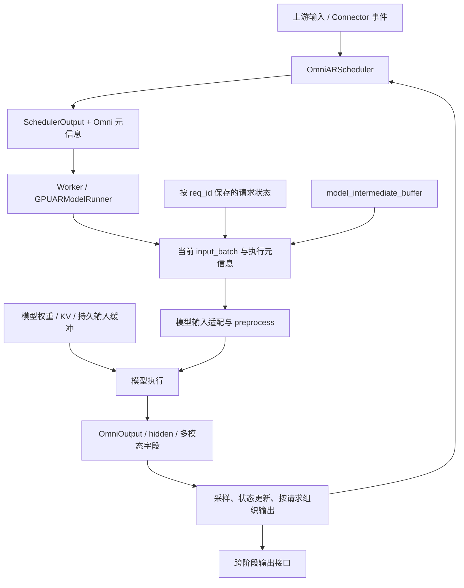

# vLLM-Omni 阶段内执行：从调度输出到多模态结果契约

**面向读者：** 已理解 vLLM/SGLang 的 Scheduler、Worker、ModelRunner、KV 和 CUDA Graph，并已阅读本组 [Runtime](vllm-omni-runtime.md)。本文帮助读者定位 Omni 对阶段内执行增加的接口，判断修改输入或输出时需要维护哪些关系。

**核心结论：** 一个 Omni stage 仍要把本轮已调度工作变成模型执行，但它还要维护按请求组织的中间状态，并将模型的多种输出正确归属到当前请求。**调度顺序、Tensor 行顺序、请求状态和输出身份必须对齐。** 只核对 `forward()` 的数值或返回形状，不能证明整个执行契约成立。

**范围与依据：** 当前源码固定为 `5ca23106fd6a0f500deea818bc2b7089306a210f`。Level 3 使用 Qwen3-Omni 普通 turn 模式和 `qwen3_omni_moe.yaml`；该配置沿用 `model_runner: v1` 默认值。Level 4 单独讨论已合并 [PR #8184][pr8184] 引入的 MRv2 契约，历史 head 为 `e4689f3a8ad7754f1cb442a018a7f693530614e2`。源码走读没有运行模型或 CUDA 测试；本篇写出的断言来自测试代码，PR 实验结果归于作者报告。[1][config] [2][deploy]

## Level 1｜职责边界：一个 stage 要完成什么工作？

**阶段内执行接收本阶段已经就绪的工作，推进模型状态并产生本阶段结果。** 对 AR stage 来说，核心仍是按 token 预算推进请求、维护 KV、执行模型并采样；Omni 在这条链上增加了上游数据到达、中间状态适配、额外输出和跨阶段发送等需求。[3][scheduler] [4][ar-runner]

“请求已经进入 stage”并不意味着它立刻具备所有模型输入。下游可能先登记身份，再等待上游条件或后续 chunk。当前 `OmniARScheduler.schedule()` 在调用上游调度前处理 Omni 输入与等待状态，调度后补充 Omni 元信息；从中可以看出，输入可用性与 token/KV 调度需要协作，但没有由一个模型 `forward()` 统一处理所有队列。[3][scheduler]

### 1.1 三个问题限定本层范围

1. **这轮执行什么？** 由阶段内 scheduler 产生调度输出，包含请求、token 进度和相应元信息。
2. **模型怎样得到所需输入？** runner 将调度表示、长期状态与上游 payload 转成当前 batch 的 Tensor 和模型参数。
3. **结果归谁、如何继续？** runner/scheduler 恢复请求归属，处理采样与中间状态，产出可供下游或编排器使用的结果。

下一 stage 应当是谁、整个请求是否满足最终输出条件，仍要回到全局编排。具体 payload 如何入队、传输和释放，则见 [Connectors](vllm-omni-connectors.md)。本篇把这两个边界视为输入和输出接口，不在每一层重复其内部实现。

### 1.2 AR、generation 与 diffusion 的接口边界

当前 `StageExecutionType` 将 AR 与 generation 映射到不同 scheduler；diffusion 则接入独立 runtime。Qwen3-Omni 的 Talker 是 `LLM_AR`，Code2Wav 是 `LLM_GENERATION`。[1][config] [5][pipeline]

这个区分直接影响如何理解“一个执行结果”。AR runner 通常需要用 hidden states 计算 logits、采样并继续更新请求；generation runner 可以接收模型产生的音频等结果，按请求包装输出。不要因为 Code2Wav 位于 Talker 后面，就假设它也在输出一个待采样的文本 token。[6][generation-runner]

## Level 2｜对象与资源：状态如何附着到请求？

### 2.1 先建立阶段内对象图

以下是主例所用 V1 路径的职责图。Worker/runner 与实际模型类型由配置选定；图中箭头不表示每一步都跨进程。



`GPUARModelRunner` 继承 `OmniGPUModelRunner`，后者集中处理额外 payload、模型前后处理和中间状态。继承关系提供复用，实际责任仍要沿 `execute_model()`、`_preprocess()`、`_model_forward()` 和 `sample_tokens()` 核对。[4][ar-runner] [7][base-runner]

### 2.2 四类东西具有不同的使用期

| 类别 | 本篇使用的对象 | 要维护的关系 |
| --- | --- | --- |
| 长期执行资源 | 模型权重、KV 存储、输入 Tensor buffer、Graph 相关资源 | 可跨多轮复用，但写入和消费必须有序 |
| 请求持续状态 | runner 的 `requests`、按 `req_id` 索引的 `model_intermediate_buffer` | 随请求推进保留，结束时清理 |
| 当前调度视图 | `SchedulerOutput`、`input_batch.req_ids`、当前 token spans | 可以逐轮改变顺序和成员 |
| 当前执行产物 | hidden states、logits、codec、音频及附带字段 | 必须按当前有效范围和请求映射消费 |

这四类东西经常通过引用相连。例如，一次输出可能引用 graph 的复用存储；保留这个 Tensor 对象，并不自动把其数值冻结到本轮。异步输出如果需要在下一轮写入后继续读取，就必须核查快照、所有权或等待协议。当前源码既有复制/快照路径，也有显式 `OwnedBatchTensor` 标记表示新分配 Tensor 的所有权移交；不能把所有输出都当作独占的新内存。[4][ar-runner] [8][output-template]

### 2.3 `model_intermediate_buffer` 保存什么？

V1 runner 将模型中间状态按 request ID 存放，再按当前 `input_batch.req_ids` 顺序收集给模型。对 Talker，这里可包含 Thinker 的 embedding、hidden states、文本/特殊 token 信息，及 Talker 已处理位置、上轮 hidden、codec 等状态。它的职责是保存模型适配需要的请求上下文，并不是另一个通用 KV allocator。[7][base-runner] [9][qwen-model]

`_gather_runtime_additional_information()` 按本轮请求顺序构造列表；`_compute_request_token_spans()` 给出每个请求在展平 token 轴上的 `[start, end)`；`_build_model_kwargs_extra()` 将这些信息交给模型适配接口。源码保留旧名 `runtime_additional_information` 的兼容输出，阅读旧 PR 时应注意它与当前 `model_intermediate_buffer` 接口的对应关系。[7][base-runner]

这里有两个必须分开保存的对应关系：

- request ID → 跨轮状态，回答“这是哪个请求的历史”。
- 本轮行范围 → request ID，回答“这个 Tensor 的哪几行属于它”。

动态 batch 改变第二个关系时，不应改变第一个关系的含义。后文所有“按请求切片”的讨论都建立在这个前提上。

### 2.4 模型输出也有两个用途

`OmniOutput` 是模型侧的输出封装，包含 `text_hidden_states`、`multimodal_outputs`、可选中间 Tensor 和 token 信息。它并非直接发送给 HTTP 客户端的完整响应。[8][output-template]

Talker 的 hidden states 可以继续用于 logits 与采样，而 `multimodal_outputs` 中的 `codes.audio` 则服务下游音频生成。当前 runner 进一步区分对外输出与跨阶段输出的组织路径。因此，删除一个“客户端看不到”的字段前，要先找到所有下游消费者。[4][ar-runner] [9][qwen-model]

## Level 3｜动态数据流：放大真实请求中的一轮 Talker 执行

### 3.1 固定模型、配置和观察窗口

全书主例是 `/v1/chat/completions` 的一条文本请求，指定 `modalities: ["text", "audio"]`。模型为 `Qwen/Qwen3-Omni-30B-A3B-Instruct`；完整启动和请求见 [Runtime 的 Level 3](vllm-omni-runtime.md)。这里使用同一个请求，在它已经进入 Talker 后，观察一轮普通 decode。[2][deploy] [5][pipeline]

为便于走读，将该请求在本篇记作 **R**。R 是叙述用的身份标签，不断言服务端实际生成这个字符串。以下不虚构 Thinker 的回答、token ID 或 codec 值；形状使用符号：`H` 为 Talker hidden 维度，`Q` 为配置中的 codec code-group 数，`T` 为本轮有效 token 行数。

前提是 Talker 已完成必要的输入准备和 prefill，普通 decode 为该请求安排一行。若本轮只有 R，则 `T=1`；Graph 可能使用更大的 padded 容量。这里的“一行”是 Talker 的执行行，不是一个音频采样点，也不等于最终音频 chunk 的长度。

### 3.2 调度入口：先接收可推进的状态，再选本轮工作

`OmniARScheduler.schedule()` 先清理已取消但暂留队列的请求，处理待到达的 Omni 输入，再调用继承的 scheduler。之后 `_postprocess_omni_schedule_output()` 和包装步骤补上所需的 Omni 数据。实际请求是否就绪，必须结合当前等待状态，而不能只看它是否出现在某个注册表中。[3][scheduler]

对于 R，交给 runner 的关键信息是本轮推进多少 token、它是新请求还是缓存请求、有哪些更新，以及哪些请求已经结束。runner 不用遍历全局 pipeline 来重新选择 Talker；调用到这里时 stage 已经确定。

### 3.3 执行准备：把请求身份映射到当前 batch

`GPUARModelRunner.execute_model()` 先处理必要的输入注册与接收，再通过 `_update_states()` 更新持续 batch 状态。随后按 `input_batch.req_ids` 收集本轮 token 数，形成 logits 索引、位置、KV slot 与 attention 元信息，并选择本轮 padding/执行方式。[4][ar-runner]

这一段中，`num_tokens_unpadded` 与 `num_tokens_padded` 分别描述有效工作量和所选执行容量。二者参与不同接口：某些 attention/KV 操作需要 padded 维度，输出归属则必须回到真实请求与有效行范围。不能将“一些接口必须按容量执行”扩展成“所有输出都应该按容量发送”。

模型额外参数由 `_build_model_kwargs_extra()` 补充。对 R 而言，`request_token_spans` 给出它在本轮展平输入中的位置，`model_intermediate_buffer` 则提供其请求上下文。两者按同一个 batch 顺序交给模型。[7][base-runner]

### 3.4 Talker 输入适配：上一轮状态参与这一轮计算

Qwen3-Omni 在 Talker 初始化时注册 `talker_preprocess` 与 `talker_postprocess`。preprocess 按 runner 提供的 phase 信息区分 prefill/decode；源码明确指出，prefix cache 可能让剩余 prefill 只占一行，因此仅凭 `span_len == 1` 无法可靠判断阶段。[9][qwen-model]

prefill 分支利用 Thinker embedding、hidden states、文本与特殊 token 信息构造 Talker 输入，并记录已消费的文本边界。decode 分支读取这个边界、上一轮 Talker hidden 与当前文本条件，准备 MTP/code predictor 所需输入。缺少 `prefill_consumed_text_tokens` 时，当前实现会抛错，而不是默默从文本开头重新消费。

在本例 V1 路径中，runner 的 `_talker_mtp_forward()` 将当前请求所需的 code prediction 工作组织起来。模型 `talker_mtp()` 返回组合后的 embedding 与 codec codes；runner 把对应结果放回输入缓冲和请求中间状态，再进入本轮主模型计算。[7][base-runner] [9][qwen-model]

对普通 decode，可以把时间关系进一步写清：本轮已经持有的输入 ID 是一个 layer-0 codec code；`code_predictor_forward()` 结合上一轮 hidden，补全该帧的 `Q` 组 codes，并求和相应 embedding。随后主 Talker forward 产生 hidden，采样路径得到后续的 layer-0 code，postprocess 保存 hidden 供下一轮使用。由此，本轮交出的完整 codec 帧与本轮新采样、用于后续推进的 code 具有不同的时间位置。[16][talker-model]

这一顺序解释了一个常见误读：不能看到“Talker forward 返回”就假设 codec、采样 token、下一轮 hidden 都首次产生于同一个操作。正确追踪单位是接口中明确的输入与输出，而不是给每个 Tensor 都贴同一个模糊的“当前 token”标签。

### 3.5 模型执行：计算路径与返回封装

runner 调用 `_model_forward()` 时传入已准备的 `input_ids`/`inputs_embeds`、positions、attention 上下文与模型附加参数。Qwen3-Omni 的外层模型根据固定的 `model_stage` 进入 Talker 分支；这不是在每轮重新执行 Thinker 和 Code2Wav。[4][ar-runner] [9][qwen-model]

随后 `make_omni_output()` 将 Talker hidden 与中间状态里的 `codes.audio` 组织为 `OmniOutput`。在提供 `request_token_spans` 的路径中，模型按这些范围对齐 codec 行。主模型 hidden 与 codec 输出的有效行范围必须一致，不能按每个请求平均分配行数。[9][qwen-model]

```text
R 的持续状态：上游条件 / 文本消费位置 / 上轮 hidden
                         │
本轮调度与 token span ────┼──> preprocess / code predictor
                         │              │
                         │              ├──> 本轮 inputs_embeds
                         │              └──> R 的 codes.audio
                         │
                         └────────> Talker forward
                                        │
                                        ├──> hidden → logits / sampling
                                        └──> OmniOutput 的多模态字段
```

这是本轮读写关系图；不会把上述各步骤误画成不同进程。

### 3.6 采样、请求状态与下游输出

`execute_model()` 与 `sample_tokens()` 是有序配对的：runner 保存执行中间结果供采样路径继续使用，并防止前一轮尚未消费就进入下一轮。hidden states 经 logits 计算与采样后生成后续推进所需 token；模型 postprocess 和 runner 的状态更新路径保留下一轮需要的 hidden 等信息。[4][ar-runner] [7][base-runner]

输出构建则把展平模型产物重新组织成请求级结果。当前源码分别构建 `inter_stage_outputs` 与 `multimodal_outputs`，随后 scheduler 的 `update_from_output()` 消费这些结果并推进请求。Talker 的 codec 数据在跨阶段适配器中进一步积累和组 chunk；一次模型执行返回不等于已经满足发送一个完整 chunk 的条件。[3][scheduler] [4][ar-runner]

| 观察点 | R 相关的数据 | 本步需要确认的关系 |
| --- | --- | --- |
| 调度输出 | 本轮 token 数、更新、完成 ID | R 是否真的可推进 |
| 当前 batch | R 的位置和 token span | batch 顺序与状态顺序一致 |
| preprocess | 上游条件、文本位置、上一轮 hidden | 读取的是 R 的持续状态 |
| 模型返回 | hidden、`codes.audio` 等 | 有效行对应本轮真实请求 |
| 输出构建 | 请求级 token/多模态字段 | 结果没有被 padding 或旧映射污染 |
| 下游交接 | 累积 codec 与 chunk 元信息 | 达到下游输入契约才提交 |

### 3.7 Code2Wav 为什么走另一条 runner 路径？

Code2Wav 的模型输入是 codec 序列和相应上下文。当前模型分支根据每个请求的 codec 长度及 `left_context_size` 生成波形，再在输出封装中提供 waveform 与采样率。它不依靠 Talker 的 logits 采样来生成每个音频采样点。[6][generation-runner] [9][qwen-model]

这条路径仍需要请求身份、batch 边界和清理，但内部计算与 AR token 推进不同。因此，想调整 Code2Wav 的输出累计方式，应从 generation runner、模型输出和 serving 消费端核对；只修改 AR sampler 不会解释问题。

## Level 4｜PR #8184：执行分支为什么需要明确的输出契约？

### 4.1 先限定案例范围

[PR #8184][pr8184] 扩展共享多阶段执行框架，包含 stage 级 V1/MRv2 选择、模型输出 hooks、Graph 辅助输出、传输唤醒等多个改动。本篇选取与阶段内执行直接相关的 **runner 选择、辅助 Tensor 输出、当前请求信息和 D2H 完成条件**。其余改动不能因为同属一个 PR 就混成一次“整体提速”。PR 明确没有对该框架改动本身声称端到端加速。

4.2–4.4 切换到 MRv2 契约分析，不声称 Level 3 的默认 V1 请求已经经过这条分支；4.5 再看同一 PR 在 V1 generation runner 中的输出复制改动。MRv2 是本文对 Model Runner V2 的简称，不代表整个上游 vLLM 的产品版本号。

### 4.2 配置选择与能力检查要同时成立

`resolve_stage_model_runner()` 优先使用 stage 自己的配置，否则沿用部署级设置。这使同一个模型拓扑可以逐 stage 迁移 runner，而不用把所有 stage 的实现同时更换。模型拓扑中的 `supports_native_mrv2_data_plane` 则声明数据交接能力；选择 V2 与声明原生能力是两个需要一起检查的条件。[1][config]

当前 `validate_native_mrv2_session()` 对接收上游输入且声明 native data plane 的 V2 stage 限定 turn session。这个限制非常具体：不能从“可逐 stage 选择 runner”推出“任意 stage、任意会话模式都可混用”。对于不适用的模式，应该在配置/能力边界给出明确行为，避免请求运行到一半才等不到输入。

### 4.3 Graph 需要保留的不只是主 hidden Tensor

纯文本模型常把主要计算产物表示为 hidden states，后续再取 logits。Omni 的某些模型还返回捕获层等辅助 Tensor；如果 Graph replay 只恢复主输出，下游条件数据就可能丢失或停留在旧轮次。[10][v2-runner]

PR 为声明 `supports_mrv2_full_graph_aux_outputs` 的模型定义了受限契约：辅助输出必须是非空、仅含 Tensor 的树；每个叶子的首维是相同的 token 轴；不同 capture 的树结构必须稳定。`_flatten_capture_aux_output()` 将树转为叶子列表和结构描述，让 Graph 机制保存、更新这些输出；replay 后 `_split_fullgraph_output()` 按保存的结构还原。

这里的“稳定”指结构与存储契约，不表示每轮数值不变。当前源码会验证 Tensor 类型、首维及结构一致性。未声明能力的某些 tuple 模型会排除不支持的 FULL Graph 路径；已经声明却返回非法结构则抛出错误。不能把这两种行为统称为“出问题就自动 fallback”。[10][v2-runner]

### 4.4 稳定 Graph 输出与动态请求身份如何结合？

Graph 可复用并不意味着请求成员固定。MRv2 的 `make_omni_output_mrv2` hook 获得当前 `input_batch`、`req_states` 和按当前 batch 收集的中间状态，使用这些信息构造请求相关输出。数值来自本轮执行，归属来自本轮请求映射；两条信息链需要在输出边界汇合。[11][v2-state]

可以把这一规则写成解释性的接口关系：

```text
本轮 replay 的主/辅助 Tensor
          + 本轮有效 token 范围
          + 本轮 request ↔ row 映射
          + 本轮请求中间状态
          → 本轮的 Omni 输出
```

它不是任意模型都可以直接实现的统一公式，而是检查该 hook 时必须核对的依赖。把旧 batch 的请求元信息保存在 capture 时的闭包里，会破坏这条关系，即使 Graph 本身返回了正确的新数值。

### 4.5 输出复制的完成条件同样属于契约

同一 PR 在 **V1 generation runner** 中还提供 `_HostCopyBatch`，把若干 device-to-host 拷贝组织起来。使用 pinned CPU 存储时，`copy()` 通过 `non_blocking=True` 发起拷贝，随后 `wait()` 对当前 CUDA stream 做一次 `synchronize()`，确保这批拷贝完成。调用 `copy()` 得到目标对象，与 CPU 可以安全读取完成后的数值，是两个时间点；消费端需要遵守完成条件。[6][generation-runner]

这里不从“异步 copy”推导确定的性能收益。收益取决于可重叠工作、同步位置、输出大小及额外分配；本篇只用该实现说明输出类型、所有权和就绪时间必须一起定义。

## Level 5｜如何证明修改没有破坏输出归属？

### 5.1 一个会被形状测试漏掉的问题

假设把输出组织逻辑从逐请求处理改成整 batch 处理。结果 Tensor 的总形状可能完全不变，但当前 batch 的请求顺序已经不同，或者每个请求的 token 数不同。若仍按上一轮顺序或平均行数分配输出，数值会落到错误的请求上。

这是由 Level 2 的两种映射直接推导出的风险，并非宣称 PR #8184 出现过某个未记录的 bug。它给测试设计一个具体要求：除了检查形状，还要让不同请求的数据可辨认，并检查当前请求状态确实被使用。

现有 `test_device_output_hook_receives_live_batch_and_request_state` 使用可识别的 batch、request-state 和 buffer 对象，断言它们原样传给模型 hook；`test_sampled_embeddings_merge_preserves_sibling_fields_and_input` 检查新增 sampled embedding 不会覆盖已有 prefill 或无关字段。它们验证接口依赖和合并语义，而不是模型质量。[12][contract-tests]

### 5.2 用一个最小 Graph 例子检验“数值真的更新”

`test_aux_pytree_tracks_replayed_graph_values` 的机制很直接：capture 时输入 Tensor 全为 1，模型样例输出主 Tensor `2x` 和辅助叶子 `x+1`、`x+2`；随后将输入改为 7，再 replay。测试断言主输出为 14，辅助输出分别为 8、9。[13][cuda-tests]

| 时点 | 输入 x | 主输出 2x | 辅助 x+1 | 辅助 x+2 |
| --- | ---: | ---: | ---: | ---: |
| capture 使用的输入 | 1 | 2 | 2 | 3 |
| replay 后应观察到 | 7 | 14 | 8 | 9 |

这个例子刚好区分两种实现：只恢复结构但读取旧数据，和让辅助叶子随 replay 更新。它没有使用真实 checkpoint，因此不能单独证明某个完整模型在所有 batch、dtype 和 session 下正确。本文阅读了这项 CUDA 测试代码，没有在本次环境执行它。

### 5.3 有效范围、状态与异步消费分别验证

当前 MRv2 输出代码明确允许 graph-padded hidden 与未 padding 的多模态字段同时存在，并根据 scheduled token 数识别真实轴。padding 是执行资源约束；多模态结果的有效范围仍要按其输出契约解释。[14][v2-ar]

| 改动内容 | 应先建立的假设 | 最小验证方向 |
| --- | --- | --- |
| 改 batch 收集或顺序 | 状态与 Tensor 行可能失配 | 可区分请求内容、不同 token span、换序/退出 |
| 改 Graph 辅助输出 | 结构正确但数值可能陈旧 | 改输入后 replay，核对每个辅助叶子 |
| 改 payload 合并 | 新字段可能覆盖旧兄弟字段 | 嵌套字段更新与输入不被意外修改 |
| 改 D2H 组织 | CPU 可能过早读，非连续布局可能错 | 非默认 stream、非连续源 Tensor、显式完成检查 |
| 改 runner 选择 | 配置生效但模型/会话不支持 | stage override、回退组合、不支持能力的拒绝路径 |

其中非连续 D2H 和 Graph replay 已有小型 CUDA 测试；请求换序等项目是继续修改此类代码时应选择的测试维度，不声称每个组合都已由该 PR 完整覆盖。[12][contract-tests] [13][cuda-tests]

### 5.4 功能通过之后，性能结论还缺什么？

#8184 的框架改动包含多种可能影响开销的机制，但 PR 明确把具体模型适配和性能证据留给后续工作。当前模型真实请求成功，至多说明那组模型、配置与输入的功能路径可用；不能由此推出所有 stage 混用都被验证，或所有模型都有端到端收益。[15][pr8184]

若要测量某项输出改动，比较组至少需要固定模型、输入、dtype、runner、并发与输出消费方式。然后分别观察模型执行、输出准备/复制、跨阶段等待和端到端延迟。某项 kernel 时间不变而端到端更快，可能来自准备或等待减少；单次总时间变化也可能来自 workload 差异。先提出能区分这些解释的观测，再归因。

## 自检与继续阅读

现在应能回答：

1. R 的请求状态按哪个键保存，本轮 Tensor 行又通过什么映射归属 R？
2. Talker 的 `codes.audio` 与用于采样的 hidden 为什么需要两个消费路径？
3. 如果给 MRv2 辅助输出增加 Python 字符串叶子，哪条声明契约被破坏？该检查应发生在哪里？
4. 如果 Graph replay 数值正确，却把结果交给了另一个请求，应优先检查数值计算还是本轮映射？需要什么测试区分？
5. 若提前读取 pinned CPU 输出，为什么“已经调用 copy”不构成正确性证明？

后续进入 [Connectors](vllm-omni-connectors.md)，把视角从单 stage 的输出身份推进到跨 stage 的数据到达与资源生命周期。Diffusion 的 step state 和 batch 管理由 [Diffusion Runtime](vllm-omni-diffusion-runtime.md) 独立解释。

## 参考源码与历史材料

当前实现与历史案例分开引用。下列路径均已对固定源码或 PR head 核对；测试文件说明测试方法，不表示本次执行结果。

[config]: https://github.com/vllm-project/vllm-omni/blob/5ca23106fd6a0f500deea818bc2b7089306a210f/vllm_omni/config/stage_config.py
[deploy]: https://github.com/vllm-project/vllm-omni/blob/5ca23106fd6a0f500deea818bc2b7089306a210f/vllm_omni/deploy/qwen3_omni_moe.yaml
[scheduler]: https://github.com/vllm-project/vllm-omni/blob/5ca23106fd6a0f500deea818bc2b7089306a210f/vllm_omni/core/sched/omni_ar_scheduler.py
[ar-runner]: https://github.com/vllm-project/vllm-omni/blob/5ca23106fd6a0f500deea818bc2b7089306a210f/vllm_omni/worker/gpu_ar_model_runner.py
[pipeline]: https://github.com/vllm-project/vllm-omni/blob/5ca23106fd6a0f500deea818bc2b7089306a210f/vllm_omni/model_executor/models/qwen3_omni/pipeline.py
[generation-runner]: https://github.com/vllm-project/vllm-omni/blob/5ca23106fd6a0f500deea818bc2b7089306a210f/vllm_omni/worker/gpu_generation_model_runner.py
[base-runner]: https://github.com/vllm-project/vllm-omni/blob/5ca23106fd6a0f500deea818bc2b7089306a210f/vllm_omni/worker/gpu_model_runner.py
[output-template]: https://github.com/vllm-project/vllm-omni/blob/5ca23106fd6a0f500deea818bc2b7089306a210f/vllm_omni/model_executor/models/output_templates.py
[qwen-model]: https://github.com/vllm-project/vllm-omni/blob/5ca23106fd6a0f500deea818bc2b7089306a210f/vllm_omni/model_executor/models/qwen3_omni/qwen3_omni.py
[v2-runner]: https://github.com/vllm-project/vllm-omni/blob/5ca23106fd6a0f500deea818bc2b7089306a210f/vllm_omni/worker_v2/omni_model_runner.py
[v2-state]: https://github.com/vllm-project/vllm-omni/blob/5ca23106fd6a0f500deea818bc2b7089306a210f/vllm_omni/worker_v2/model_states/omni_model_state.py
[contract-tests]: https://github.com/vllm-project/vllm-omni/blob/5ca23106fd6a0f500deea818bc2b7089306a210f/tests/worker_v2/test_shared_stage_contracts.py
[cuda-tests]: https://github.com/vllm-project/vllm-omni/blob/5ca23106fd6a0f500deea818bc2b7089306a210f/tests/worker_v2/test_shared_stage_cuda.py
[v2-ar]: https://github.com/vllm-project/vllm-omni/blob/5ca23106fd6a0f500deea818bc2b7089306a210f/vllm_omni/worker_v2/omni_ar_model_runner.py
[pr8184]: https://github.com/vllm-project/vllm-omni/pull/8184
[talker-model]: https://github.com/vllm-project/vllm-omni/blob/5ca23106fd6a0f500deea818bc2b7089306a210f/vllm_omni/model_executor/models/qwen3_omni/qwen3_omni_moe_talker.py#L131-L195
